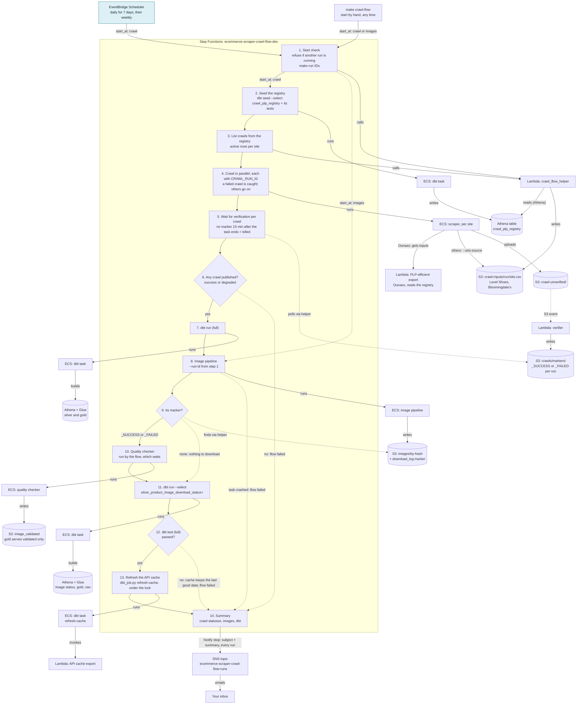
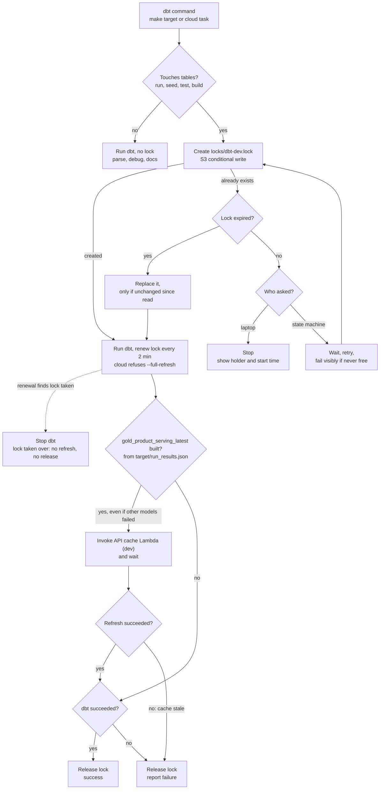
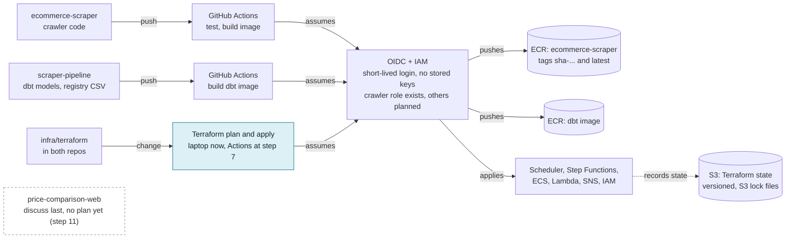

# CI/CD and Orchestration Architecture

The planned AWS setup for deploying and running the crawl pipeline, kept as a
long-term reference. **Status (2026-11-03): mostly not built.** Green-blue boxes
in the diagrams are planned; the rest exists. The order of work is in
`tickets/cicd_pipeline.md` ("▶ Next steps"), and step numbers below refer to it.

Update this doc whenever a step changes what's here, and add a change log row.
Names of planned items are proposals until built. Everything runs in dev until
`../scraper-pipeline/ticket/migrate-validated-dev-to-prod.md` passes.

The diagrams are Mermaid, so they stay editable as text. GitHub renders them;
VS Code's preview needs a Mermaid extension.

---

## What happens on each run

Step Functions decides the order; ECS and Lambda do the work. A failed crawl
doesn't stop the other sites. Frequency: daily for 7 days, then about weekly.
Design agreed and built 2026-11-10 (step 3; details and decisions in
`tickets/cicd_pipeline.md`; code in `infra/terraform/orchestration.tf` and
`lambda/crawl_flow_helper/`). First runs 2026-11-10. Start it with
`make crawl-flow` (optional `CRAWL_LIMIT=` listing pages per URL for Level
Shoes and Bloomingdale's, `START_AT=images`).

**Before a crawl start** (2026-11-13), `make crawl-flow` runs
`scripts/check_crawl_registry.py`: it refuses to start when the dbt image
(`price-comparison-dbt:latest`, which carries the seeds) doesn't contain the
newest scraper-pipeline `main` commit that changed `crawl_plp_registry.csv`,
and prints the active sites and URL counts from the CSV at the image's commit.
What's pushed is the source of truth; local edits are never read.
`SKIP_REGISTRY_CHECK=1` skips the check. A registry change is: edit, commit,
push, wait for the dbt image build, `make crawl-flow`.

**Which crawl each registry row becomes** (step 3): one crawl per site with
active rows; a site with none isn't crawled.

| Registry `site` | Spider | How it reads its URLs |
|---|---|---|
| `ounass` | `ounass --plp-efficient` | The PLP-efficient export reads the seeded table itself |
| `level-shoes` | `level` | `--urls-source s3://…/crawl-inputs/<run>/level-shoes.csv`, written by step 3 |
| `bloomingdales` | `bloomingdales` | `--urls-source s3://…/crawl-inputs/<run>/bloomingdales.csv`, written by step 3 |

**Two dbt runs, one cache refresh, after the tests:** the full run after the
crawls builds new prices; the second run rebuilds only the 4 image-dependent
models after the quality checker. The flow's dbt steps run with
`--no-cache-refresh`, and the cache is refreshed once, only after `dbt test`
passes (decided 2026-11-11, after the second test run served a price-0 gift
product in dev). New products stay hidden until they have images: the website
API's filter, live in dev since 2026-11-09.

### Edge cases (agreed 2026-11-10)

Rule: handle what would otherwise hang or break the flow, plus cheap guards.
Everything else stops and reports; the summary (step 13) always says what
happened.

| Case | How often | What the flow does | Result |
|---|---|---|---|
| A crawl dies without a manifest (killed, out of memory) | Rare | Step 5 stops waiting 15 minutes after the task ends | That crawl is `killed`; the others go on |
| One crawl fails (blocked, bad input) | Now and then | Caught in its own branch | Others go on; gold gets the good crawls |
| Every crawl failed or was killed | Rare | Step 6 skips dbt and images | Summary; flow **failed** |
| A crawl is `degraded` | Common | Counts as published | Listed in the summary |
| Another flow run is still running | Possible once scheduled daily | Step 1 refuses to start | New run **failed** at once; the running one is untouched |
| The dbt image is older than the latest registry commit | After a registry push, until the image build passes | `make crawl-flow` refuses to start | Nothing runs; wait for (or fix) the dbt image build |
| Registry seed or its tests fail | Only after a bad registry edit | Step 2 stops before any crawl | No Zyte spend; flow **failed** |
| A site has no active registry rows | By choice | Step 3 leaves it out | Not crawled |
| Nothing to download (no new image URLs) | Common on repeat crawls | Step 9 finds no marker, skips the checker | Step 11 still runs |
| Some image downloads failed (`_FAILED`) | Rare (never yet in dev) | Checker runs anyway | Downloaded images still reach gold |
| Image pipeline or checker task crashes | Rare | Stop and report, no second dbt run | Prices already live from step 7; the next run or an images-only start retries the images; flow **failed** |
| `dbt run` fails | Rare | Stop and report | The previous gold and cache stay; flow **failed** |
| Cache refresh fails (refresh step exit 77) | Rare; also if `gold_site_nav` is missing or invalid (the dev export reads it since 2026-11-10, release `20261110T071721Z-472182ed`) | The refresh step fails | The cache stays at the previous version; flow **failed** |
| `dbt test` fails | Seen on 2026-11-10 (new categories brought unmapped labels and a price-0 gift) | No cache refresh | Gold has the new data but the API keeps the last tested version; flow **failed** so it gets looked at |
| The laptop holds the dbt lock | When you run dbt during a flow | The dbt task waits up to 2 hours | Then fails visibly (exit 75) if still held |
| A crawl or the flow runs too long | Rare | Time limits: 10 hours per crawl, 24 hours per flow | That crawl counts as failed; the flow **fails** |

**Notes:**
- The S3 notification that started the quality checker is removed (2026-11-10;
  the flow runs it). `make ecs-run-quality-checker DT= RUN_ID=` is for
  emergencies; the `image_pipeline_trigger` Lambda is now unused.
- Every dbt run (laptop or cloud) goes through one wrapper with the shared
  lock; the cloud dbt task waits up to 2 hours for it.
- Never `--full-refresh` the Ounass silver models
  (`docs/ounass_plp_efficient_crawl.md`, section 7).

---

## Every dbt run: lock, run, refresh the cache

Laptop side built 2026-11-09 (`../scraper-pipeline/scripts/dbt_job.py`, details
in its `docs/DBT.md`); the cloud task will use the same script. Prod targets
take their own lock (`locks/dbt-prod.lock`) and refresh nothing.
dbt and Athena have no lock across runs, so this is the only guard against two
runs overlapping. Calling `.venv/bin/dbt` directly skips it.

While dbt runs, the wrapper renews the lock every 2 minutes; it expires 10
minutes after the last renewal. If the process dies before releasing (a killed
task, a closed laptop), the lock expires within 10 minutes; `make dbt-unlock`
clears it sooner. If a renewal finds the lock was taken over, or renewal keeps
failing (network) until the lock is about to expire, dbt is stopped. The cache
refreshes whenever gold built, even if other models failed, so the cache always
matches gold; the run still reports the failure.

The crawl flow passes `--no-cache-refresh` to every dbt step and refreshes the
cache once with `dbt_job.py refresh-cache` after `dbt test` passes; that command
takes the same lock, so the export never reads gold mid-build. Laptop `make`
targets still refresh whenever gold builds. The website API hides products
without images (`../price-comparison-web/tickets/hide_products_without_images.md`).

---

## How code reaches AWS

A push to GitHub starts a build, which logs in to AWS with short-lived
credentials and pushes an image. Running tasks pick up that image on their next
start.

---

## AWS services

| Service | Job | Status |
|---|---|---|
| EventBridge Scheduler | Starts the flow on a cron | Planned |
| Step Functions | Runs the steps in order, with waits and branches | Exists (`ecommerce-scraper-crawl-flow-dev`, 2026-11-10; first run pending) |
| ECS on Fargate | Runs scraper, image and quality tasks, plus a dbt task | Exists (dbt task tested 2026-11-09) |
| Lambda | Verifier, export and API cache; `crawl_flow_helper` (start check, registry reader, verification and marker checks, summary) | Exists (helper 2026-11-10); `image_pipeline_trigger` unused |
| ECR | Stores container images | Exists, including `price-comparison-dbt` |
| S3 | Crawl data, images, URL lists, Terraform state | Exists |
| Athena + Glue | dbt builds and queries the tables here | Exists |
| SNS | Sends the run summary and failure alerts | Planned |
| IAM + OIDC | Logins for GitHub; roles for the scheduler and flow | Exists; more roles planned |
| Secrets Manager | Holds crawler secrets such as the Zyte key | Exists |
| CloudWatch Logs | Logs from each task | Exists |

Region: `eu-central-1`.

---

## Where each setting lives

Git holds the settings and AWS holds the deployed copy. Only the on/off switch
lives in AWS alone, so pausing doesn't need a commit.

| Setting | Name | Location | Change with |
|---|---|---|---|
| Run frequency | `crawl_schedule_expression` | `infra/terraform/variables.tf` | Terraform |
| Automatic stop after 7 days | `crawl_schedule_end_date` | `infra/terraform/variables.tf` | Terraform |
| On or off | schedule `state` | AWS; Terraform ignores it | `make schedule-on` / `make schedule-off` |
| Timezone and target | the schedule resource | `infra/terraform/orchestration.tf` | Terraform |
| Steps in the flow | the state machine definition | `infra/terraform/orchestration.tf` | Terraform |
| What gets crawled | `crawl_plp_registry.csv` | `../scraper-pipeline/canonical_seeds/` | commit, push; the flow seeds it first |
| Warning thresholds | `OUNASS_PLP_EFFICIENT_*` | `ecommercecrawl/settings.py` | commit, push |

---

## Change log

| Date | Change | Commit |
|---|---|---|
| 2026-11-03 | Doc created from the agreed plan (mostly not built) | — |
| 2026-11-04 | Step 1 done: both repos' Terraform state in S3, versioned, with S3 lock files | — |
| 2026-11-09 | Step 2 plan: API cache refreshes when gold builds (wrapper, not the EventBridge rule); shared dbt lock; wrapper diagram added | — |
| 2026-11-09 | Lock renewed while dbt runs; website API hides products without images, so the first refresh in a flow is safe | — |
| 2026-11-09 | Wrapper built (laptop side): refresh whenever gold built even if dbt failed; lock-lost path; prod gets its own lock | — |
| 2026-11-09 | Cloud dbt task built (dev): ECR repo, task, IAM, image workflow; first image build and run pending | — |
| 2026-11-09 | Step 2 done: cloud dbt task tested (seed, full run with cache refresh, full test, lock both ways) | — |
| 2026-11-10 | Step 3 design agreed: run IDs passed to crawls, registry read for every site, checker in the flow, second dbt run only the image models, images-only start | — |
| 2026-11-10 | Edge cases table added (step 3) | — |
| 2026-11-10 | Step 3 built and applied: state machine, helper Lambda, checker S3 trigger removed; first run pending | — |
| 2026-11-11 | Cache refresh moved after `dbt test` (flow's dbt steps use `--no-cache-refresh`; new refresh step); `CRAWL_LIMIT` works for Level Shoes and Bloomingdale's | — |
| 2026-11-13 | Step 4: `make crawl-flow` checks the dbt image has the latest pushed registry and prints the active sites | — |
| 2026-11-13 | Step 5a: summary emailed after every run (SNS topic, `Notify` state; subject, cache line, blocked-by-site section, console link). The address lives only in the gitignored `infra/terraform/local.auto.tfvars` | — |
