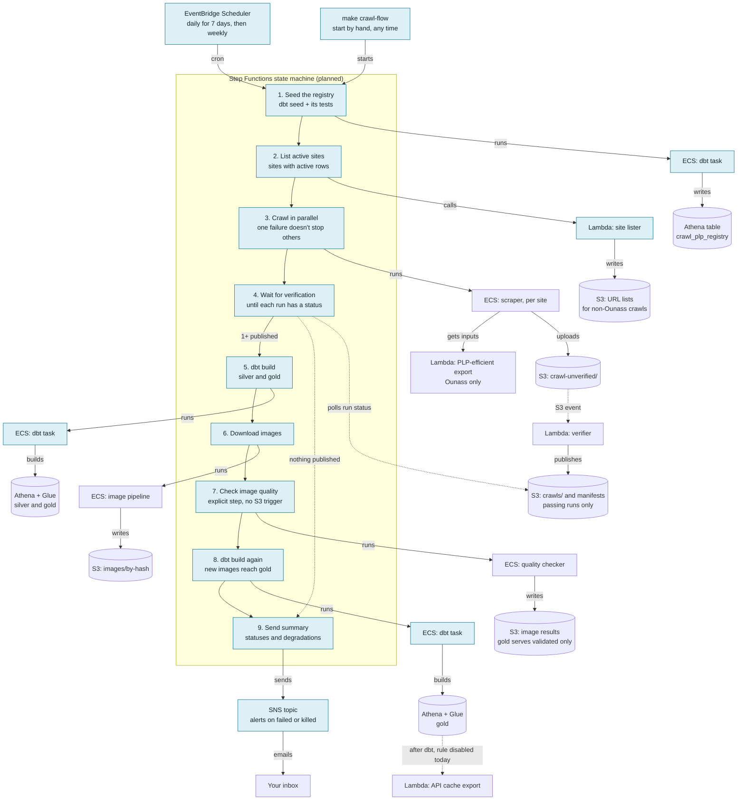
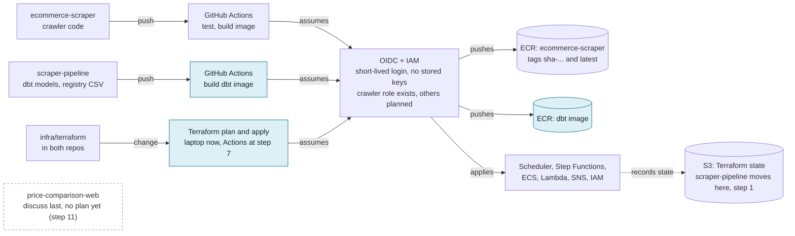

# CI/CD and Orchestration Architecture

The planned AWS setup for deploying and running the crawl pipeline, kept as a
long-term reference. **Status (2026-11-03): mostly not built.** Green-blue boxes
in the diagrams are planned; the rest exists. The order of work is in
`tickets/cicd_pipeline.md` ("▶ Next steps"), and step numbers below refer to it.

Update this doc whenever a step changes what's here, and add a change log row.
Names of planned items are proposals until built. Everything runs in dev until
`../scraper-pipeline/ticket/migrate-validated-dev-to-prod.md` passes.

The diagrams are Mermaid, so they stay editable as text. GitHub renders them;
VS Code's preview needs a Mermaid extension.

---

## What happens on each run

Step Functions decides the order; ECS and Lambda do the work. A failed crawl
doesn't stop the other sites. Frequency: daily for 7 days, then about weekly.

**To resolve when building:**
- Remove the S3 notification that starts the quality checker
  (`infra/terraform/lambda.tf`), or it runs twice (step 3).
- dbt runs twice per flow, so the API cache rule
  (`../scraper-pipeline/terraform/eventbridge_api_export.tf`) would fire twice if
  enabled (step 2).
- Never `--full-refresh` the Ounass silver models
  (`docs/ounass_plp_efficient_crawl.md`, section 7).

---

## How code reaches AWS

A push to GitHub starts a build, which logs in to AWS with short-lived
credentials and pushes an image. Running tasks pick up that image on their next
start.

---

## AWS services

| Service | Job | Status |
|---|---|---|
| EventBridge Scheduler | Starts the flow on a cron | Planned |
| Step Functions | Runs the steps in order, with waits and branches | Planned |
| ECS on Fargate | Runs scraper, image and quality tasks, plus a dbt task | Exists; dbt task planned |
| Lambda | Verifier, export and API cache; site lister | Exists; site lister planned |
| ECR | Stores container images | Exists; dbt repository planned |
| S3 | Crawl data, images, URL lists, Terraform state | Exists |
| Athena + Glue | dbt builds and queries the tables here | Exists |
| SNS | Sends the run summary and failure alerts | Planned |
| IAM + OIDC | Logins for GitHub; roles for the scheduler and flow | Exists; more roles planned |
| Secrets Manager | Holds crawler secrets such as the Zyte key | Exists |
| CloudWatch Logs | Logs from each task | Exists |

Region: `eu-central-1`.

---

## Where each setting lives

Git holds the settings and AWS holds the deployed copy. Only the on/off switch
lives in AWS alone, so pausing doesn't need a commit.

| Setting | Name | Location | Change with |
|---|---|---|---|
| Run frequency | `crawl_schedule_expression` | `infra/terraform/variables.tf` | Terraform |
| Automatic stop after 7 days | `crawl_schedule_end_date` | `infra/terraform/variables.tf` | Terraform |
| On or off | schedule `state` | AWS; Terraform ignores it | `make schedule-on` / `make schedule-off` |
| Timezone and target | the schedule resource | `infra/terraform/orchestration.tf` | Terraform |
| Steps in the flow | the state machine definition | `infra/terraform/orchestration.tf` | Terraform |
| What gets crawled | `crawl_plp_registry.csv` | `../scraper-pipeline/canonical_seeds/` | commit, push; the flow seeds it first |
| Warning thresholds | `OUNASS_PLP_EFFICIENT_*` | `ecommercecrawl/settings.py` | commit, push |

---

## Change log

| Date | Change | Commit |
|---|---|---|
| 2026-11-03 | Doc created from the agreed plan (mostly not built) | — |
