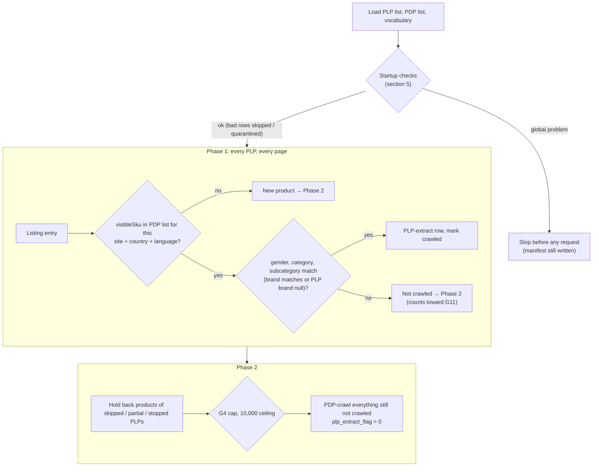

# Ounass PLP-Efficient Crawl Mode

**What this doc is:** the reference for how this crawler mode works **today**.
Keep it current: any behaviour change updates this doc in the same commit,
with a change-log line (rule in `context/AGENTS.md`). History, rejected
options and the build plan live in `tickets/ounass_plp_efficient_crawl.md`.

**Build status (2026-10-05): planned, not yet built.** Each section is marked
**[planned]** or **[built]**. Flip a marker when the matching ticket part
lands, and correct the section if the build differs from the plan.

---

## 1. What it is [planned]

An opt-in mode of the Ounass spider (`OUNASS_PLP_EFFICIENT_CRAWL = True`) that
refreshes products we already know about from **listing pages (PLPs)** instead
of their **product pages (PDPs)**. A listing entry already carries the
product's ID, price and badges, so one listing request refreshes ~48 products.
Doing the same through PDPs costs one Zyte request per product.

- **Phase 1:** sweep every PLP in the run. A known product found on its PLP
  gets a **PLP-extract row** (ID, price, discount, label) and no PDP request.
- **Phase 2:** PDP-crawl only what's left: new products, known products not
  seen on any PLP, and special PDPs no PLP covers.

Cost case (bags, Saudi, 2026-09-17): ≈ $2/month in this mode vs ≈ $181/month
for daily full PDP re-crawls (`notes/2026-09-17-ounass-zyte-crawl-cost.md`).

With the flag off (the default), the spider behaves exactly as before.

---

## 2. Inputs [planned]

Three files, written fresh **at the start of every crawl**. At startup the
crawler invokes scraper-pipeline's export Lambda synchronously, waits for it,
and reads the files from the S3 paths it returns. It isn't triggered after
dbt or on a clock: dbt runs often and for unrelated reasons, while the crawler
only needs fresh inputs right before it crawls. If the export fails, the
crawl stops before any Zyte request. Local files (`--plp-list`, `--pdp-list`,
`--vocabulary`) skip the invoke, for tests.

All values are **canonical** (scraper-pipeline `canonical_seeds/`). The
crawler never canonicalizes raw Ounass values itself.

| Input | Source (in scraper-pipeline) | Contents |
|---|---|---|
| **PLP list** | active rows of the `crawl_plp_registry` seed | one row per listing page to sweep |
| **PDP list** | `gold_product_serving_latest`, scoped to active PLP rows | one row per known product × country × language; its manifest records **when gold was last built** |
| **Canonical vocabulary** | `dim_country`, `dim_map_gender`, `dim_canonical_category_subcategory`, `dim_canonical_brand` | all allowed canonical values |

**Export (scraper-pipeline, code written 2026-10-13, not deployed):** Lambda
`price-comparison-plp-efficient-export-<env>` writes
`s3://price-comparison-bucket-eu-central-1/resources/plp-efficient/<env>/ounass/<export_id>/`
`pdp_list.csv`, `plp_list.csv`, `vocabulary.json` and, last, `manifest.json`
(only a complete export has one; it carries `gold_built_at` and row counts).
`<prefix>/ounass/latest.json` points at the newest manifest. Full contract:
scraper-pipeline `docs/PLP_EFFICIENT_EXPORT.md`.

Keys in both lists follow scraper-pipeline's SQL rules: lowercase, with
`language` as `ar` / `en`. The crawler compares case-insensitively; the
rows it writes keep `product_schema.py`'s `EN` / `AR`.

### PLP list columns

```
url,site,country,language,gender,category,subcategory,brand,is_active
https://saudi.ounass.com/api/women/bags/tote-bags,ounass,sa,ar,women,bags,tote_bags,,true
```

- `is_active = false` switches a listing off without deleting the row; it's
  neither crawled nor used to scope the PDP list.

- `url` must be the `/api/...` endpoint. The human-facing page is HTML the
  spider can't parse. The hostname must match `country` + `language`
  (`ounass_constants.TLD_LANGUAGE_MAP`).
- `gender`, `category`, `subcategory` are **required**; `brand` is optional
  (null = any brand).
- Category **and** subcategory are required because canonical categories are
  broader than Ounass listings. Canonical `bags` includes Ounass
  `Accessories / Small Leather Goods`, which never appears on `women/bags`.
  Broad and designer listings are crawled with the mode off.

### PDP list columns

```
portal_itemid,primary_key,site,country,language,url,gender,category,subcategory,brand,out_of_stock,last_available_date
```

From `gold_product_serving_latest` (`category` ← `category_canonical`,
`subcategory` ← `sub_category_canonical`, `brand` ← `brand_canonical`).
`url` is that product's PDP URL for **that** country and language. Every row
has been crawled before, so it enters the run with `crawled_before = true`.

**What's in it:** only gold Ounass products that match an **active** PLP list
row on site, country, language, gender, category and subcategory (and brand,
when the row sets one), minus products sold out for 3+ days. The PLP list is
therefore the single definition of scope: add or activate a listing row and
its products join the next export; set `is_active = false` and they drop out.

The crawler does **not** filter this list: everything in it is crawled, via a
PLP or directly in Phase 2. That's why scoping happens in the export.

---

## 3. How a run works [planned]



### Matching

- Key: `(site, country, language, portal_itemid)`. Site, country and language
  come from the PLP row; `portal_itemid` is the listing entry's `visibleSku`.
  Our PDP extractor stores the same value (`pdp.visibleSku`).
- Then gender, category and subcategory must equal the PLP row's, and brand
  must equal it unless the PLP's brand is null.
- **Nothing is parsed from URLs.** The number in a product URL is a
  colour-group code, not the product ID (grey Chloé tote: URL `…219035998_19`,
  ID `219036032`).
- A product already marked crawled by an earlier, overlapping PLP is skipped.
- A product **quarantined** at startup (bad PDP list row) is skipped if seen,
  not treated as new.

### Colour variants

In-stock colours each have their own listing entry and ID. **Sold-out colours
lose their own entry** and survive only as a swatch inside a sibling's
entry. The swatch has a slug and colour code but no ID, price or stock. Swatches
are **ignored**: they're not proof of identity. Those products go to Phase 2
until the 3-day sold-out cutoff drops them from the PDP list.

---

## 4. PLP-extract row [planned]

Only these fields are set. Everything else (`product_name`, `image_urls`,
`text`, `out_of_stock`, `was_price`, `sizes`, `color`, …) is **null**, meaning
"not observed", not "empty". Downstream keeps the previous values (section 7).

| Field | Source | Why this source |
|---|---|---|
| `portal_itemid` | `visibleSku` | Equals the PDP extractor's value (42/42) |
| `price` | `priceByCustomerGroupId["-1"]` | Equals the PDP selling price (42/42). The listing's plain `price` key is the **pre-sale** price on sale items. |
| `price_discount` | `round_half_up((1 − priceByCustomerGroupId["-1"] / price) × 100)`; null when 0 | Equals the PDP discount (42/42). The listing's own discount fields were 5 points too high on some sale items. `discountText` is translated display text. |
| `primary_label` | highest-priority `badges[].value` | Equals the PDP badge (41/42). Promotion-campaign labels (e.g. `EXTRA25`) exist only on the PDP: accepted loss. |
| `url` | **copied from the product's PDP list row** | Never the listing URL. Downstream keeps the latest non-blank `url` as the website link and the recrawl address (section 7). |
| `site`, `country`, `language` | the PLP row | |
| `plp_extract_flag` | `1` | PDP rows always carry `0` |
| `plp_source_url` (optional) | the listing page | Analysis only |

Evidence: parity probe runs 2026-09-30 (Saudi Arabic bags) and 2026-10-01 (UAE
sale), `scripts/probe_ounass_plp_parity.py`. If Ounass changes its listing
format, re-run the probe before trusting these mappings.

---

## 5. Guardrails [planned]

Principle: fail closed, never fall back to a mass PDP recrawl, and stop only as
much as the problem affects.

| # | Check | Failure scope | Setting(s) (current value) |
|---|---|---|---|
| G1 | PLP row canonical; gender/category/subcategory set | Skip that PLP, hold back its products. Too many bad rows → stop run. | `OUNASS_PLP_EFFICIENT_MAX_BAD_PLP_ROWS_RATIO` (0.25) |
| G2 | PLP list and PDP list present, all columns | Stop run | — |
| G3 | Every page of a PLP fetched | That PLP's products get no Phase 2 | — |
| G4 | Known-but-unseen products per PLP (excluding ones gold has as sold out) | Over the cap → that PLP's missing products held back | `OUNASS_PLP_EFFICIENT_MISSING_RATIO_CAP` (0.25) |
| G6 | PLP-extract `url` = PDP list `url`, not a listing URL | Drop that row → Phase 2 | — |
| G7 | PLP hostname ↔ country/language; entry `localeCurrency` = country currency | Startup: skip that PLP. Sweep: stop that PLP. | — |
| G8 | Gold age: gold's last build time from the PDP list manifest. The export itself is always fresh. | Warn at the warn age; stop run at the max age (dbt likely stuck) | `OUNASS_PLP_EFFICIENT_GOLD_WARN_AGE_DAYS` (2), `OUNASS_PLP_EFFICIENT_GOLD_MAX_AGE_DAYS` (3) |
| G9 | Daily parity spot check, per country | Confirmed mismatches ≥ max → stop run, no PLP-extract rows. Too few usable comparisons → no PLP-extract rows for that country. Failed fetches aren't mismatches. | `OUNASS_PLP_EFFICIENT_PARITY_SAMPLE` (20), `OUNASS_PLP_EFFICIENT_PARITY_MIN_COMPARISONS` (10), `OUNASS_PLP_EFFICIENT_PARITY_MAX_MISMATCHES` (2) |
| G10 | Canonical values exist in the latest vocabulary | Bad PLP row → as G1. Bad PDP row → quarantine that product. Too many bad PDP rows → stop run. | `OUNASS_PLP_EFFICIENT_MAX_BAD_PDP_ROWS_RATIO` (0.05) |
| G11 | ID matched but fields differ (drift / reclassification) | Over the share → stop that PLP | `OUNASS_PLP_EFFICIENT_FIELD_MISMATCH_RATIO` (0.05) |
| — | Phase 2 ceiling | Over → skip Phase 2, `phase2_ceiling_exceeded = true` | `OUNASS_PLP_EFFICIENT_MAX_PHASE2_PDPS` (10000) |

"Hold back" = neither refreshed nor PDP-crawled this run, and logged.

Other settings:

| Setting | Current value | Meaning |
|---|---|---|
| `OUNASS_PLP_EFFICIENT_CRAWL` | `False` | Turns the mode on |
| `OUNASS_PLP_EFFICIENT_SHADOW` | `False` | Shadow mode: full run, no rows written, outcomes logged to the manifest |
| `OUNASS_PLP_EFFICIENT_EXPORT_LAMBDA` | _set in Part 2_ | Name of scraper-pipeline's export Lambda, invoked at crawl start |

Setting names are planned and may change in Part 2. The drift test
(`tests/test_plp_efficient_docs.py`) fails if a setting in `settings.py`
isn't listed in this doc.

---

## 6. Outputs [planned]

- **Rows:** PLP-extract rows (`plp_extract_flag = 1`) and normal PDP rows
  (`plp_extract_flag = 0`) in the same output file, landing in
  `bronze_ounass_raw`.
- **Manifest:** a `plp_efficient` block with mode, input paths and dates;
  counts (PLPs swept / skipped / partial / stopped, refreshed, new,
  quarantined, held back, Phase 2 crawled, sold-out excluded from G4); and
  guardrail outcomes (per-PLP missing ratio, G11 trips, ceiling, parity per
  country). Written **even when a run stops at startup**.
- **Quality gate**, split by row type: PDP rows use the standard blank-ratio
  rules; PLP-extract rows only require `portal_itemid`, `url`, `price`,
  `site`, `country`, `language`, with `price > 0` and `url` not a listing
  URL.
- **Markers (verifier Lambda):** a degraded run (a PLP skipped, Phase 2
  skipped, a country without PLP rows) still gets `_SUCCESS`, with the
  degradation in the manifest. Global stops get a failure marker. Shadow runs
  must not produce `_FAIL_QUALITY`; how is open (ticket, open question 3).

---

## 7. Downstream behaviour (scraper-pipeline) [planned]

- Silver merges each new raw row onto the stored state with
  `coalesce(new, previous)` (`silver_product_fact_ounass_daily`,
  `silver_product_dim_ounass`, `silver_product_i18n_ounass`).
  - So a PLP-extract row's nulls **keep** the previous name, images,
    category and stock.
  - Any **non-blank** value overwrites, which is why `url` must be copied
    from the PDP list.
- **Known issue (fix planned, ticket Part 6):** when a sale ends, a blank
  discount can't clear the old one, so ended sales can keep showing a
  discount. This affects the PDP path too.
- **Known gap:** no silver model reads `primary_label` yet, so label refreshes
  don't reach the website.

---

## 8. How to run [planned]

| Step | Command |
|---|---|
| Check inputs before spending budget | `make preflight-ounass-plp-efficient`: invokes the export exactly as a crawl would (small Athena queries), then runs every startup check. Zero Zyte requests; `--probe-one-page` = 1 request. |
| Shadow run | _to fill in (Part 4/7)_ |
| Live run | _to fill in (Part 3)_ |
| Re-verify listing ↔ product-page parity | `.venv/bin/python scripts/probe_ounass_plp_parity.py --plp-url <api listing url>` (needs `ZYTE_API_KEY`; ~30 Zyte requests) **[built]** |

---

## 9. Troubleshooting [planned]

| Symptom | Likely cause | Check |
|---|---|---|
| Run stopped at startup | Export Lambda failed, or G2 / G8 / G1 or G10 over threshold | Run preflight: it lists every failed check with the offending rows. For an export failure, check the Lambda's logs in scraper-pipeline. |
| Run stopped on G8 | gold hasn't been rebuilt for 3+ days | Check scraper-pipeline's dbt runs |
| A PLP was skipped | Bad PLP row (non-canonical value, missing subcategory, hostname ≠ country) | Fix the row in `crawl_plp_registry` |
| Products quarantined | Gold row with a value not in the vocabulary, often mid-rename | Wait for the dbt rebuild, or fix the seed |
| A country has no PLP-extract rows | G9 inconclusive: too few parity comparisons, usually Ounass blocking (seen on Saudi) | Manifest parity block; `--probe-one-page` |
| Run stopped on parity | G9 confirmed mismatches: listing format likely changed | Re-run the parity probe; update section 4 |
| A PLP stopped mid-sweep | G7 currency mismatch or G11 field-mismatch spike | Manifest per-PLP outcomes; check for a canonical rename or Ounass reclassification |
| Phase 2 skipped | G4 cap or the 10,000 ceiling | Manifest counts; check the PDP list's scope |
| Many products refreshed every day via PDP instead of PLP | Unmapped products (absent from gold) or swatch-only sold-out colours | Accepted losses; see section 10 |

---

## 10. Known limitations and accepted losses

- **Unmapped products:** products gold can't map to canonical values aren't
  in the PDP list, so they look new and get a PDP crawl every run until the
  mapping is fixed.
- **Promotion-campaign labels** (e.g. `EXTRA25`) are PDP-only and missing
  from PLP-extract rows.
- **Swatch-only (sold-out) colours** get a Phase 2 PDP check until the 3-day
  sold-out cutoff removes them.
- **Saudi blocking:** paginated Saudi listing requests got Zyte "Website Ban"
  / HTTP 429 on 2026-09-30 and 2026-10-03. Expect degraded Saudi runs.
- **Exact-half discount rounding** (e.g. 32.5%) is assumed to round up;
  unverified against Ounass.

---

## Change log

| Date | Change | Commit |
|---|---|---|
| 2026-10-05 | Doc created from the agreed design (all sections planned) | — |
| 2026-10-13 | PDP list scoped to active PLP list rows; `is_active` column added to the PLP list | — |
| 2026-10-13 | Export prefix moved under `resources/` (`resources/plp-efficient/<env>/`), next to the hand-maintained `resources/crawl-lists/` | — |
| 2026-10-13 | Export written in scraper-pipeline (not deployed): one manifest per export, written last; `vocabulary.json`; input keys lowercase (`language` `ar`/`en`) | — |
| 2026-10-13 | Inputs exported on demand at crawl start (crawler invokes scraper-pipeline's export Lambda); G8 now measures gold's last build time, with settings renamed `…_GOLD_WARN_AGE_DAYS` / `…_GOLD_MAX_AGE_DAYS`; added `…_EXPORT_LAMBDA` | — |
