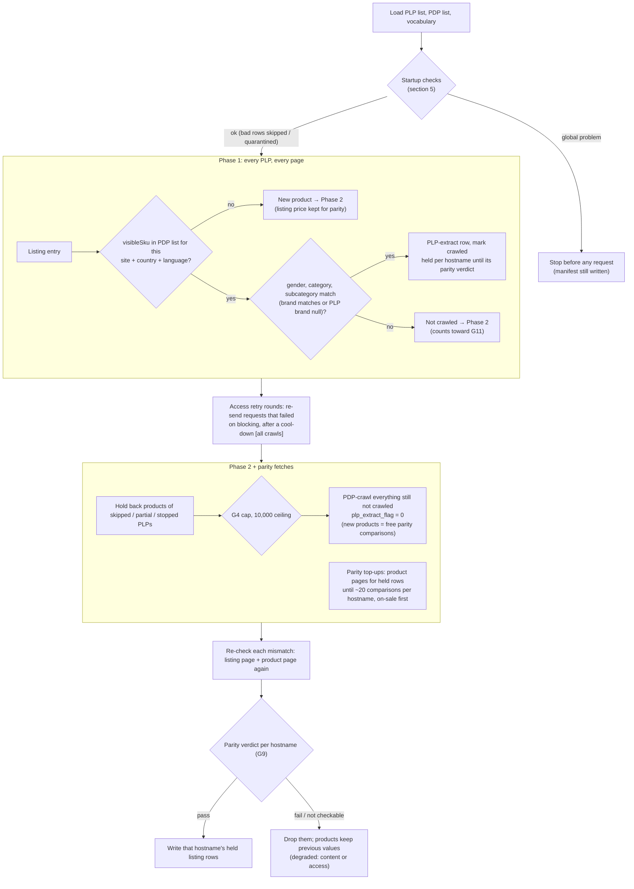

# Ounass PLP-Efficient Crawl Mode

**What this doc is:** the reference for how this crawler mode works **today**.
Keep it current: any behaviour change updates this doc in the same commit,
with a change-log line (rule in `context/AGENTS.md`). History, rejected
options and the build plan live in `tickets/ounass_plp_efficient_crawl.md`.

**Build status (2026-10-16): inputs, startup checks, preflight (Part 2) and
the crawl itself (Part 3: sweep, PLP-extract rows, Phase 2) built and
smoke-tested locally; run observability (Part 4: manifest block,
quality-gate split, run status, publish-on-pass) built; access layer (Part
5a) and the parity check (Part 5b, 2026-10-29) built. Dev only until the
downstream fixes (Part 6) and shadow mode (Part 7).** Each section is marked
**[planned]** or **[built]**. Flip a marker when the matching ticket part
lands, and correct the section if the build differs from the plan.

---

## 1. What it is [built]

An opt-in mode of the Ounass spider (`OUNASS_PLP_EFFICIENT_CRAWL = True`, or
`run_crawler.py ounass --plp-efficient`) that
refreshes products we already know about from **listing pages (PLPs)** instead
of their **product pages (PDPs)**. A listing entry already carries the
product's ID, price and badges, so one listing request refreshes ~48 products.
Doing the same through PDPs costs one Zyte request per product.

- **Phase 1:** sweep every PLP in the run. A known product found on its PLP
  gets a **PLP-extract row** (ID, price, discount, label) and no PDP request.
- **Phase 2:** PDP-crawl only what's left: new products, known products not
  seen on any PLP, and special PDPs no PLP covers.

Cost case (bags, Saudi, 2026-09-17): ≈ $2/month in this mode vs ≈ $181/month
for daily full PDP re-crawls (`notes/2026-09-17-ounass-zyte-crawl-cost.md`).

Measured in dev (Saudi tote + shoulder bags, Arabic + English, 4 listings,
~6,300 known products; ticket "Dry run" entries):

| Run | Requests | Time | Refreshed from listings | Note |
|---|---|---|---|---|
| Full product-page crawl (reference) | ~4,000 | ~2.5 h | — | dry run #1, nothing known yet |
| #4, 2026-10-27 | 372 | 8.5 min | 6,078 of 6,102 (99.6%) | ~200 of 234 product pages were products gold dropped (section 10) |
| #5, 2026-10-29 | 304 | 7.5 min | 6,212 of 6,279 | first with parity; 2 days of new arrivals |

A steady day: 138 listing pages + new arrivals + products sold out since
the last run + parity top-ups ≈ 200–300 requests.

With the flag off (the default), the spider behaves exactly as before.

---

## 2. Inputs [built: export + loader; used by the crawl from Part 3]

Three files, written fresh **at the start of every crawl**. At startup the
crawler invokes scraper-pipeline's export Lambda synchronously, waits for it,
and reads the files from the S3 paths it returns. It isn't triggered after
dbt or on a clock: dbt runs often and for unrelated reasons, while the crawler
only needs fresh inputs right before it crawls. If the export fails, the
crawl stops before any Zyte request. Local files (`--plp-list`, `--pdp-list`,
`--vocabulary`) skip the invoke, for tests.

All values are **canonical** (scraper-pipeline `canonical_seeds/`). The
crawler never canonicalizes raw Ounass values itself.

| Input | Source (in scraper-pipeline) | Contents |
|---|---|---|
| **PLP list** | active rows of the `crawl_plp_registry` seed | one row per listing page to sweep |
| **PDP list** | `gold_product_serving_latest`, scoped to active PLP rows | one row per known product × country × language; its manifest records **when gold was last built** |
| **Canonical vocabulary** | `dim_country`, `dim_map_gender`, `dim_canonical_category_subcategory`, `dim_canonical_brand` | all allowed canonical values |

**Export (scraper-pipeline, code written 2026-10-13, not deployed):** Lambda
`price-comparison-plp-efficient-export-<env>` writes
`s3://price-comparison-bucket-eu-central-1/resources/plp-efficient/<env>/ounass/<export_id>/`
`pdp_list.csv`, `plp_list.csv`, `vocabulary.json` and, last, `manifest.json`
(only a complete export has one; it carries `gold_built_at` and row counts).
`<prefix>/ounass/latest.json` points at the newest manifest. Full contract:
scraper-pipeline `docs/PLP_EFFICIENT_EXPORT.md`.

Keys in both lists follow scraper-pipeline's SQL rules: lowercase, with
`language` as `ar` / `en`. The crawler compares case-insensitively; the
rows it writes keep `product_schema.py`'s `EN` / `AR`.

### PLP list columns

```
url,site,country,language,gender,category,subcategory,brand,is_active
https://saudi.ounass.com/api/women/bags/tote-bags,ounass,sa,ar,women,bags,tote_bags,,true
```

- `is_active = false` switches a listing off without deleting the row; it's
  neither crawled nor used to scope the PDP list.

- `url` must be the `/api/...` endpoint. The human-facing page is HTML the
  spider can't parse. The hostname must match `country` + `language`
  (`ounass_constants.TLD_LANGUAGE_MAP`).
- `gender`, `category`, `subcategory` are **required**. `brand` must be
  **blank**, and the URL must be a **category** listing, not a brand page
  (`/designers/`): rejected by G1 since 2026-10-21.
- Why: a listing returns whatever its URL contains, whatever the row says.
  Ounass no longer serves brand + category listings
  (`/api/.../designers/<brand>/<category>` is gone), and brand pages mix all
  of a brand's categories. Only a category page with no brand shows exactly
  the products the row claims; with any other combination the rest of the
  page looks **new** (product pages crawled in Phase 2 every day, under
  the 10,000 ceiling) or **mismatched** (G11 holds the listing back). The
  `brand` column stays in the template for possible brand-page support
  (section 10).
- Category **and** subcategory are required because canonical categories are
  broader than Ounass listings. Canonical `bags` includes Ounass
  `Accessories / Small Leather Goods`, which never appears on `women/bags`.
  Broad and designer listings are crawled with the mode off.

### PDP list columns

```
portal_itemid,primary_key,site,country,language,url,gender,category,subcategory,brand,out_of_stock,last_available_date,last_crawl_date
```

From `gold_product_serving_latest` (`category` ← `category_canonical`,
`subcategory` ← `sub_category_canonical`, `brand` ← `brand_canonical`).
`url` is that product's PDP URL for **that** country and language. Every row
has been crawled before, so it enters the run with `crawled_before = true`.

**What's in it:** only gold Ounass products that match an **active** PLP list
row on site, country, language, gender, category and subcategory (and brand,
when the row sets one), minus products sold out for 3+ days. The PLP list is
therefore the single definition of scope: add or activate a listing row and
its products join the next export; set `is_active = false` and they drop out.

The crawler does **not** filter this list: everything in it is crawled, via a
PLP or directly in Phase 2. That's why scoping happens in the export.

---

## 3. How a run works [built]



### Matching

- Key: `(site, country, language, portal_itemid)`. Site, country and language
  come from the PLP row; `portal_itemid` is the listing entry's `visibleSku`.
  Our PDP extractor stores the same value (`pdp.visibleSku`).
- Then gender, category and subcategory must equal the PLP row's, and brand
  must equal it unless the PLP's brand is null.
- **Nothing is parsed from URLs.** The number in a product URL is a
  colour-group code, not the product ID (grey Chloé tote: URL `…219035998_19`,
  ID `219036032`).
- A product already marked crawled by an earlier, overlapping PLP is skipped.
- A product **quarantined** at startup (bad PDP list row) is skipped if seen,
  not treated as new.

### Parity check: is the listing still telling the truth? [built 2026-10-29, Part 5b]

Listing-extract rows are only as good as our mapping from Ounass's listing
JSON (section 4). Part 0 proved it matches the product page (42/42), but if
Ounass renames a price field or changes what a field means, the mapping
would silently save wrong prices. So every run compares listing prices with
product pages, per hostname, **before** that hostname's listing rows are
written (`ecommercecrawl/plp_parity.py`):

1. **Free comparisons first:** every product the run fetches a product page
   for anyway (Phase 2: new products, and known products whose listing
   fields disagreed with gold) whose listing entry showed a price. The
   listing price is kept from the sweep; the comparison costs no request.
   All of them are compared, however many (catch-up days have hundreds).
   New and known entries go through the same listing code, so a broken
   mapping shows on both.
2. **Top-ups:** product pages fetched for some of a hostname's held
   listing-refreshed products, for two reasons:
   - **on sale, always:** until about half the sample (10 of 20) of the
     hostname's comparisons have a discount, **even when free comparisons
     already fill the sample**. New arrivals are rarely on sale (dry run #5:
     1 of 49 free comparisons), and the discount is the most fragile field;
   - **any, to fill the sample:** when free comparisons are fewer than
     `…_PARITY_SAMPLE` (20).
   A topped-up product's product-page row is written, and replaces its
   listing row (no duplicate row in the same run).
3. **Compare** price and discount (no discount = `None` or `0` on either
   side). Labels are compared but only counted (`label_differs`): promotion
   labels exist only on product pages (section 10).
4. **Re-check each mismatch:** re-fetch **both** the listing page the entry
   was on and the product page. Agree now → a real price change between
   the two fetches (Phase 2 runs minutes after the sweep): **cleared**.
   Still different → **confirmed**. Re-fetching only the product page
   couldn't tell a price change from a broken mapping. Re-check rows aren't
   written.
5. **Excluded, never mismatches:** product page blocked (`access`), sold out
   now (`sold_out`), page fetched but unusable or never came back
   (`no_product_data`), a different product ID (`different_product`), the
   entry no longer on that listing page at re-check (`moved`).
6. **Verdict, per hostname:**
   - own verdict with ≥ `…_PARITY_MIN_COMPARISONS` (10) usable comparisons,
     or with fewer when none was lost to blocking (a hostname with few
     products judges what it has): **fail** if confirmed mismatches are ≥
     `…_PARITY_MAX_MISMATCH_RATIO` (20%) of them and at least
     `…_PARITY_MIN_MISMATCHES` (2). One confirmed mismatch = warning only;
   - short because of blocking (or nothing usable) → takes the verdict of the
     hostnames with their own (the listing format is shared across Ounass
     hostnames; any own fail → fail);
   - no hostname with its own verdict → **not checked**.
7. **Effect:** **pass** → the held rows are written. **Fail** (content) or
   **not checked** (access when comparisons were lost to blocking) → dropped:
   those products keep their previous values and are refreshed tomorrow, and
   the run is **degraded**. No whole-run stop: product-page rows are valid
   either way.

How held rows are written: the spider keeps them in memory per hostname
(`PlpEfficientRun.held`); after the verdict it schedules one `data:,`
request (no network) whose callback yields the passing rows, so they go
through the item pipelines like any other row. A run stopped before the
verdict writes no listing rows; it's `aborted` anyway (section 6).

After the sweep the spider works in steps, each when it's idle again
(`_plp_efficient_on_idle`): Phase 2 + top-ups → re-checks → verdict and
release. Every step waits for access retry rounds.

Cost: up to 10 on-sale top-ups per hostname every run, plus fill-up top-ups
on days with fewer than 20 new products per hostname, plus 2 requests per
mismatch re-check. About 20–40 requests a run for 2 hostnames. Nothing is
wasted: topped-up products get full product-page rows.

Record: manifest `plp_efficient.parity` = `hosts` (per hostname: `sampled`,
`free`, `top_up`, `on_sale`, `compared`, `agree`, `cleared_on_recheck`,
`confirmed`, `excluded` by reason, `label_differs`, `verdict`, `basis`
own/borrowed) and `release` (`written`, `dropped` per hostname,
`replaced_by_product_page`). Log: `PLP-efficient parity <hostname>: <verdict>
…` (warning unless a clean pass), one `… mismatch:` line per cleared or
confirmed mismatch (listing vs product page values, up to 20), and
`PLP-efficient listing rows: {…}`.

### After the sweep: what Phase 2 gets [built]

When every listing page has been fetched (or failed), the crawler checks
each listing's health once, then decides Phase 2:

- **Healthy listing:** its known-but-unseen products and its new products
  are PDP-crawled.
- **Unhealthy listing:** its leftovers are **held back**: neither refreshed
  nor PDP-crawled this run, and logged with the reason. A listing is
  unhealthy if, in this order:
  - it was stopped during the sweep (G7 currency);
  - a page failed or no page was parsed (G3);
  - more than 5% of the products it matched by ID disagree with it on
    gender/category/subcategory/brand (G11), once at least 20 were matched;
  - more than 25% of the products it should show (ignoring ones gold has
    as sold out) weren't on it (G4), when it should show at least 20.
    With fewer, one delisted product would read as "100% missing", so the
    numbers are only recorded.
- A known product covered by several listings is crawled if **any** of them
  is healthy.
- Known products **no listing covers** (e.g. special PDPs) are always
  PDP-crawled.
- If the total exceeds the Phase 2 ceiling, **nothing** is PDP-crawled
  (`phase2_ceiling_exceeded`). Matched listing rows still stand (parity only
  decides them).

**Matched rows stay.** Health is judged after the sweep, so a listing that
trips G11 or G4 (or is stopped by G7 partway) has usually already produced
PLP-extract rows for the products that did match. Those rows are kept (held
for the parity verdict like any other, then written): each one passed the ID,
scope and price checks on its own. Only the listing's leftovers are held
back. The listing's outcome
and counts are in the run log now and go in the manifest from Part 4.

**Partial and stopped runs** (status rules in section 6, "Run status").
A run that reached its end but held back products or skipped Phase 2 is
**degraded**: its rows reach dbt and the manifest names every skip. A run
stopped or killed partway is **failed** (`aborted` / `killed`), even when its
rows pass quality, and its rows never reach dbt. Until Part 4b lands, an
aborted run still gets `_SUCCESS`: another reason the mode isn't used in the
cloud yet.

### Colour variants

In-stock colours each have their own listing entry and ID. **Sold-out colours
lose their own entry** and survive only as a swatch inside a sibling's
entry. The swatch has a slug and colour code but no ID, price or stock. Swatches
are **ignored**: they're not proof of identity. Those products go to Phase 2
until the 3-day sold-out cutoff drops them from the PDP list.

---

## 4. PLP-extract row [built]

Only these fields are set. Everything else (`product_name`, `image_urls`,
`text`, `out_of_stock`, `was_price`, `sizes`, `color`, …) is **null**, meaning
"not observed", not "empty". Downstream keeps the previous values (section 7).

| Field | Source | Why this source |
|---|---|---|
| `portal_itemid` | `visibleSku` | Equals the PDP extractor's value (42/42) |
| `price` | `priceByCustomerGroupId["-1"]` | Equals the PDP selling price (42/42). The listing's plain `price` key is the **pre-sale** price on sale items. |
| `price_discount` | `round_half_up((1 − priceByCustomerGroupId["-1"] / price) × 100)`; **`0` when not on sale**; null only when a price is missing | Equals the PDP discount (42/42). The listing's own discount fields were 5 points too high on some sale items. `discountText` is translated display text. `0`, not null, so an ended sale clears the old discount downstream (section 7; since 2026-10-29, both paths). |
| `primary_label` | highest-priority `badges[].value` | Equals the PDP badge (41/42). Promotion-campaign labels (e.g. `EXTRA25`) exist only on the PDP: accepted loss. |
| `url` | **copied from the product's PDP list row** | Never the listing URL. Downstream keeps the latest non-blank `url` as the website link and the recrawl address (section 7). |
| `site`, `country` | the PLP row | |
| `language` | from the product URL's hostname (`TLD_LANGUAGE_MAP`), `EN` / `AR` | Same derivation as PDP rows |
| `run_id`, `crawl_date` | the run | As PDP rows |
| `plp_extract_flag` | `1` | PDP rows always carry `0`, in normal mode too |
| `plp_source_url` (optional) | the listing page | Analysis only |

Evidence: parity probe runs 2026-09-30 (Saudi Arabic bags) and 2026-10-01 (UAE
sale), `scripts/probe_ounass_plp_parity.py`. If Ounass changes its listing
format, re-run the probe before trusting these mappings.

---

## 5. Guardrails [built except shadow mode (Part 7)]

Principle: fail closed, never fall back to a mass PDP recrawl, and stop only as
much as the problem affects.

**Access errors are not content errors** (agreed 2026-10-19; crawler logic
to be built in Part 5). Ounass blocking (Zyte "Website Ban", HTTP 429/403,
repeated 5xx/timeouts) hits a whole **hostname** at once and says nothing
about whether our data or mapping is right. So:
- a blocked request is never a parity mismatch, a missing product (G4), a
  field mismatch (G11) or any other content failure;
- the crawler tracks access failures **per hostname** and reports them
  separately (manifest, log), so "Ounass blocked en-saudi today" and "the
  listing format changed" can never look the same;
- the parity check (G9) only judges content: comparisons lost to blocking
  are excluded from it, not counted as "inconclusive".

### Access retry rounds [built 2026-10-20, Part 5a; all crawls, not only this mode]

Blocking is often temporary, and Scrapy's own retries (`RETRY_TIMES = 5`)
happen back to back, while the block is still on. So:

1. A request that still fails on an **access error** after its normal
   retries (Zyte "Website Ban", HTTP 429/403, repeated 5xx, timeouts or
   connection errors) is **set aside**, not dropped, and counted against
   its hostname. Content errors (page loads but can't be parsed, product
   gone) are never set aside: waiting won't fix them.
2. When the crawl has nothing else to do, it waits
   `ACCESS_RETRY_COOLDOWN_SECONDS` and re-sends everything set aside: one
   round. Up to `ACCESS_RETRY_ROUNDS` rounds, stopping early once the total
   wait reaches `ACCESS_RETRY_MAX_TOTAL_SECONDS`.
3. What still fails is given up. A hostname is reported **blocked** when
   every one of its requests was given up on access (any number), or when
   at least `ACCESS_BLOCKED_HOST_RATIO` of them were (min 5 requests).
4. **A lost listing page degrades the run** (2026-10-21), even when its
   hostname isn't blocked: losing one silently drops every product it
   would have linked to (up to 48). Spiders opt in by flagging listing
   requests with `meta[access.LISTING_META_KEY]`; the run gets a
   `kind: access` degradation naming the URL. Flagged today: Ounass normal
   mode (`/api/` requests). PLP-efficient listings aren't flagged, because
   G3 already records them.

What a degraded run means for data: it still gets `_SUCCESS`, so **every
row it wrote reaches raw**. Degradations describe only what's missing
(products never written that day keep their previous values downstream).
Only failed runs are kept out of raw.

Not covered (fetched outside Scrapy, so no retry rounds or access record):
Level Shoes listing pages (`level_crawl._get_payload`, plain `requests`),
and Ounass's "requests mode" fallback, which is off by default
(`OUNASS_REQUESTS_TLDS` empty).

In this mode the order after the sweep is: retry rounds → Phase 2 and parity
top-ups → re-checks → parity verdict; each step waits for the rounds of the
step before. Crawls run as
ECS Fargate tasks with no time limit, so the cool-downs only lengthen the
task; no Lambda waits on them.

How it's built (`ecommercecrawl/access.py`): `AccessRetryMiddleware`, a
downloader middleware at priority 540, just after the retry middlewares, so
it only sees what they gave up on. A set-aside request raises
`AccessDeferred` (an `IgnoreRequest`: callbacks and errbacks must ignore it,
the same request returns later); the copy carries `meta["access_round"]` and
a fresh `retry_times`. On `spider_idle` it waits the cool-down and re-sends.
When the next cool-down would pass the cap, it sends one last attempt
immediately, with no further deferral, so errbacks still see the real final
failure. After the last round, a refused response (403/429/5xx) reaches the
callback as usual. PLP-efficient chooses Phase 2 only once the layer is idle
(`crawler.access_retry.busy()`), and counts a listing page lost to access as
`pages_failed_access`: a G3 hold-back caused only by blocking is recorded as
`kind = access`. Listing pages are routed by their request (`plp_idx`), not
by the page body, so a blocked HTML page is never silently dropped, and a
requested page that never came back is also G3.
Verified 2026-10-20 with a real Scrapy crawl against a local server (refused
twice then recovered in round 2; always-refused reached the callback after
the last round).

### Where degradations and access problems are recorded [built 2026-10-20, Part 5a]

- **Manifest (the record):** `degradations` becomes structured, one entry
  per skip: `{"kind": "content" | "access", "scope": <hostname or listing>,
  "message": …}`. Details stay in their blocks: `plp_efficient` (listings,
  Phase 2, `parity` per hostname, section 3) and a top-level `access`
  block for **every** crawl: `rounds_run`, `total_waited_seconds`, and per
  hostname `requests` (final outcomes), `succeeded`, `other_errors`,
  `gave_up`, `recovered_in_rounds`, `deferred`, `access_failures` by label
  (`zyte_520`, `http_429`, `timeout`, …), `status` `ok` / `blocked`. Verified copy in
  `crawl_manifest_raw.raw_json`; in silver from Part 6.
- **CloudWatch log** (`/ecs/<ecs_name>`), once at the end of the run: a
  `RUN DEGRADED` warning with one indented line per degradation, `RUN FAILED`
  (error) with the failure reason, and an `ACCESS <hostname>` warning per
  hostname with any access failures (also on clean runs).
  Grep-able now; the hook for alerting (`tickets/cicd_pipeline.md`).

| # | Check | Failure scope | Setting(s) (current value) |
|---|---|---|---|
| G1 | PLP row canonical; gender/category/subcategory set; brand blank and not a `/designers/` URL (category listings only, section 2) | Skip that PLP, hold back its products. Too many bad rows → stop run. | `OUNASS_PLP_EFFICIENT_MAX_BAD_PLP_ROWS_RATIO` (0.25) |
| G2 | PLP list and PDP list present, all columns | Stop run | — |
| G3 | Every page of a PLP fetched | After the sweep: that PLP's leftovers held back (matched rows stay) | — |
| G4 | Known-but-unseen products per PLP (excluding ones gold has as sold out) | After the sweep: over the cap → that PLP's leftovers held back (matched rows stay). Applies only to listings with at least `OUNASS_PLP_EFFICIENT_MISSING_MIN_EXPECTED` (20) expected products; below that the numbers are recorded per listing (`expected_products`, `expected_unseen`, `note`), not acted on. | `OUNASS_PLP_EFFICIENT_MISSING_RATIO_CAP` (0.25) |
| G6 | PLP-extract `url` = PDP list `url`, not a listing URL | Don't write that row; product left for Phase 2 | — |
| G7 | PLP hostname ↔ country/language; entry `localeCurrency` = country currency | Startup: skip that PLP. Sweep: stop that PLP at the first wrong-currency entry; its leftovers held back (matched rows stay). | — |
| G8 | Gold age: gold's last build time from the PDP list manifest. The export itself is always fresh. | **Warn only** (2026-10-22): warn at the warn age, or if the age is unknown; never stops the run | `OUNASS_PLP_EFFICIENT_GOLD_WARN_AGE_DAYS` (2) |
| G9 | Parity check, per hostname (section 3, "Parity check"): new products' product pages first, top-ups to 20 | Confirmed mismatches ≥ 20% (min 2) → that hostname's listing rows dropped, products keep previous values. Short because of blocking → borrow other hostnames' verdict; none with a verdict → rows dropped (access). Never a whole-run stop. | `OUNASS_PLP_EFFICIENT_PARITY_SAMPLE` (20), `OUNASS_PLP_EFFICIENT_PARITY_MIN_COMPARISONS` (10), `OUNASS_PLP_EFFICIENT_PARITY_MAX_MISMATCH_RATIO` (0.2), `OUNASS_PLP_EFFICIENT_PARITY_MIN_MISMATCHES` (2) |
| G10 | Canonical values exist in the latest vocabulary | Bad PLP row → as G1. Bad PDP row → quarantine that product. Too many bad PDP rows → stop run. | `OUNASS_PLP_EFFICIENT_MAX_BAD_PDP_ROWS_RATIO` (0.05) |
| G11 | ID matched but fields differ (drift / reclassification) | After the sweep: over the share → that PLP's leftovers held back (matched rows stay). Applies only once at least `OUNASS_PLP_EFFICIENT_FIELD_MISMATCH_MIN_SEEN` (20) products were matched; below that it's recorded as a `note`. | `OUNASS_PLP_EFFICIENT_FIELD_MISMATCH_RATIO` (0.05) |
| — | Phase 2 ceiling | Over → skip Phase 2 entirely, `phase2_ceiling_exceeded = true` (logged as an error) | `OUNASS_PLP_EFFICIENT_MAX_PHASE2_PDPS` (10000) |

"Hold back" = neither refreshed nor PDP-crawled this run, and logged.

Other settings:

| Setting | Current value | Meaning |
|---|---|---|
| `OUNASS_PLP_EFFICIENT_CRAWL` | `False` | Turns the mode on |
| `OUNASS_PLP_EFFICIENT_SHADOW` [planned, Part 7] | `False` | Shadow mode: full run, no rows written, outcomes logged to the manifest |
| `OUNASS_PLP_EFFICIENT_EXPORT_LAMBDA` | `price-comparison-plp-efficient-export-<APP_ENV>` | Name of scraper-pipeline's export Lambda, invoked at crawl start |
| `OUNASS_PLP_EFFICIENT_STALE_CRAWL_DAYS` | `7` | Stale-crawl warning: products not crawled for more than this many days |
| `ACCESS_RETRY_ROUNDS` | `2` | Access retry rounds after the normal retries; 0 = off (all crawls) |
| `ACCESS_RETRY_COOLDOWN_SECONDS` | `900` | Wait before each round |
| `ACCESS_RETRY_MAX_TOTAL_SECONDS` | `3600` | Cap on total cool-down per run |
| `ACCESS_BLOCKED_HOST_RATIO` | `0.5` | Share of a hostname's requests failing on access (min 5) to report it blocked; a hostname that lost every request is blocked regardless |

Settings live in `ecommercecrawl/settings.py`; thresholds can be overridden
with environment variables of the same name. The startup checks read them
through `plp_efficient.Config.from_settings`. The drift test
(`tests/test_plp_efficient_docs.py`) fails if a setting in `settings.py`
isn't listed in this doc.

### Startup checks, in detail [built]

Code: `ecommercecrawl/plp_efficient.py` (`validate()`), tests:
`tests/test_plp_efficient.py`.

These run before the crawler makes any Zyte request (in a real crawl and
in preflight). There are three possible outcomes, from mild to severe:

- **warn:** the crawl runs; the warning is logged and shown by preflight.
- **skip / quarantine:** the crawl runs without that listing or product.
- **stop:** the crawl doesn't start, and no Zyte money is spent.

A single **stop** means the crawl doesn't start. Otherwise it runs without
the skipped listings and quarantined products, and with all warnings
recorded.

**G2: all three files present and complete**
- *Checks:* the PLP list, the PDP list and the vocabulary all exist, with
  every expected column.
- *Why:* without the PDP list, every product on every listing would look
  new and get a full PDP crawl, which is the expensive case this mode avoids.
- *Example:* `pdp_list.csv` lost its `subcategory` column.
- *Outcome:* **stop.**

**G1: each listing row is valid**
- *Checks:* every value in a PLP list row is canonical (in the vocabulary),
  and gender, category and subcategory are filled in.
- *Why:* listings match products by exact value. A typo matches nothing,
  and a missing subcategory makes the listing too broad (it would pull in
  products Ounass lists elsewhere).
- *Example:* subcategory `tote-bags` instead of `tote_bags`, or empty.
- *Outcome:* **skip that listing** and hold back its products. They're
  neither refreshed nor PDP-crawled, so a typo can't trigger a burst of
  PDP crawls. **Over 25% of listing rows bad → stop**: that signals a broken
  registry or vocabulary, not a one-off typo.

**G7: listing URL matches its country and language**
- *Checks:* the URL's hostname belongs to the row's country and language
  (`saudi.ounass.com` = Saudi Arabic, `en-saudi.ounass.com` = Saudi English,
  …, per `ounass_constants.TLD_LANGUAGE_MAP`).
- *Why:* PLP-extract rows carry prices but no currency, so a UAE page tagged
  as Saudi would silently write UAE prices onto Saudi products.
- *Example:* `https://www.ounass.ae/api/women/bags/tote-bags` tagged
  `country=sa`.
- *Outcome:* **skip that listing**, like G1; it counts toward G1's 25%.
  During the sweep, a second check compares each entry's currency.

**G8: gold was rebuilt recently**
- *Checks:* `gold_built_at` from the export manifest: when gold was last
  **rebuilt**.
- *Why:* if dbt hasn't run, gold doesn't know the products crawled since
  its last rebuild. Those products then look **new** and get a product-page
  crawl in Phase 2 every run until dbt runs again (capped by the Phase 2
  ceiling). That's extra cost, not wrong data: prices come from the listing
  pages, and every product-page crawl is a complete row.
- *Outcome:* **warn only** (changed 2026-10-22; it used to stop the run at
  3 days). Under 2 days OK; **2+ days, or age unknown → warn**. Stopping
  the crawl would leave every product unrefreshed while dbt is down,
  compounding the staleness. The fix for stale gold is a dbt schedule in
  AWS (`tickets/cicd_pipeline.md`), not a crawl stop.
- *Where the warning shows:* preflight output; a `PLP-efficient startup
  warning G8: …` line in the crawl log (CloudWatch); and the manifest
  (`plp_efficient.startup.warning_messages`, plus `gold_age_days`). It
  doesn't make the run degraded: nothing is skipped.
- *Note:* this says nothing about how fresh each product's data is. A gold
  rebuild doesn't refresh product dates; see the next check.

**Stale-crawl warning** (decided 2026-10-16)
- *Checks:* each product's `last_crawl_date`, i.e. when it was last observed
  at all. It's kept per product through silver (`greatest(new, previous)`),
  so rebuilding gold without a new crawl leaves it unchanged.
- *Why:* G8 only knows when gold was rebuilt. Dev showed the gap: gold
  rebuilt 2026-10-13, but its products were last crawled 2026-08-08. Once
  PLP-efficient runs, it also surfaces products that keep falling through
  the gaps (repeatedly quarantined or held back, so never refreshed).
- *Outcome:* **warn only**, with the count and oldest date (e.g. "5 products
  not crawled for more than 7 days; oldest 2026-08-08"). It never stops a run,
  because refreshing stale products is what the crawl is for. Threshold:
  `OUNASS_PLP_EFFICIENT_STALE_CRAWL_DAYS` (7).
- *Source:* the PDP list export's `last_crawl_date` column (added
  2026-10-16, scraper-pipeline `0345c2b`; dev Lambda redeployed).

**G10: every product row uses known values**
- *Checks:* each PDP list row's country, language, gender,
  category/subcategory and brand exist in the vocabulary.
- *Why:* catches a rename caught halfway, e.g. the vocabulary already says
  `totes` while gold still says `tote_bags` until dbt rebuilds.
- *Outcome:* **quarantine that product.** It isn't refreshed or PDP-crawled
  this run, and if seen on a listing it's skipped rather than treated as
  new. **Over 5% of product rows bad → stop**: good gold has almost none.

Language is compared case-insensitively: inputs use `ar` / `en`
(scraper-pipeline convention), output rows keep `EN` / `AR`.

---

## 6. Outputs [built]

- **Rows [built]:** PLP-extract rows (`plp_extract_flag = 1`) and normal PDP
  rows (`plp_extract_flag = 0`) in the same output file, landing in
  `bronze_ounass_raw`.
- **Manifest `plp_efficient` block [built]** (`plp_efficient.manifest_block`,
  added by `PostCrawlPipeline`). Written **even when the run stops at
  startup**: the output folder exists from spider open, so the manifest
  explains the stop.
  - `startup_stopped`, `startup_error` (export failure);
  - `inputs`: file paths, export id, `gold_built_at`, row counts;
  - `startup`: gold age, listings valid / skipped (with URLs), products
    valid / quarantined / held back / uncovered / stale, problem counts per
    check and severity, the stop messages;
  - `listings`: per listing, pages requested / parsed / failed, rows
    `emitted` (matched and held for parity, not necessarily written),
    matched, mismatched, unusable, new, and `held_back_reason`;
  - `phase2`: candidates, `phase2_ceiling_exceeded`, counts (known unseen,
    uncovered, new, held back), `scheduled`;
  - `refreshed_from_listing` (listing rows actually **written**, after
    parity), `new_products`;
  - `parity`: per hostname comparisons and verdict, and `release`
    (written / dropped / replaced by a product page); section 3;
  - `degradations`: one line per piece of work a guardrail chose to skip.
    Empty = nothing skipped. Feeds the run status (below).
- **Quality gate, split by row type [built]** (`quality_gate.py`):
  - product-page rows (`plp_extract_flag` not 1): the standard per-site
    blank-ratio rule, unchanged, counted over product-page rows only;
  - PLP-extract rows: every row must have `portal_itemid`, `url`, `price`,
    `site`, `country`, `language`, with `price > 0` and `url` not a listing
    URL (no `/api/`, not the `plp_source_url`). **One bad row fails the run**:
    the crawler never writes such rows, so one means a bug. Reported under
    `plp_extract_rows` in the quality report.

### Run status [built 2026-10-16; applies to all crawls]

**The full reference for all crawls (every status, marker, what to do,
queries) is `docs/crawl_run_status.md`.** This section keeps the
PLP-efficient view and history.

One question decides it: **did the crawler reach its own end, and did it
skip anything on purpose?**

| `run_status` | When | Marker | Reaches dbt |
|---|---|---|---|
| `success` | Reached its own end, nothing skipped | `_SUCCESS` | yes |
| `degraded` | Reached its own end, but a guardrail skipped work (a listing skipped or held back, products quarantined or held back, Phase 2 skipped by the ceiling). The manifest's `degradations` names each one. | `_SUCCESS` | yes |
| `failed` | Rows can't be trusted or the run didn't finish. `failure_reason`: `aborted` (closed for any reason other than `finished`: Ctrl+C, ECS stop, timeout), `startup_check` (stopped before any request), `access` (no rows written and requests were lost to blocking after every retry round, 2026-10-21), `quality` (quality gate failed), `verification` (file check failed) | a failure marker per reason | **no** |
| `killed` | A "run started" record with no manifest (hard kill, out-of-memory) | none | no |

An aborted run is **failed**, never "partly saved", like an edit abandoned
before saving: its rows may be genuine, but a half-finished day reads as
misleading data. The next day's crawl refreshes those products.

**Where a run's data goes (publish on pass).** Athena reads a whole day
folder (`crawls/<site>/<dt>/`, every run under it) once any run that day
writes `_SUCCESS`. So the crawler doesn't upload there:

1. The crawler uploads its data file to
   `bronze/<env>/crawl-unverified/<site>/<dt>/<run_id>/`, which nothing
   reads, and its manifest to `crawls/metadata/…` as before.
2. The verifier Lambda (`lambda/bronze_manifest_verifier`) checks the file
   and decides the final `run_status` / `failure_reason`, overwriting the
   crawler's own view (`pipelines.crawler_run_status`).
3. **Pass** (success / degraded): it copies the file to
   `crawls/<site>/<dt>/<run_id>/`, then writes `_SUCCESS`, which registers
   the day for dbt. **Fail**: the file stays in `crawl-unverified/` for
   inspection, and one marker per reason is written under
   `crawls/markers/<site>/<dt>/<run_id>/`: `_FAIL_ABORTED`,
   `_FAIL_STARTUP_CHECK`, `_FAIL_ACCESS`, `_FAIL_QUALITY`, `_FAILED`
   (verification). A startup-stopped or fully blocked run has no data file
   by design, so it gets only its own marker.
4. Every verified manifest, failed ones included, lands in
   `crawl_manifest_raw` (the day is registered for every run), with
   `run_status`, `failure_reason`, `degradations` and `verification`
   (`outcome`, `data_source`, `published_key`) inside `raw_json`.

Files from crawler images older than this change sit directly in `crawls/`;
the verifier still accepts them there (`data_source = "legacy"`).

**Killed runs.** At spider open the crawler writes
`bronze/<env>/crawl-started/<site>/<dt>/<run_id>.json` (only when uploads
are on: `APP_ENV=prod` or `S3_UPLOAD_ENABLED=true`), read by scraper-pipeline's
`crawl_started_raw` table. A start with no manifest = killed:

```sql
select s.crawler_name, s.dt, s.run_id, s.started_at
from crawl_started_raw s
left join crawl_manifest_raw m on m.run_id = s.run_id
where m.run_id is null;
```

## 7. Downstream behaviour (scraper-pipeline)

**How silver reads a PLP-extract row.** The Ounass silver models
(`silver_product_fact_ounass_daily`, `silver_product_dim_ounass`,
`silver_product_i18n_ounass`) are incremental: each run picks the latest raw
row per product and merges it onto yesterday's state with
`coalesce(new, previous)`.
- A PLP-extract row's nulls therefore **keep** the previous name, images,
  brand, category, currency and stock; only price, discount, label and url
  change.
- Any **non-blank** value overwrites, which is why `url` is copied from the
  PDP list, and why "no discount" must be `0`, not null.

**Discounts clear on ended sales (fixed 2026-10-29).** Before, both paths
wrote null for "no discount", which silver read as "not observed", so an
ended sale kept its old discount forever (all crawl modes). Now both write
`0` (`ounass_rules.get_discount`, `plp_hit_discount`). Website and API treat
only `> 0` as on sale. Only on positive evidence, though: the PDP path writes
`0` when the page's `discountPercent` is present but empty, and null when the
field is **missing** (a renamed field must not wipe every real discount).

**⚠ Never full-refresh (or drop and rebuild) the Ounass silver models.**
The `coalesce(new, previous)` merge only works between runs. A first build or
`--full-refresh` reads all bronze at once and takes each product's **latest
row**, which, in this mode, is usually a PLP-extract row. Everything only
product pages carry (currency, stock, name, brand label, …) comes out null,
and gold drops the product (it joins on currency). Happened in dev
2026-10-29: after a rebuild, gold had 276 Ounass rows instead of ~6,500.
The same loss hit incremental runs whenever one batch held a product page
and a later listing row (dbt skipping a day). **Fixed 2026-10-29**
(scraper-pipeline `e637dbf`): each field takes its latest non-null value
within the batch, so a rebuild equals day-by-day merging and is safe.
Exception: `primary_label` takes the latest row's value even when null (both
paths observe the badge, so null = removed). Dev rebuilt with it: gold back
to 6,560 Ounass rows, the rebuilt dim matched the pre-incident one.

**Kept for analysis:** `plp_extract_flag` (silver fact
`last_plp_extract_flag`: which path set the kept price; dev 2026-10-29: 3,107
products last priced from a listing, 222 from a product page) and
`primary_label` (silver i18n / gold; not shown on the website yet). Run
status and killed runs are queryable in `silver_crawl_manifest` /
`silver_crawl_killed_runs` (scraper-pipeline `77daded`).

**Products gold drops are recrawled every run.** Gold keeps only products
with a canonical gender, brand, category and subcategory (seed mappings),
and the export keeps only those matching an active registry row. Anything
else on a listing looks new to the crawler and gets a product page every
day (section 10, "Unmapped products", "Out-of-scope products"). A Phase 2
"new" count that stays high day after day means this, not real arrivals.

**After a crawl, in this order** (manual today; orchestration planned in
`tickets/cicd_pipeline.md`):
1. `make dbt-run` (scraper-pipeline): gold learns the run's products.
2. Image pipeline (`make ecs-run-image-pipeline APP_ENV=dev`) for new
   products' images.
3. **Wait for the image quality checker** (its output lands in
   `bronze/<env>/images/validated/dt=<dt>/`). Gold shows only validated
   images; a dbt run before it finishes filters every new image out.
4. `make dbt-run` again.
5. `make api-cache-export-dev` (the website's data).

The next crawl needs step 1 at least: without it, yesterday's new products
are still unknown and get product pages again.

**Language versions age apart.** A product's Arabic and English product
pages are now crawled only when needed, often on different days, so their
galleries can differ (Ounass changes `?ts=` and sometimes image count). The
dbt test `test_bronze_product_image_urls_no_cross_locale_conflicts` flags
this (3 products on 2026-10-27); silver keeps the latest gallery
deterministically. The test needs rethinking for this mode (Part 6).

---

## 8. How to run [built; dev]

| Step | Command |
|---|---|
| Check inputs before spending budget **[built]** | `make preflight-ounass-plp-efficient` (exit 0 = would start, 1 = would stop). With the 1-request Zyte probe: `make preflight-ounass-plp-efficient-probe`. Local files: `make preflight-ounass-plp-efficient PREFLIGHT_ARGS="--plp-list plp.csv --pdp-list pdp.csv --vocabulary vocabulary.json [--manifest manifest.json]"`. Prod: `APP_ENV=prod make preflight-ounass-plp-efficient`. |
| Before the run | `make dbt-run` in scraper-pipeline if a crawl ran since the last one (section 7) |
| Run in AWS (dev) | `make ecs-run APP_ENV=dev ECS_RUN_COMMAND="python3 run_crawler.py ounass --env dev --plp-efficient"`; prints the task ARN (last part = task id). Uses the crawler image `latest` (built by CI on every push to `main`) |
| Watch | `aws logs tail /ecs/ecommerce-scraper --region eu-central-1 --follow --log-stream-names ecs/scraper/<task-id> --filter-pattern '?"PLP-efficient" ?"Access retry" ?"RUN " ?"ACCESS " ?ERROR'`. Milestones: `PLP-efficient Phase 2: {…}` (sweep done), `PLP-efficient parity <hostname>: …`, `PLP-efficient listing rows: {…}`, `RUN DEGRADED` / `RUN FAILED` |
| Check | marker under `bronze/<env>/crawls/markers/ounass/<dt>/<run_id>/` (`_SUCCESS` or a failure marker, `docs/crawl_run_status.md`); manifest `plp_efficient` block |
| After the run | section 7, "After a crawl, in this order" |
| Shadow run | _Part 7_ |
| Live run, local | `ZYTE_API_KEY=… .venv/bin/python run_crawler.py ounass --plp-efficient` invokes the export Lambda. With local files: `… --plp-efficient --plp-list plp.csv --pdp-list pdp.csv --vocabulary vocabulary.json [--plp-manifest manifest.json]`. Not with `--urls` / `--urls-source`. Cap Phase 2 for a test with `OUNASS_PLP_EFFICIENT_MAX_PHASE2_PDPS=20`. Uploads only with `S3_UPLOAD_ENABLED=true` |
| Re-verify listing ↔ product-page parity | `.venv/bin/python scripts/probe_ounass_plp_parity.py --plp-url <api listing url>` (needs `ZYTE_API_KEY`; ~30 Zyte requests) **[built]** |

---

### Preflight (`make preflight-ounass-plp-efficient`) [built 2026-10-16]

**What it is:** a dry run of the crawler's startup. It does everything a
real PLP-efficient crawl does before its first Zyte request, then stops and
reports whether the crawl would start, and what it would skip or hold back.
It uses the same code as the crawl, so the two can't disagree.

**When to use it:**
- before a crawl you care about (e.g. the first run after a registry or
  dbt change);
- right after editing `crawl_plp_registry`, to see a rejected row and why
  immediately, not as a skipped listing the next day;
- after a crawl stopped or skipped something, to see the full list of
  problems (a crawl acts on them; preflight lists them all);
- later, the scheduled crawl runs the same checks at startup automatically.

**What it does:**
1. Invokes scraper-pipeline's export Lambda, exactly as a crawl would (a
   few seconds, a fraction of a cent of Athena). Or it uses local files
   passed with `--plp-list`, `--pdp-list`, `--vocabulary`.
2. Reads the three files and the manifest.
3. Runs every startup check (section 5, "Startup checks, in detail") and
   collects **all** problems.
4. Prints the problems grouped by check, with the exact rows, then a
   summary: listings valid/skipped, products per country × language,
   quarantined products, gold age, stale-crawl count, and products no
   listing covers (plus whether the 10,000 Phase 2 ceiling is already
   exceeded).
5. Exits 0 if the crawl would start, non-zero if it would stop.

It makes **no Zyte requests** and writes nothing, except with
`--probe-one-page` (`make preflight-ounass-plp-efficient-probe`), which
fetches one listing page to check Ounass isn't blocking requests (1 Zyte
request).

Code: `scripts/preflight_ounass_plp_efficient.py`. First real run, 2026-10-16
(dev): 4 listings and 5 products valid; warnings G8 (gold rebuilt 2.9 days
ago) and STALE (5 products last crawled 2026-08-08); exit 0.

## 9. Troubleshooting [planned]

| Symptom | Likely cause | Check |
|---|---|---|
| Run failed with `failure_reason: access` | Nothing written because the site refused us through every retry round | Manifest `access` block (which hostnames, which errors); Saudi routing (`CRAWLER_API_ZYTE_GEOLOCATION_BY_HOST`); re-run later |
| A run's rows aren't in Athena | Run failed: data left in `crawl-unverified/` | `crawl_manifest_raw` `run_status` / `failure_reason`; markers under `crawls/markers/<site>/<dt>/<run_id>/` |
| Run stopped at startup | Export Lambda failed, or G2 / G1 or G10 over threshold | Run preflight: it lists every failed check with the offending rows. For an export failure, check the Lambda's logs in scraper-pipeline. |
| `startup warning G8` / Phase 2 much larger than usual | gold hasn't been rebuilt for 2+ days, so recently found products look new | Run dbt in scraper-pipeline (`make dbt-run`); a scheduled dbt job is planned (`tickets/cicd_pipeline.md`) |
| A PLP was skipped | Bad PLP row (non-canonical value, missing subcategory, hostname ≠ country) | Fix the row in `crawl_plp_registry` |
| Products quarantined | Gold row with a value not in the vocabulary, often mid-rename | Wait for the dbt rebuild, or fix the seed |
| A hostname has no PLP-extract rows, `kind = access` | Ounass blocked it through every retry round, and no other hostname could vouch for parity | Manifest `access` block; `--probe-one-page` |
| A hostname has no PLP-extract rows, `kind = content` | G9 parity failed: listing format likely changed | Manifest `plp_efficient.parity`; re-run the parity probe; update section 4 |
| A PLP's leftovers held back | G3 page failure, G7 currency mismatch, G11 field-mismatch spike or G4 missing spike | Manifest per-PLP outcomes; check for a canonical rename or Ounass reclassification |
| Phase 2 skipped | G4 cap or the 10,000 ceiling | Manifest `plp_efficient.phase2` and `degradations`; check the PDP list's scope |
| Many products refreshed every day via PDP instead of PLP | Unmapped products (absent from gold), out-of-scope products in a listing, or swatch-only sold-out colours | Section 10. To tell: are the "new" products already in bronze from earlier runs? Then gold is dropping them: check `brand_canonical` / `gender` nulls in `silver_product_dim_ounass` and add the seed mapping |
| Gold suddenly lost most Ounass products | An Ounass silver model was rebuilt (first build / `--full-refresh`) | Section 7, "Never full-refresh"; Glue `CreateTime` of the silver tables |
| Phase 2 "known but not seen" much higher than ~2% per listing | Listing pagination showing only part of the listing (fixed 2026-10-23), or real churn after days without a run | Section 10, "Listing pagination"; compare unique entries per sweep with `pagination.totalHits` |

---

## 10. Known limitations and accepted losses

- **Unmapped products:** products gold can't map to canonical values aren't
  in the PDP list, so they look new and get a PDP crawl every run until the
  mapping is fixed. Dry run #4 (2026-10-27) measured it: of 210 "new"
  product pages, ~95% were products crawled before that gold drops,
  because their brand isn't in `dim_map_brand` for Ounass (70 products, 11
  brands) or their gender is `Unisex`, which `dim_map_gender` doesn't map
  (24). Another 7 were `Mens` products inside a women's listing: in gold,
  but outside the registry row's scope. Fix: scraper-pipeline seeds
  (ticket, dry run #4).
- **Out-of-scope products in a listing:** Ounass lists some `Mens` products
  in women's listings. Gold has them as men, so the export (scoped by the
  registry row's gender, like category) leaves them out, and the crawler
  can't tell "excluded on purpose" from "never seen": they get a product
  page every run (~10 requests a day, 2026-10-29). Deferred (user,
  2026-10-27); if it grows, refresh them from the listing (an
  `out_of_scope` list from the export, matched without the gender check)
  rather than skip them, so their gold price stays fresh.
- **Promotion-campaign labels** (e.g. `EXTRA25`) are PDP-only and missing
  from PLP-extract rows (parity counts them as `label_differs`, ~20% of
  comparisons on 2026-10-29).
- **Swatch-only (sold-out) colours** get a Phase 2 PDP check until the 3-day
  sold-out cutoff removes them.
- **Saudi blocking:** paginated Saudi listing requests got Zyte "Website Ban"
  / HTTP 429 on 2026-09-30 and 2026-10-03. Expect degraded Saudi runs.
  Blocking is an access problem for the whole hostname, handled apart from
  content checks (section 5). **Mitigation (2026-10-20):** Saudi hostnames
  go through Zyte's Türkiye exits (`CRAWLER_API_ZYTE_GEOLOCATION_BY_HOST` in
  `settings.py`): the same listing that was banned 5/5 times on default
  routing returned 200 via `TR`, prices still SAR.
- **Planned direction (2026-10-22): brand-scoped category rows.** A row's
  `brand` would filter its category listing to that brand's entries, so
  only the registry's brands are refreshed or product-crawled (dry run #1
  had to product-crawl 3,897 products of every brand). Each entry carries
  `designerCategoryUrl` / `id_designer`; it needs a designer → canonical
  brand map from scraper-pipeline. Design notes: ticket, "Future
  direction: brand-scoped category rows". Until then:
- **Category listings only:** brand pages and brand-scoped rows are
  rejected (section 2). To support them, the sweep would have to ignore
  entries outside the row's scope using each entry's breadcrumbs and brand.
  Breadcrumbs carry Ounass's raw category (`tote-bags`), not the canonical
  one (`tote_bags`), so that needs a raw→canonical map exported from
  scraper-pipeline. Worth it only to track a few brands without sweeping
  whole categories. The brand rule in matching (`plp_covers_pdp`) is kept
  for that.
- **Listing pagination must use a sort without ties** (fixed 2026-10-23, all
  Ounass crawls). Pages are fetched with `sortBy=onlineDateWithStock-desc`
  (the site's own "Newest", listed in every response's `sortBy`). The old
  `fh_sort_by=-newness_ae` (Fredhopper syntax, not a listed option) sorted on
  a value many products share; ties resolved differently per page request
  (and the answers are cached), so products appeared on two pages and others
  on none. Probe, `saudi.ounass.com/api/women/bags/shoulder-bags`, one pass
  each, 2026-10-23:

| Sort parameter | Entries | Unique products |
|---|---|---|
| `fh_sort_by=-newness_ae` (used until 2026-10-23) | 1,860 | 1,517 |
| `fh_sort_by=-newness_sa` | 1,863 | 1,518 |
| none (site default, "Ounass Picks") | 1,860 | 1,599 |
| **`sortBy=onlineDateWithStock-desc`** (now used) | 1,860 | **1,854** |
| `sortBy=price-asc` | 1,862 | 1,854 |

  Effect before the fix: every sweep (normal and PLP-efficient) missed about
  18% of a listing, a different 18% each day. In PLP-efficient mode the
  missed products looked "known but not seen" (product-crawled for nothing)
  and yesterday's missed ones looked "new". Re-probe if Ounass changes its
  sort options: unique products should equal `pagination.totalHits`.
- **Exact-half discount rounding** (e.g. 32.5%) is assumed to round up;
  unverified against Ounass.

---

## Change log

| Date | Change | Commit |
|---|---|---|
| 2026-10-05 | Doc created from the agreed design (all sections planned) | — |
| 2026-10-13 | PDP list scoped to active PLP list rows; `is_active` column added to the PLP list | — |
| 2026-10-16 | **Part 2 built:** startup checks (G1, G2, G7, G8, G10, stale-crawl), settings, `make preflight-ounass-plp-efficient` (+ `-probe`). Verified against the dev export | — |
| 2026-10-29 | Parity always tops up on-sale products to half the sample (dry run #5: 1 of 49 free comparisons on sale). `price_discount` `0` = no discount on both paths. Sections 1 (measured runs), 7 (downstream: merge rule, full-refresh hazard, order of operations, language drift), 8 (how to run in AWS), 9, 10 (out-of-scope products) brought up to date | — |
| 2026-10-29 | **Part 5b built: parity check (G9).** New products' product pages (fetched in Phase 2 anyway) are the first comparisons, free; hostnames short of 20 get top-ups from held rows, on-sale first. Listing rows are now held per hostname and written after the verdict (one `data:,` request), so the verdict comes after Phase 2. Topped-up products' product-page rows replace their listing rows. `refreshed_from_listing` = rows written. New setting `…_PARITY_MIN_MISMATCHES` (2). The access layer ignores non-HTTP requests | — |
| 2026-10-27 | Dry run #4 (steady state): 372 requests, 8.5 min, 99.6% of known products refreshed from listings; Phase 2 inflated by products gold drops (unmapped brands, `Unisex`), recorded in section 10 | — |
| 2026-10-23 | **Listing sort changed to `sortBy=onlineDateWithStock-desc`** (all Ounass crawls): `fh_sort_by=-newness_ae` paginated with ties and showed only ~82% of each listing per sweep (probe evidence in section 10) | — |
| 2026-10-22 | **Minimum samples for G4 and G11** (20 products each, `…_MISSING_MIN_EXPECTED`, `…_FIELD_MISMATCH_MIN_SEEN`): dry run #1 held back the Saudi Arabic tote listing (1,059 new products) on "1 of 1 expected products not seen", its only known product having been delisted. Per-listing `expected_products` / `expected_unseen` / `note` in the manifest | — |
| 2026-10-22 | **G8 warn-only:** stale gold no longer stops the run (setting `…_GOLD_MAX_AGE_DAYS` removed); an unreadable `gold_built_at` warns too. Startup warnings are logged one per line at WARNING and their texts go in the manifest (`startup.warning_messages`) | — |
| 2026-10-22 | Run statuses and markers for all crawls moved to their own reference, `docs/crawl_run_status.md` (with a drift test); section 6 points to it | — |
| 2026-10-21 | A listing page lost to blocking degrades the run (`kind: access`, URL named) even when its hostname isn't blocked; opt-in per spider via `access.LISTING_META_KEY`, set for Ounass normal mode. Documented what a degraded run means for raw, and the fetches outside Scrapy the access layer can't see | — |
| 2026-10-21 | New `failure_reason: access` (`_FAIL_ACCESS`): a run with no rows whose requests were lost to blocking fails as access, not quality, in the crawler and the verifier. A hostname that lost every request is `blocked` regardless of the 5-request minimum | — |
| 2026-10-21 | G1 rejects listing rows with a brand or a `/designers/` URL: only category pages with no brand match what a row claims (otherwise Phase 2 flood or G11). Brand-page support recorded as a possible extension (section 10) | — |
| 2026-10-20 | Saudi Ounass hostnames routed through Zyte geolocation `TR` (`CRAWLER_API_ZYTE_GEOLOCATION_BY_HOST`), after default routing was banned 5/5 times | — |
| 2026-10-20 | **Part 5a built (all crawls):** access retry rounds (`AccessRetryMiddleware`), `access` manifest block, structured `degradations`, `RUN DEGRADED` / `RUN FAILED` / `ACCESS` log lines; G3 now tells access from content, and counts pages that never came back; listing pages routed by request | — |
| 2026-10-20 | Part 5 design recorded: access retry rounds for all crawls (5a), structured degradations + `access` block + `RUN DEGRADED` / `ACCESS` log lines; parity (5b) per hostname, 20% / min 2, re-check re-fetches listing and product page, rows held until verdict, no whole-run stop, unverifiable → rows dropped (access). Parity added to the section 3 flow. `…_PARITY_MAX_MISMATCHES` replaced by `…_PARITY_MAX_MISMATCH_RATIO` | — |
| 2026-10-19 | Principle recorded: access errors (Ounass blocking a hostname) are never content errors (parity, G4, G11); tracked per hostname, reported separately. Crawler logic in Part 5 | — |
| 2026-10-16 | **Part 4b built (all crawls):** data uploaded to `crawl-unverified/`, verifier publishes only passing runs into `crawls/` (failed runs had been readable whenever another run that day passed); final `run_status` / `failure_reason`, one failure marker per reason, `crawl_manifest_raw` registered for every run; run-started record + scraper-pipeline `crawl_started_raw` | — |
| 2026-10-16 | **Part 4a built:** manifest `plp_efficient` block (also on startup stops), quality gate split by row type. Run-status definitions agreed (success / degraded / failed with reason / killed; an aborted run is failed and never reaches dbt) | — |
| 2026-10-16 | Crawler ECS task role may invoke the export Lambda (dev + prod names), applied (`infra/terraform/iam_ecs.tf`) | — |
| 2026-10-16 | **Part 3 built:** listing sweep, PLP-extract rows, Phase 2 selection (G3, G4, G6, G7 currency, G11, ceiling), `run_crawler.py --plp-efficient`, `plp_extract_flag = 0` on every normal PDP row. G11 judged after the sweep (not mid-sweep): rows already written stay, leftovers held back. Partial runs to be recorded as "incomplete" (Part 4). Smoke run: 1 Saudi listing, 29/29 pages, 1 row refreshed, correct against gold | — |
| 2026-10-16 | PDP list contract gains `last_crawl_date` (scraper-pipeline `0345c2b`, dev Lambda redeployed) | — |
| 2026-10-16 | Added "Startup checks, in detail" and "Preflight" sections; new stale-crawl warning (`…_STALE_CRAWL_DAYS`, based on `last_crawl_date`, pending an export column) | — |
| 2026-10-13 | Export prefix moved under `resources/` (`resources/plp-efficient/<env>/`), next to the hand-maintained `resources/crawl-lists/` | — |
| 2026-10-13 | Export written in scraper-pipeline (not deployed): one manifest per export, written last; `vocabulary.json`; input keys lowercase (`language` `ar`/`en`) | — |
| 2026-10-13 | Inputs exported on demand at crawl start (crawler invokes scraper-pipeline's export Lambda); G8 now measures gold's last build time, with settings renamed `…_GOLD_WARN_AGE_DAYS` / `…_GOLD_MAX_AGE_DAYS`; added `…_EXPORT_LAMBDA` | — |
