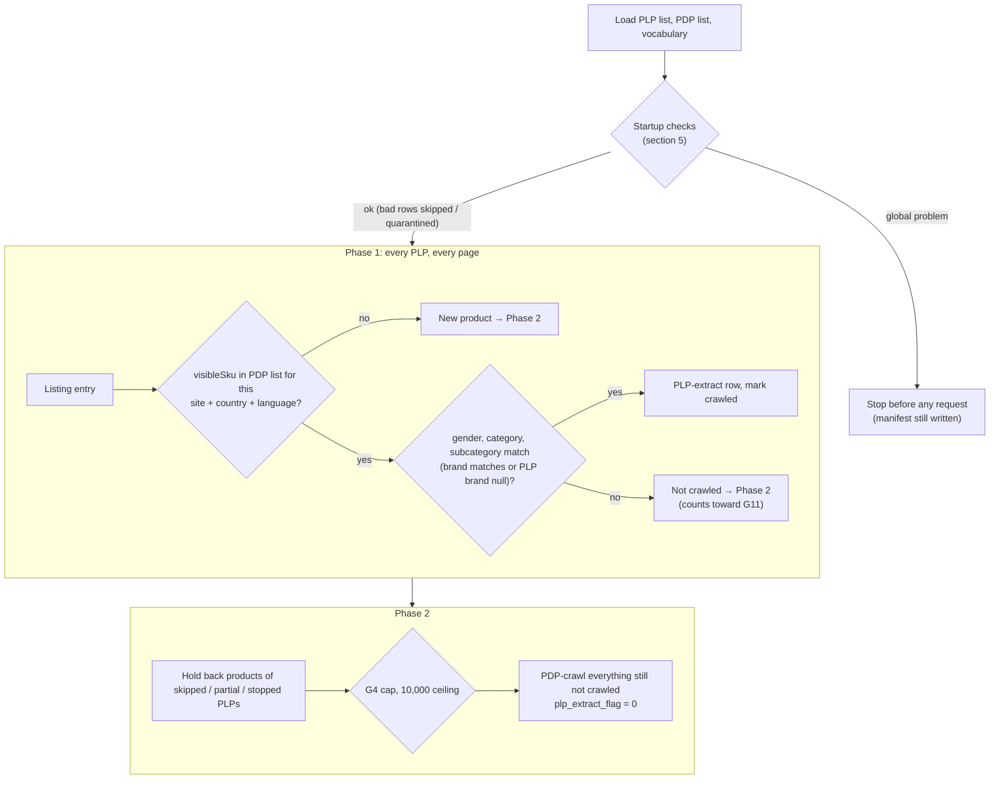

# Ounass PLP-Efficient Crawl Mode

**What this doc is:** the reference for how this crawler mode works **today**.
Keep it current: any behaviour change updates this doc in the same commit,
with a change-log line (rule in `context/AGENTS.md`). History, rejected
options and the build plan live in `tickets/ounass_plp_efficient_crawl.md`.

**Build status (2026-10-16): inputs, startup checks, preflight (Part 2) and
the crawl itself (Part 3: sweep, PLP-extract rows, Phase 2) built and
smoke-tested locally; the manifest block and quality-gate split (Part 4a)
built. Not yet safe for cloud runs: run status (Part 4b) and the daily parity
check (Part 5) are still planned.** Each section is marked
**[planned]** or **[built]**. Flip a marker when the matching ticket part
lands, and correct the section if the build differs from the plan.

---

## 1. What it is [built]

An opt-in mode of the Ounass spider (`OUNASS_PLP_EFFICIENT_CRAWL = True`, or
`run_crawler.py ounass --plp-efficient`) that
refreshes products we already know about from **listing pages (PLPs)** instead
of their **product pages (PDPs)**. A listing entry already carries the
product's ID, price and badges, so one listing request refreshes ~48 products.
Doing the same through PDPs costs one Zyte request per product.

- **Phase 1:** sweep every PLP in the run. A known product found on its PLP
  gets a **PLP-extract row** (ID, price, discount, label) and no PDP request.
- **Phase 2:** PDP-crawl only what's left: new products, known products not
  seen on any PLP, and special PDPs no PLP covers.

Cost case (bags, Saudi, 2026-09-17): ≈ $2/month in this mode vs ≈ $181/month
for daily full PDP re-crawls (`notes/2026-09-17-ounass-zyte-crawl-cost.md`).

With the flag off (the default), the spider behaves exactly as before.

---

## 2. Inputs [built: export + loader; used by the crawl from Part 3]

Three files, written fresh **at the start of every crawl**. At startup the
crawler invokes scraper-pipeline's export Lambda synchronously, waits for it,
and reads the files from the S3 paths it returns. It isn't triggered after
dbt or on a clock: dbt runs often and for unrelated reasons, while the crawler
only needs fresh inputs right before it crawls. If the export fails, the
crawl stops before any Zyte request. Local files (`--plp-list`, `--pdp-list`,
`--vocabulary`) skip the invoke, for tests.

All values are **canonical** (scraper-pipeline `canonical_seeds/`). The
crawler never canonicalizes raw Ounass values itself.

| Input | Source (in scraper-pipeline) | Contents |
|---|---|---|
| **PLP list** | active rows of the `crawl_plp_registry` seed | one row per listing page to sweep |
| **PDP list** | `gold_product_serving_latest`, scoped to active PLP rows | one row per known product × country × language; its manifest records **when gold was last built** |
| **Canonical vocabulary** | `dim_country`, `dim_map_gender`, `dim_canonical_category_subcategory`, `dim_canonical_brand` | all allowed canonical values |

**Export (scraper-pipeline, code written 2026-10-13, not deployed):** Lambda
`price-comparison-plp-efficient-export-<env>` writes
`s3://price-comparison-bucket-eu-central-1/resources/plp-efficient/<env>/ounass/<export_id>/`
`pdp_list.csv`, `plp_list.csv`, `vocabulary.json` and, last, `manifest.json`
(only a complete export has one; it carries `gold_built_at` and row counts).
`<prefix>/ounass/latest.json` points at the newest manifest. Full contract:
scraper-pipeline `docs/PLP_EFFICIENT_EXPORT.md`.

Keys in both lists follow scraper-pipeline's SQL rules: lowercase, with
`language` as `ar` / `en`. The crawler compares case-insensitively; the
rows it writes keep `product_schema.py`'s `EN` / `AR`.

### PLP list columns

```
url,site,country,language,gender,category,subcategory,brand,is_active
https://saudi.ounass.com/api/women/bags/tote-bags,ounass,sa,ar,women,bags,tote_bags,,true
```

- `is_active = false` switches a listing off without deleting the row; it's
  neither crawled nor used to scope the PDP list.

- `url` must be the `/api/...` endpoint. The human-facing page is HTML the
  spider can't parse. The hostname must match `country` + `language`
  (`ounass_constants.TLD_LANGUAGE_MAP`).
- `gender`, `category`, `subcategory` are **required**; `brand` is optional
  (null = any brand).
- Category **and** subcategory are required because canonical categories are
  broader than Ounass listings. Canonical `bags` includes Ounass
  `Accessories / Small Leather Goods`, which never appears on `women/bags`.
  Broad and designer listings are crawled with the mode off.

### PDP list columns

```
portal_itemid,primary_key,site,country,language,url,gender,category,subcategory,brand,out_of_stock,last_available_date,last_crawl_date
```

From `gold_product_serving_latest` (`category` ← `category_canonical`,
`subcategory` ← `sub_category_canonical`, `brand` ← `brand_canonical`).
`url` is that product's PDP URL for **that** country and language. Every row
has been crawled before, so it enters the run with `crawled_before = true`.

**What's in it:** only gold Ounass products that match an **active** PLP list
row on site, country, language, gender, category and subcategory (and brand,
when the row sets one), minus products sold out for 3+ days. The PLP list is
therefore the single definition of scope: add or activate a listing row and
its products join the next export; set `is_active = false` and they drop out.

The crawler does **not** filter this list: everything in it is crawled, via a
PLP or directly in Phase 2. That's why scoping happens in the export.

---

## 3. How a run works [built]



### Matching

- Key: `(site, country, language, portal_itemid)`. Site, country and language
  come from the PLP row; `portal_itemid` is the listing entry's `visibleSku`.
  Our PDP extractor stores the same value (`pdp.visibleSku`).
- Then gender, category and subcategory must equal the PLP row's, and brand
  must equal it unless the PLP's brand is null.
- **Nothing is parsed from URLs.** The number in a product URL is a
  colour-group code, not the product ID (grey Chloé tote: URL `…219035998_19`,
  ID `219036032`).
- A product already marked crawled by an earlier, overlapping PLP is skipped.
- A product **quarantined** at startup (bad PDP list row) is skipped if seen,
  not treated as new.

### After the sweep: what Phase 2 gets [built]

When every listing page has been fetched (or failed), the crawler checks
each listing's health once, then decides Phase 2:

- **Healthy listing:** its known-but-unseen products and its new products
  are PDP-crawled.
- **Unhealthy listing:** its leftovers are **held back**: neither refreshed
  nor PDP-crawled this run, and logged with the reason. A listing is
  unhealthy if, in this order:
  - it was stopped during the sweep (G7 currency);
  - a page failed or no page was parsed (G3);
  - more than 5% of the products it matched by ID disagree with it on
    gender/category/subcategory/brand (G11);
  - more than 25% of the products it should show (ignoring ones gold has
    as sold out) weren't on it (G4).
- A known product covered by several listings is crawled if **any** of them
  is healthy.
- Known products **no listing covers** (e.g. special PDPs) are always
  PDP-crawled.
- If the total exceeds the Phase 2 ceiling, **nothing** is PDP-crawled
  (`phase2_ceiling_exceeded`). Rows already written from listings stay.

**Rows already written stay.** Health is judged after the sweep, so a listing
that trips G11 or G4 (or is stopped by G7 partway) has usually already
written PLP-extract rows for the products that did match. Those rows are kept
and go to raw like any other: each one passed the ID, scope and price checks
on its own. Only the listing's leftovers are held back. The listing's outcome
and counts are in the run log now and go in the manifest from Part 4.

**Partial and stopped runs** (status rules in section 6, "Run status").
A run that reached its end but held back products or skipped Phase 2 is
**degraded**: its rows reach dbt and the manifest names every skip. A run
stopped or killed partway is **failed** (`aborted` / `killed`), even when its
rows pass quality, and its rows never reach dbt. Until Part 4b lands, an
aborted run still gets `_SUCCESS`: another reason the mode isn't used in the
cloud yet.

### Colour variants

In-stock colours each have their own listing entry and ID. **Sold-out colours
lose their own entry** and survive only as a swatch inside a sibling's
entry. The swatch has a slug and colour code but no ID, price or stock. Swatches
are **ignored**: they're not proof of identity. Those products go to Phase 2
until the 3-day sold-out cutoff drops them from the PDP list.

---

## 4. PLP-extract row [built]

Only these fields are set. Everything else (`product_name`, `image_urls`,
`text`, `out_of_stock`, `was_price`, `sizes`, `color`, …) is **null**, meaning
"not observed", not "empty". Downstream keeps the previous values (section 7).

| Field | Source | Why this source |
|---|---|---|
| `portal_itemid` | `visibleSku` | Equals the PDP extractor's value (42/42) |
| `price` | `priceByCustomerGroupId["-1"]` | Equals the PDP selling price (42/42). The listing's plain `price` key is the **pre-sale** price on sale items. |
| `price_discount` | `round_half_up((1 − priceByCustomerGroupId["-1"] / price) × 100)`; null when 0 | Equals the PDP discount (42/42). The listing's own discount fields were 5 points too high on some sale items. `discountText` is translated display text. |
| `primary_label` | highest-priority `badges[].value` | Equals the PDP badge (41/42). Promotion-campaign labels (e.g. `EXTRA25`) exist only on the PDP: accepted loss. |
| `url` | **copied from the product's PDP list row** | Never the listing URL. Downstream keeps the latest non-blank `url` as the website link and the recrawl address (section 7). |
| `site`, `country` | the PLP row | |
| `language` | from the product URL's hostname (`TLD_LANGUAGE_MAP`), `EN` / `AR` | Same derivation as PDP rows |
| `run_id`, `crawl_date` | the run | As PDP rows |
| `plp_extract_flag` | `1` | PDP rows always carry `0`, in normal mode too |
| `plp_source_url` (optional) | the listing page | Analysis only |

Evidence: parity probe runs 2026-09-30 (Saudi Arabic bags) and 2026-10-01 (UAE
sale), `scripts/probe_ounass_plp_parity.py`. If Ounass changes its listing
format, re-run the probe before trusting these mappings.

---

## 5. Guardrails [built except G9 parity (Part 5) and shadow mode (Part 7)]

Principle: fail closed, never fall back to a mass PDP recrawl, and stop only as
much as the problem affects.

| # | Check | Failure scope | Setting(s) (current value) |
|---|---|---|---|
| G1 | PLP row canonical; gender/category/subcategory set | Skip that PLP, hold back its products. Too many bad rows → stop run. | `OUNASS_PLP_EFFICIENT_MAX_BAD_PLP_ROWS_RATIO` (0.25) |
| G2 | PLP list and PDP list present, all columns | Stop run | — |
| G3 | Every page of a PLP fetched | After the sweep: that PLP's leftovers held back (rows already written stay) | — |
| G4 | Known-but-unseen products per PLP (excluding ones gold has as sold out) | After the sweep: over the cap → that PLP's leftovers held back (rows already written stay) | `OUNASS_PLP_EFFICIENT_MISSING_RATIO_CAP` (0.25) |
| G6 | PLP-extract `url` = PDP list `url`, not a listing URL | Don't write that row; product left for Phase 2 | — |
| G7 | PLP hostname ↔ country/language; entry `localeCurrency` = country currency | Startup: skip that PLP. Sweep: stop that PLP at the first wrong-currency entry; its leftovers held back (rows already written stay). | — |
| G8 | Gold age: gold's last build time from the PDP list manifest. The export itself is always fresh. | Warn at the warn age; stop run at the max age (dbt likely stuck) | `OUNASS_PLP_EFFICIENT_GOLD_WARN_AGE_DAYS` (2), `OUNASS_PLP_EFFICIENT_GOLD_MAX_AGE_DAYS` (3) |
| G9 | Daily parity spot check, per country | Confirmed mismatches ≥ max → stop run, no PLP-extract rows. Too few usable comparisons → no PLP-extract rows for that country. Failed fetches aren't mismatches. | `OUNASS_PLP_EFFICIENT_PARITY_SAMPLE` (20), `OUNASS_PLP_EFFICIENT_PARITY_MIN_COMPARISONS` (10), `OUNASS_PLP_EFFICIENT_PARITY_MAX_MISMATCHES` (2) |
| G10 | Canonical values exist in the latest vocabulary | Bad PLP row → as G1. Bad PDP row → quarantine that product. Too many bad PDP rows → stop run. | `OUNASS_PLP_EFFICIENT_MAX_BAD_PDP_ROWS_RATIO` (0.05) |
| G11 | ID matched but fields differ (drift / reclassification) | After the sweep: over the share → that PLP's leftovers held back (rows already written stay) | `OUNASS_PLP_EFFICIENT_FIELD_MISMATCH_RATIO` (0.05) |
| — | Phase 2 ceiling | Over → skip Phase 2 entirely, `phase2_ceiling_exceeded = true` (logged as an error) | `OUNASS_PLP_EFFICIENT_MAX_PHASE2_PDPS` (10000) |

"Hold back" = neither refreshed nor PDP-crawled this run, and logged.

Other settings:

| Setting | Current value | Meaning |
|---|---|---|
| `OUNASS_PLP_EFFICIENT_CRAWL` | `False` | Turns the mode on |
| `OUNASS_PLP_EFFICIENT_SHADOW` [planned, Part 7] | `False` | Shadow mode: full run, no rows written, outcomes logged to the manifest |
| `OUNASS_PLP_EFFICIENT_EXPORT_LAMBDA` | `price-comparison-plp-efficient-export-<APP_ENV>` | Name of scraper-pipeline's export Lambda, invoked at crawl start |
| `OUNASS_PLP_EFFICIENT_STALE_CRAWL_DAYS` | `7` | Stale-crawl warning: products not crawled for more than this many days |

Settings live in `ecommercecrawl/settings.py`; thresholds can be overridden
with environment variables of the same name. The startup checks read them
through `plp_efficient.Config.from_settings`. The drift test
(`tests/test_plp_efficient_docs.py`) fails if a setting in `settings.py`
isn't listed in this doc.

### Startup checks, in detail [built]

Code: `ecommercecrawl/plp_efficient.py` (`validate()`), tests:
`tests/test_plp_efficient.py`.

These run before the crawler makes any Zyte request (in a real crawl and
in preflight). There are three possible outcomes, from mild to severe:

- **warn:** the crawl runs; the warning is logged and shown by preflight.
- **skip / quarantine:** the crawl runs without that listing or product.
- **stop:** the crawl doesn't start, and no Zyte money is spent.

A single **stop** means the crawl doesn't start. Otherwise it runs without
the skipped listings and quarantined products, and with all warnings
recorded.

**G2: all three files present and complete**
- *Checks:* the PLP list, the PDP list and the vocabulary all exist, with
  every expected column.
- *Why:* without the PDP list, every product on every listing would look
  new and get a full PDP crawl, which is the expensive case this mode avoids.
- *Example:* `pdp_list.csv` lost its `subcategory` column.
- *Outcome:* **stop.**

**G1: each listing row is valid**
- *Checks:* every value in a PLP list row is canonical (in the vocabulary),
  and gender, category and subcategory are filled in.
- *Why:* listings match products by exact value. A typo matches nothing,
  and a missing subcategory makes the listing too broad (it would pull in
  products Ounass lists elsewhere).
- *Example:* subcategory `tote-bags` instead of `tote_bags`, or empty.
- *Outcome:* **skip that listing** and hold back its products. They're
  neither refreshed nor PDP-crawled, so a typo can't trigger a burst of
  PDP crawls. **Over 25% of listing rows bad → stop**: that signals a broken
  registry or vocabulary, not a one-off typo.

**G7: listing URL matches its country and language**
- *Checks:* the URL's hostname belongs to the row's country and language
  (`saudi.ounass.com` = Saudi Arabic, `en-saudi.ounass.com` = Saudi English,
  …, per `ounass_constants.TLD_LANGUAGE_MAP`).
- *Why:* PLP-extract rows carry prices but no currency, so a UAE page tagged
  as Saudi would silently write UAE prices onto Saudi products.
- *Example:* `https://www.ounass.ae/api/women/bags/tote-bags` tagged
  `country=sa`.
- *Outcome:* **skip that listing**, like G1; it counts toward G1's 25%.
  During the sweep, a second check compares each entry's currency.

**G8: gold was rebuilt recently**
- *Checks:* `gold_built_at` from the export manifest: when gold was last
  **rebuilt**.
- *Why:* if dbt is stuck, the PDP list reflects an outdated picture. If the
  scheduled flow runs dbt right before each crawl (dbt → export → crawl),
  this is a safety net for that step failing or being skipped.
- *Outcome:* within 1 day OK; **2 days → warn**; **3+ days, or missing →
  stop.**
- *Note:* this says nothing about how fresh each product's data is. A gold
  rebuild doesn't refresh product dates; see the next check.

**Stale-crawl warning** (decided 2026-10-16)
- *Checks:* each product's `last_crawl_date`, i.e. when it was last observed
  at all. It's kept per product through silver (`greatest(new, previous)`),
  so rebuilding gold without a new crawl leaves it unchanged.
- *Why:* G8 only knows when gold was rebuilt. Dev showed the gap: gold
  rebuilt 2026-10-13, but its products were last crawled 2026-08-08. Once
  PLP-efficient runs, it also surfaces products that keep falling through
  the gaps (repeatedly quarantined or held back, so never refreshed).
- *Outcome:* **warn only**, with the count and oldest date (e.g. "5 products
  not crawled for more than 7 days; oldest 2026-08-08"). It never stops a run,
  because refreshing stale products is what the crawl is for. Threshold:
  `OUNASS_PLP_EFFICIENT_STALE_CRAWL_DAYS` (7).
- *Source:* the PDP list export's `last_crawl_date` column (added
  2026-10-16, scraper-pipeline `0345c2b`; dev Lambda redeployed).

**G10: every product row uses known values**
- *Checks:* each PDP list row's country, language, gender,
  category/subcategory and brand exist in the vocabulary.
- *Why:* catches a rename caught halfway, e.g. the vocabulary already says
  `totes` while gold still says `tote_bags` until dbt rebuilds.
- *Outcome:* **quarantine that product.** It isn't refreshed or PDP-crawled
  this run, and if seen on a listing it's skipped rather than treated as
  new. **Over 5% of product rows bad → stop**: good gold has almost none.

Language is compared case-insensitively: inputs use `ar` / `en`
(scraper-pipeline convention), output rows keep `EN` / `AR`.

---

## 6. Outputs [rows, manifest block, quality gate built; run status planned (Part 4b)]

- **Rows [built]:** PLP-extract rows (`plp_extract_flag = 1`) and normal PDP
  rows (`plp_extract_flag = 0`) in the same output file, landing in
  `bronze_ounass_raw`.
- **Manifest `plp_efficient` block [built]** (`plp_efficient.manifest_block`,
  added by `PostCrawlPipeline`). Written **even when the run stops at
  startup**: the output folder exists from spider open, so the manifest
  explains the stop.
  - `startup_stopped`, `startup_error` (export failure);
  - `inputs`: file paths, export id, `gold_built_at`, row counts;
  - `startup`: gold age, listings valid / skipped (with URLs), products
    valid / quarantined / held back / uncovered / stale, problem counts per
    check and severity, the stop messages;
  - `listings`: per listing, pages requested / parsed / failed, rows
    emitted, matched, mismatched, unusable, new, and `held_back_reason`;
  - `phase2`: candidates, `phase2_ceiling_exceeded`, counts (known unseen,
    uncovered, new, held back), `scheduled`;
  - `refreshed_from_listing`, `new_products`;
  - `degradations`: one line per piece of work a guardrail chose to skip.
    Empty = nothing skipped. Feeds the run status (below).
- **Quality gate, split by row type [built]** (`quality_gate.py`):
  - product-page rows (`plp_extract_flag` not 1): the standard per-site
    blank-ratio rule, unchanged, counted over product-page rows only;
  - PLP-extract rows: every row must have `portal_itemid`, `url`, `price`,
    `site`, `country`, `language`, with `price > 0` and `url` not a listing
    URL (no `/api/`, not the `plp_source_url`). **One bad row fails the run**:
    the crawler never writes such rows, so one means a bug. Reported under
    `plp_extract_rows` in the quality report.

### Run status [planned, Part 4b; applies to all crawls]

One question decides it: **did the crawler reach its own end, and did it
skip anything on purpose?**

| `run_status` | When | Marker | Reaches dbt |
|---|---|---|---|
| `success` | Reached its own end, nothing skipped | `_SUCCESS` | yes |
| `degraded` | Reached its own end, but a guardrail skipped work (a listing skipped or held back, products quarantined or held back, Phase 2 skipped by the ceiling). The manifest's `degradations` names each one. | `_SUCCESS` | yes |
| `failed` | Rows can't be trusted or the run didn't finish. `failure_reason`: `aborted` (closed for any reason other than `finished`: Ctrl+C, ECS stop, timeout), `startup_check` (stopped before any request), `quality` (quality gate failed), `verification` (file check failed) | a failure marker per reason | **no** |
| `killed` | A "run started" record with no manifest (hard kill, out-of-memory) | none | no |

An aborted run is **failed**, never "partly saved", like an edit abandoned
before saving: its rows may be genuine, but a half-finished day reads as
misleading data. Its file is still uploaded next to the failure marker for
inspection; nothing registers it. The next day's crawl refreshes those
products.

## 7. Downstream behaviour (scraper-pipeline) [planned]

- Silver merges each new raw row onto the stored state with
  `coalesce(new, previous)` (`silver_product_fact_ounass_daily`,
  `silver_product_dim_ounass`, `silver_product_i18n_ounass`).
  - So a PLP-extract row's nulls **keep** the previous name, images,
    category and stock.
  - Any **non-blank** value overwrites, which is why `url` must be copied
    from the PDP list.
- **Known issue (fix planned, ticket Part 6):** when a sale ends, a blank
  discount can't clear the old one, so ended sales can keep showing a
  discount. This affects the PDP path too.
- **Known gap:** no silver model reads `primary_label` yet, so label refreshes
  don't reach the website.

---

## 8. How to run [planned]

| Step | Command |
|---|---|
| Check inputs before spending budget **[built]** | `make preflight-ounass-plp-efficient` (exit 0 = would start, 1 = would stop). With the 1-request Zyte probe: `make preflight-ounass-plp-efficient-probe`. Local files: `make preflight-ounass-plp-efficient PREFLIGHT_ARGS="--plp-list plp.csv --pdp-list pdp.csv --vocabulary vocabulary.json [--manifest manifest.json]"`. Prod: `APP_ENV=prod make preflight-ounass-plp-efficient`. |
| Shadow run | _to fill in (Part 4/7)_ |
| Live run, local (Part 3) | `ZYTE_API_KEY=… .venv/bin/python run_crawler.py ounass --plp-efficient` invokes the export Lambda. With local files: `… --plp-efficient --plp-list plp.csv --pdp-list pdp.csv --vocabulary vocabulary.json [--plp-manifest manifest.json]`. Not with `--urls` / `--urls-source`. Cap Phase 2 for a test with `OUNASS_PLP_EFFICIENT_MAX_PHASE2_PDPS=20`. **Local only until Part 4.** |
| Re-verify listing ↔ product-page parity | `.venv/bin/python scripts/probe_ounass_plp_parity.py --plp-url <api listing url>` (needs `ZYTE_API_KEY`; ~30 Zyte requests) **[built]** |

---

### Preflight (`make preflight-ounass-plp-efficient`) [built 2026-10-16]

**What it is:** a dry run of the crawler's startup. It does everything a
real PLP-efficient crawl does before its first Zyte request, then stops and
reports whether the crawl would start, and what it would skip or hold back.
It uses the same code as the crawl, so the two can't disagree.

**When to use it:**
- before a crawl you care about (e.g. the first run after a registry or
  dbt change);
- right after editing `crawl_plp_registry`, to see a rejected row and why
  immediately, not as a skipped listing the next day;
- after a crawl stopped or skipped something, to see the full list of
  problems (a crawl acts on them; preflight lists them all);
- later, the scheduled crawl runs the same checks at startup automatically.

**What it does:**
1. Invokes scraper-pipeline's export Lambda, exactly as a crawl would (a
   few seconds, a fraction of a cent of Athena). Or it uses local files
   passed with `--plp-list`, `--pdp-list`, `--vocabulary`.
2. Reads the three files and the manifest.
3. Runs every startup check (section 5, "Startup checks, in detail") and
   collects **all** problems.
4. Prints the problems grouped by check, with the exact rows, then a
   summary: listings valid/skipped, products per country × language,
   quarantined products, gold age, stale-crawl count, and products no
   listing covers (plus whether the 10,000 Phase 2 ceiling is already
   exceeded).
5. Exits 0 if the crawl would start, non-zero if it would stop.

It makes **no Zyte requests** and writes nothing, except with
`--probe-one-page` (`make preflight-ounass-plp-efficient-probe`), which
fetches one listing page to check Ounass isn't blocking requests (1 Zyte
request).

Code: `scripts/preflight_ounass_plp_efficient.py`. First real run, 2026-10-16
(dev): 4 listings and 5 products valid; warnings G8 (gold rebuilt 2.9 days
ago) and STALE (5 products last crawled 2026-08-08); exit 0.

## 9. Troubleshooting [planned]

| Symptom | Likely cause | Check |
|---|---|---|
| Run stopped at startup | Export Lambda failed, or G2 / G8 / G1 or G10 over threshold | Run preflight: it lists every failed check with the offending rows. For an export failure, check the Lambda's logs in scraper-pipeline. |
| Run stopped on G8 | gold hasn't been rebuilt for 3+ days | Check scraper-pipeline's dbt runs |
| A PLP was skipped | Bad PLP row (non-canonical value, missing subcategory, hostname ≠ country) | Fix the row in `crawl_plp_registry` |
| Products quarantined | Gold row with a value not in the vocabulary, often mid-rename | Wait for the dbt rebuild, or fix the seed |
| A country has no PLP-extract rows | G9 inconclusive: too few parity comparisons, usually Ounass blocking (seen on Saudi) | Manifest parity block; `--probe-one-page` |
| Run stopped on parity | G9 confirmed mismatches: listing format likely changed | Re-run the parity probe; update section 4 |
| A PLP's leftovers held back | G3 page failure, G7 currency mismatch, G11 field-mismatch spike or G4 missing spike | Manifest per-PLP outcomes; check for a canonical rename or Ounass reclassification |
| Phase 2 skipped | G4 cap or the 10,000 ceiling | Manifest `plp_efficient.phase2` and `degradations`; check the PDP list's scope |
| Many products refreshed every day via PDP instead of PLP | Unmapped products (absent from gold) or swatch-only sold-out colours | Accepted losses; see section 10 |

---

## 10. Known limitations and accepted losses

- **Unmapped products:** products gold can't map to canonical values aren't
  in the PDP list, so they look new and get a PDP crawl every run until the
  mapping is fixed.
- **Promotion-campaign labels** (e.g. `EXTRA25`) are PDP-only and missing
  from PLP-extract rows.
- **Swatch-only (sold-out) colours** get a Phase 2 PDP check until the 3-day
  sold-out cutoff removes them.
- **Saudi blocking:** paginated Saudi listing requests got Zyte "Website Ban"
  / HTTP 429 on 2026-09-30 and 2026-10-03. Expect degraded Saudi runs.
- **Exact-half discount rounding** (e.g. 32.5%) is assumed to round up;
  unverified against Ounass.

---

## Change log

| Date | Change | Commit |
|---|---|---|
| 2026-10-05 | Doc created from the agreed design (all sections planned) | — |
| 2026-10-13 | PDP list scoped to active PLP list rows; `is_active` column added to the PLP list | — |
| 2026-10-16 | **Part 2 built:** startup checks (G1, G2, G7, G8, G10, stale-crawl), settings, `make preflight-ounass-plp-efficient` (+ `-probe`). Verified against the dev export | — |
| 2026-10-16 | **Part 4a built:** manifest `plp_efficient` block (also on startup stops), quality gate split by row type. Run-status definitions agreed (success / degraded / failed with reason / killed; an aborted run is failed and never reaches dbt) | — |
| 2026-10-16 | Crawler ECS task role may invoke the export Lambda (dev + prod names), applied (`infra/terraform/iam_ecs.tf`) | — |
| 2026-10-16 | **Part 3 built:** listing sweep, PLP-extract rows, Phase 2 selection (G3, G4, G6, G7 currency, G11, ceiling), `run_crawler.py --plp-efficient`, `plp_extract_flag = 0` on every normal PDP row. G11 judged after the sweep (not mid-sweep): rows already written stay, leftovers held back. Partial runs to be recorded as "incomplete" (Part 4). Smoke run: 1 Saudi listing, 29/29 pages, 1 row refreshed, correct against gold | — |
| 2026-10-16 | PDP list contract gains `last_crawl_date` (scraper-pipeline `0345c2b`, dev Lambda redeployed) | — |
| 2026-10-16 | Added "Startup checks, in detail" and "Preflight" sections; new stale-crawl warning (`…_STALE_CRAWL_DAYS`, based on `last_crawl_date`, pending an export column) | — |
| 2026-10-13 | Export prefix moved under `resources/` (`resources/plp-efficient/<env>/`), next to the hand-maintained `resources/crawl-lists/` | — |
| 2026-10-13 | Export written in scraper-pipeline (not deployed): one manifest per export, written last; `vocabulary.json`; input keys lowercase (`language` `ar`/`en`) | — |
| 2026-10-13 | Inputs exported on demand at crawl start (crawler invokes scraper-pipeline's export Lambda); G8 now measures gold's last build time, with settings renamed `…_GOLD_WARN_AGE_DAYS` / `…_GOLD_MAX_AGE_DAYS`; added `…_EXPORT_LAMBDA` | — |
