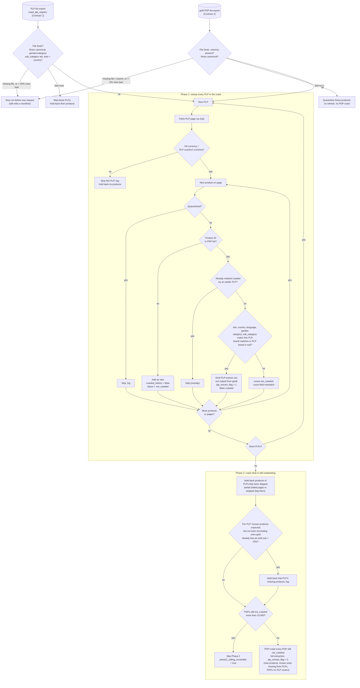

# Ticket: Ounass PLP-Efficient Crawl — Refresh Known Products From Listings, Not Product Pages

**Status: Parts 0–2 done (Part 1 dev only; prod pending); Parts 3–7 not started.**

## ▶ Where we are / next steps (handoff, updated 2026-10-20)

Read this first when resuming.

### ▶ Resume here (updated 2026-10-22, end of day): read this first

Written so a **new session** can pick up without the old conversation.

#### State in one paragraph
Parts 0–4 and 5a are built, deployed and verified in AWS (dev). The live
crawler image is `sha-d0aa1c9` (GitHub Actions auto-deploys on every
crawler-code push to `main`). The verifier Lambda was last deployed
2026-10-22 06:34 UTC. All repos are committed and pushed. Full suite: 445
tests passing. The mode is still **dev only**: Part 5b (parity) and Part 6
(downstream) must land before prod, then Part 7 (shadow, go live).

#### Reference docs (how things work now)
- `docs/ounass_plp_efficient_crawl.md`: the mode, guardrails, settings.
- `docs/crawl_run_status.md`: run statuses, failure markers (what to do).
- `docs/fail_quality_contract.md`: quality-gate rules.
- This ticket: plan, decisions (decision log at the bottom), history.

#### Where the dev data stands
- **Dry run #1** (2026-10-22, run `2026-10-22T06-52-02-550`, ECS task
  `342abe5b…`): `degraded`, 2 h 29 min, 4,035 requests (all 200, no bans),
  3,901 rows (4 listing-extract + 3,897 product pages), about $2 of Zyte
  (estimate). The Saudi **Arabic** tote listing (1,059 products) was held
  back by G4 on "1 of 1 expected not seen"; fixed since (G4/G11 minimum 20).
- **dbt** rebuilt dev 2026-10-22 11:40 UTC (21/21 models OK). Gold now
  knows **3,807** in-scope products (sa/ar 1,385, sa/en 2,422). Preflight
  after it: no problems, no warnings.
- **Images:** the image pipeline ran by hand 2026-10-22 (ECS task
  `7f0f11d0…`, run `2026-10-22T14-25-59-277`): **16,087 images, all OK**,
  15 min; `_SUCCESS` started the quality checker. ✅ In gold since
  2026-10-23 05:52 UTC: **3,884 / 3,884** Ounass products have images
  (`image_s3_blob_keys`, `is_image_available`). The first dbt after the
  downloads (14:50 UTC) ran **before** the quality checker finished
  (14:57), so gold filtered every new image out; a later dbt fixed it.
  Check: `select count(*), count_if(is_image_available) from gold_product_serving_latest where site='ounass' and country='sa'`.

#### Dry run #2 (2026-10-23) and the pagination bug it exposed
- Run `2026-10-23T11-34-10-029` (task `4f42ed88…`): `degraded`, **59 min,
  2,013 requests** (vs 2 h 29 min / 4,035 for run #1); **2,962 products
  refreshed from listing pages**; Phase 2 1,875 = 837 "known but not seen"
  + 1,038 "new"; the Saudi Arabic tote listing held back again by G4
  ("8 of 20", a real sample now).
- The 837 / 1,038 were not real churn: 816 of the "unseen" were in stock,
  and 939 "new" URLs had never been crawled. A probe showed the cause:
  the listing sort `fh_sort_by=-newness_ae` paginated with ties, so each
  sweep showed ~82% of a listing (1,517 unique of 1,860 entries), a
  different 82% each day. **Fixed 2026-10-23** by switching to the site's
  own `sortBy=onlineDateWithStock-desc` (1,854 unique of 1,860). This
  affected **every Ounass crawl since Nov 2025**, not only this mode.
  Evidence table: reference doc, section 10.
- ✅ **Dry run #3 (2026-10-26, run `2026-10-26T14-30-50-711`, task
  `080ed4a9…`), first with the fixed pagination:** `success`, 63 min, 1,919
  requests, 0 errors, no blocking, no listing held back. **4,612 of 4,703
  known products (98%) refreshed from listing pages**; "known but not seen"
  91 (~2% per listing: 24 / 35 / 32, 0 on the Arabic totes), down from 837.
  Phase 2 was still 1,780 because of a one-off catch-up: 1,295 never-crawled
  Arabic totes (held back in runs #1–#2) + ~120–145 per listing that the old
  sort never showed.
- Before it: dbt, image pipeline (run `2026-10-26T13-54-24-502`), wait for
  the quality checker, dbt: all 5,038 gold products have images; dev API
  cache refreshed; local snapshot refreshed for the web repo.
- **Next: dry run #4** = expected steady state: `make dbt-run` first (gold
  learns run #3's products), then the steps below. Expect ~140 listing pages
  + ~100–250 product pages, ~300–400 requests, ~10–15 min (vs ~4,000
  requests for a full product-page crawl).

#### Steps for the next dry run (same each time)
1. Preflight (no Zyte; invokes the export Lambda):
   `AWS_DEFAULT_REGION=eu-central-1 .venv/bin/python scripts/preflight_ounass_plp_efficient.py --env dev`
   Expect "OK: the crawl would start". If gold is 2+ days old it warns
   (G8); that no longer stops anything.
2. Launch in ECS (dev):
   `make ecs-run APP_ENV=dev ECS_RUN_COMMAND="python3 run_crawler.py ounass --env dev --plp-efficient"`
   (prints the task ARN; the last part is the task ID).
3. Watch (filters the noisy DEBUG log to milestones):
   `aws logs tail /ecs/ecommerce-scraper --region eu-central-1 --follow --log-stream-names ecs/scraper/<task-id> --filter-pattern '?"Crawled" ?"PLP-efficient" ?"Access retry" ?"RUN " ?"ACCESS " ?ERROR'`
   Key line: `PLP-efficient Phase 2: {...}` when the sweep ends.
4. **Expect:** ~138 listing pages; ~3,800 products refreshed from listings
   (`refreshed_from_listing`); Phase 2 ~1,150 product pages (the 1,059
   Arabic totes + ~90 products gold can't map + new arrivals); ~1,300
   requests, ~50 min. Run #3 should be ~140 listing pages + a few dozen.
   Note: the ~90 "known but missing from gold" products: confirm why from
   run #2's numbers (likely unmapped canonical values).
5. **Check:** the verified manifest
   `s3://price-comparison-bucket-eu-central-1/bronze/dev/crawls/manifests/ounass/<dt>/<run_id>/data.json`
   (`raw_json`: `run_status`, `degradations`, `plp_efficient.listings`,
   `plp_efficient.phase2`, `access`); Athena (workgroup `price-comparison`,
   database `price_comparison_dev`):
   `select plp_extract_flag, count(*) from bronze_ounass_raw where site='ounass' and dt='<dt>' and run_id='<run_id>' group by 1`.
6. Afterwards: `make dbt-run` (in `../scraper-pipeline`, dev) → image
   pipeline (`make ecs-run-image-pipeline APP_ENV=dev`) → **wait for the
   quality checker** (its output lands in
   `bronze/dev/images/validated/dt=<dt>/`) → `make dbt-run` again (see
   "Images" for why this order).

#### Images
- Nothing triggers the image pipeline automatically; it's manual
  (`make ecs-run-image-pipeline`). `tickets/image_pipeline_trigger.md` is a
  draft; the trigger decision is open (recommended: daily schedule).
- It reads a **dbt-built** image catalog (latest `dt`), so the order is
  **crawl → dbt → image pipeline → quality checker finishes → dbt**. Gold
  only serves images that are downloaded **and validated**
  (`image_validated`, written by the quality checker, which the image
  pipeline's `_SUCCESS` starts automatically and which takes a few
  minutes). Running dbt before it finishes silently leaves the new images
  out of gold (happened 2026-10-22); check the
  `bronze/<env>/images/validated/dt=<dt>/` object exists first.
- The existing `image_pipeline_trigger` Lambda only starts the image
  **quality checker** after the image pipeline finishes; it does not start
  the image pipeline.

#### Open decisions / follow-ups (not built)
- **Orchestration** (crawl → verify → dbt → images → dbt → notify, on a
  schedule): proposal in `tickets/cicd_pipeline.md`, "Orchestration
  proposal (2026-10-22)": EventBridge Scheduler + Step Functions running
  ECS tasks. Needs dbt to run in AWS (a dbt ECS task) first.
- **Brand-scoped category rows** (user direction): section "Future
  direction: brand-scoped category rows" below.
- **Phase 2 speed:** ~27 product pages/min (`CONCURRENT_REQUESTS_PER_DOMAIN
  = 2`, `DOWNLOAD_DELAY = 1`); test higher concurrency for Zyte requests.
- **Optional retry tuning** (less needed since Saudi goes via Zyte `TR`):
  `ZYTE_API_RETRY_POLICY = "zyte_api.aggressive_retrying"`; access rounds
  6 × 300 s.
- **Level Shoes** listing pages are fetched with plain `requests`
  (`level_crawl._get_payload`), outside the access layer.
- ✅ **CI image build failures fixed 2026-10-23** (not transient): Poetry
  installs into its own environment and downgraded `packaging` 26.3 → 25.0
  in parallel while a source build read it. `installer.parallel false` in
  the `dockerfile`; the workflow now also watches lowercase `dockerfile`
  (path filters are case-sensitive, so dockerfile edits never built).
  Live image: `sha-d0aa1c9` (includes the pagination fix).

#### Next build parts
- **Part 5b, parity** (designed in Part 5 below): required before prod.
- **Part 6** (scraper-pipeline): discount-clearing fix, labels, keep
  `plp_extract_flag` in silver, `run_status` in `silver_crawl_manifest`,
  sold-out recrawl side.
- **Part 7:** shadow mode in prod 1–2 weeks, then go live.

#### Session gotchas (how to work here)
- AWS CLI / Terraform work from the agent shell when the user's SSO session
  is valid; if they fail with `CERTIFICATE_VERIFY_FAILED` or "no
  credentials", ask the user to log in. **Never** work around TLS or
  certificates (`context/AGENTS.md` security rules).
- `git push` over SSH times out on this network; push over HTTPS with the
  gh login: `git -c credential.helper= -c credential.helper='!gh auth git-credential' push https://github.com/tareklel/ecommerce-scraper.git main`.
  scraper-pipeline: same, with its own `origin` URL.
- Routine targeted Terraform deploys (e.g.
  `terraform plan -target=aws_lambda_function.bronze_manifest_verifier -out=<file>`):
  run them, check the plan shows only the expected change, apply the saved
  plan, delete it. Stop and ask on anything unexpected or IAM-related.
- After any crawler push, confirm the "Crawler image" GitHub Actions run
  succeeded (`gh run list --limit 1`); `latest` in ECR should be the new
  `sha-…`.
- Reading `ZYTE_API_KEY` from `.env` for a local Zyte request needs the
  user's explicit approval each time.
- scraper-pipeline dbt: `make dbt-run` (dev only; `.venv` has dbt 1.12.5).
  Use **targeted** Terraform there too (a full apply would redeploy the
  API-cache Lambdas).

#### Facts learned 2026-10-20 (keep)
- The crawler reads listing pages **only** as `/api/` JSON (`routeType:
  plp`); a human listing URL returns HTML and is silently ignored. Product
  pages are HTML with an embedded `window.state`.
- Ounass no longer serves `/api/.../designers/<brand>/<category>`; brand
  pages mix all categories. Normal mode handles this with `--category`
  (filters entries by their breadcrumbs before any product page request).
- Crawls run on ECS Fargate (no time limit); Lambdas only start tasks,
  export inputs or verify, so retry cool-downs can't time anything out.

**Done:**
- Part 0 (parity proof); design, reference doc, drift test. Committed and
  pushed (`1c19886`, `84e8277`).
- Part 1 steps 1–4 in **dev** (details under Part 1):
  - registry seed loaded, gold has `portal_itemid`, dbt tests pass;
  - `plp_extract_flag` column added to dev raw;
  - export Lambda `price-comparison-plp-efficient-export-dev` deployed by a
    targeted apply, writing under `resources/plp-efficient/dev/`;
  - `gold_built_at` confirmed to track gold rebuilds.

**Next, in order:**
1. ✅ **Part 1 step 5 (2026-10-15):** `make plp-efficient-export-dev` ran
   in AWS (export `2026-10-15T13-32-21Z-dec3e27c`).
   - `plp_list` = 4 rows; vocabulary = 4 countries, 2 languages, 2 genders,
     19 bag pairs, 201 brands; `gold_built_at` = 2026-10-13T13:30:46Z.
   - `pdp_list` = 5 rows: the 4 in-stock SA `ar` shoulder bags plus 1 tote
     bag. These are exactly the in-scope dev gold products. The 1 sold-out
     shoulder bag was dropped by the 3-day cutoff, other subcategories were
     out of scope, and dev has no SA `en` Ounass rows.
   - Scanned 13 KB.
   - Note: those products were last crawled 2026-08-08 while gold was
     rebuilt 2026-10-13. G8 measures gold's **rebuild** time, not crawl
     freshness. Consider whether Part 2 should also warn on old
     `last_available_date`s.
2. ✅ (2026-10-16) scraper-pipeline committed and pushed: `7335ebd` (all of
   Part 1) and `9ca7bfb` (`requirements.txt`, previously gitignored by
   `*.txt`, now tracked and pinned to dbt-core 1.12.5 / dbt-athena 1.11.1).
3. ✅ dbt pinned (see 2).
4. ✅ **Part 2 done (2026-10-16):** `make preflight-ounass-plp-efficient`
   works against the dev export (see Part 2). Before the next dev run, gold
   needs a dbt rebuild: it's ~3 days old, so G8 will stop.
5. ✅ **Part 3 code done (2026-10-16)**, smoke-tested locally (see Part 3).
   ECS task-role IAM change applied 2026-10-16 (targeted, 1 added).
6. ✅ **Part 4a done (2026-10-16):** manifest `plp_efficient` block (also
   on startup stops) and quality gate split by row type.
7. ✅ **Part 4b code done (2026-10-16)**, rollout in this order:
   a. ✅ verifier pushed (`091227d`; accepts old and new upload locations);
   b. **deploy the verifier**: `terraform apply -target=aws_lambda_function.bronze_manifest_verifier`
      in `infra/terraform` (user runs it; no IAM change);
   c. **then push the crawler commit** (uploads to `crawl-unverified/`,
      run-started record). Pushing it before (b) would leave every run
      unpublished;
   d. scraper-pipeline `1bba8cd`: run
      `make athena-ddl DDL_FILE=sql/athena/bronze_crawl_started_raw.sql` (dev);
   e. later: `silver_crawl_manifest` to extract `run_status` /
      `failure_reason` (scraper-pipeline, **Part 6**). Alerting on
      failed / degraded / killed runs: `tickets/cicd_pipeline.md`.
   ✅ Rollout done 2026-10-20: verifier deployed, crawler pushed.
8. ✅ **Part 5a done (2026-10-20)**: access layer, all crawls.
   **Next:** the "Resume here" list above, then Part 5b (parity).
9. **Part 1 step 6 (prod):** only after prod gold and the registry exist;
   see `../scraper-pipeline/ticket/migrate-validated-dev-to-prod.md`. Apply
   prod export resources **targeted**.

**Crawler image:** solved 2026-10-15. GitHub Actions builds on every
crawler-code push to `main` and **auto-deploys** (`latest` = `sha-6f94c7f`
as of 17:31 +04). Rollback via the "Promote crawler image" workflow; the
pre-CI image is kept as `legacy-20260803`. See `tickets/cicd_pipeline.md`.

**Session gotchas:**
- AWS CLI and Terraform work from the agent shell once you're logged in to
  SSO in your own terminal.
- pip and Docker builds fail on `CERTIFICATE_VERIFY_FAILED`. Never work
  around it with certificate tricks (`context/AGENTS.md`).
- scraper-pipeline Terraform state is local (`terraform/terraform.tfstate`).
  **A full apply would also redeploy the API-cache Lambdas** with undeployed
  2026-07-30 code, so always use `-target`.
- Run scraper-pipeline's Python tests with
  `../ecommerce-scraper/.venv/bin/python -m pytest tests -q -p no:cacheprovider`
  if its own `.venv` breaks (OneDrive turns its symlinks into text files).

Cost case: `notes/2026-09-17-ounass-zyte-crawl-cost.md`. Listing (PLP) entries
already carry each product's ID, price and badges, so refreshing products we
already know through daily product-page (PDP) crawls costs ~85x more than
needed for `women/bags` alone.

## Goal

An opt-in `plp_efficient_crawl` mode for the Ounass spider:

- **Phase 1:** sweep every listing in the run. A known product (from gold)
  found on its listing is refreshed from the listing entry (ID, price,
  discount, label) with **no PDP request**, and marked crawled.
- **Phase 2:** PDP-crawl only what's left: new products, known products not
  seen on any listing, and special PDPs no listing covers. This is subject to
  caps and a ceiling.

Default is off, so current full-PDP behaviour is unchanged.

---

## Parts (do in order; each part is shippable on its own)

Complexity is high, so the work is split into parts with clear "done when"
criteria. Each part is reviewed and merged before the next one that
depends on it starts.

| Part | What | Repo | Depends on | Status |
|---|---|---|---|---|
| **0** | Prove PLP values match PDP values (parity probe) | this | — | ✅ done (2026-10-01) |
| **1** | Inputs: exports, registry, vocabulary, flag column in raw | scraper-pipeline | 0 | ✅ dev (2026-10-13–16); prod pending |
| **2** | Input loading, validation and `make preflight` | this | 0 (build with hand-made CSVs; verify against Part 1 exports) | ✅ done 2026-10-16 |
| **3** | Crawler core: Phase 1 / Phase 2, PLP-extract rows, runtime guardrails | this | 2 | ✅ done 2026-10-16 (code, local smoke, IAM applied) |
| **4** | Run observability: manifest block, quality-gate split, run status | this (+ verifier Lambda) | 3 | ✅ code 2026-10-16; 4b rollout pending (see handoff) |
| **5** | 5a access layer (all crawls) + 5b daily parity check | this | 3 | 5a ✅ 2026-10-20; 5b next |
| **6** | Downstream readiness: discount-clearing fix, label pickup, flag kept in silver, 3-day sold-out cutoff | scraper-pipeline | 1 | not started |
| **7** | Shadow mode (1–2 weeks), tune thresholds, then go live | both | 1–6 | not started |

Parts 1 and 6 (scraper-pipeline) can run in parallel with Parts 2–5 (this
repo).

**Every part's "done when" also includes updating the reference doc
`docs/ounass_plp_efficient_crawl.md`:** flip the affected sections from
**[planned]** to **[built]**, correct anything that changed during the
build, and add a change-log line. That doc describes how the mode works
today and outlives this ticket (rule in `context/AGENTS.md`).
`tests/test_plp_efficient_docs.py` fails if an `OUNASS_PLP_EFFICIENT_*`
setting isn't documented there.

---

## Future direction: brand-scoped category rows (user, 2026-10-22)

**Direction.** Don't crawl every product on a category listing. A registry
row's `brand` becomes a **filter** on its category listing: sweeping
`/api/women/bags/tote-bags` with `brand = bottega_veneta` only considers
that brand's entries; `brand` empty still means every brand. Entries of
other brands are **ignored entirely**: not new (no Phase 2 product-page
crawl), not a mismatch (no G11), not expected (no G4). Then compare what
the filtered sweep finds against gold.

**Why (dry run #1, 2026-10-22).** With only 5 known products, the first run
sent **3,897** product pages to Phase 2, every brand on 4 bag listings,
taking about 2.5 hours. Most brands may not matter for the product; paying
to crawl them all every time a gold is young (or a listing grows) is waste.

**What the listing gives us** (saved listing, Part 0 probe 2026-09-30):
each entry has `designerCategoryEnglishName` ("MCM"),
`designerCategoryUrl` (`women/designers/mcm`, a stable slug) and
`id_designer` (3050).

**Design work needed before building:**
1. **Ounass designer → canonical brand.** Rows use canonical brands
   (`bottega_veneta`); entries carry Ounass's own designer slug/id. The
   crawler doesn't canonicalize, so scraper-pipeline's export would add a
   map (designer slug or `id_designer` → `brand_canonical`), built from the
   same mapping silver already uses. Unmapped designers: ignored when a row
   names a brand, and counted (so a missing mapping is visible).
2. **Several brands on one listing.** Today G1 rejects duplicate URLs. Either
   allow the same URL on several rows (fetch the listing once, route each
   entry to the rows whose brand matches), or let a row carry a list of
   brands.
3. **Against gold.** The export already scopes the PDP list by brand, so
   "expected" (G4) and "known" match the filter. Open: a product whose gold
   brand differs from its entry's designer (rebrand, mapping change) counts
   as a G11 mismatch, or as "ignored"?
4. **New products of the chosen brands** are still product-crawled in
   Phase 2 (that's how they get their full data); products of other brands
   never are.
5. **Guard (a) changes:** brand on a **category** URL becomes allowed;
   `/designers/` brand pages stay rejected (they mix categories; the
   breadcrumb problem is separate).

**Status:** direction recorded, not designed in detail. Guard (a) (brand
must be blank) stays until this is built. Relates to Part 5b and Part 7.

# Design Reference (shared by all parts)

## Flow

Every row loaded from gold has already been crawled, so it enters with
`crawled_before = true`. Only products discovered on a listing during the
run enter with `crawled_before = false`.



Rules the diagram relies on:

1. **The crawler doesn't filter the PDP list.** Whatever is in it is crawled,
   either through a listing (Phase 1) or directly (Phase 2). Scope is decided
   when the list is built (Part 1 export), and special PDPs can be added
   deliberately.
2. **New products** found on a listing are PDP-crawled once in Phase 2, even
   if several overlapping listings show them.
3. **ID matches but fields differ** (e.g. Ounass reclassified the product):
   stays `not_crawled`, gets a full PDP crawl in Phase 2, and counts toward
   the field-mismatch counter (G11).
4. **Nested-only colour variants are ignored for matching.** Sold-out colours
   lose their own listing entry and survive only as a swatch inside an
   in-stock sibling's entry. The swatch has a slug and colour code but no ID,
   price or stock, and URL + colour code can't guarantee the same product
   (decided 2026-10-03). Those products stay `not_crawled` and get a Phase 2
   PDP check until the 3-day sold-out cutoff (Part 6) removes them from the
   export.

## Contract 1: PLP List (`crawl_plp_registry` export)

One row per listing page to sweep. **Canonical values only.**

```
url,site,country,language,gender,category,subcategory,brand,is_active
https://saudi.ounass.com/api/women/bags/tote-bags,ounass,sa,ar,women,bags,tote_bags,,true
https://www.ounass.ae/api/women/bags/shoulder-bags,ounass,ae,en,women,bags,shoulder_bags,,true
```

| Column | Required | Rule / canonical source (scraper-pipeline `canonical_seeds/`) |
|---|---|---|
| `url` | yes | The `/api/...` PLP endpoint; the human-facing page returns HTML the spider can't parse (seen 2026-09-16). Hostname must match `country` + `language` (`ounass_constants.TLD_LANGUAGE_MAP`). |
| `site` | yes | `dim_canonical_site.csv` |
| `country` | yes | `dim_country.csv` (lowercase: `ae`, `kw`, `qa`, `sa`) |
| `language` | yes | `ar` / `en`, lowercase per scraper-pipeline's `docs/SQL_RULE_MANIFEST.md`. The crawler compares case-insensitively; the rows it writes keep `product_schema.py`'s `EN` / `AR`. |
| `gender` | **yes** | `gender_canonical` in `dim_map_gender.csv` (`women`, `men`) |
| `category` | **yes** | `category_canonical` in `dim_canonical_category_subcategory.csv` |
| `subcategory` | **yes** | `subcategory_canonical` in the same file; the pair must exist together |
| `brand` | no (null = any brand) | `dim_canonical_brand.csv` |
| `is_active` | yes | `true` / `false`. `false` switches a listing off without deleting it; inactive rows are neither crawled nor used to scope the PDP list. |

- **Category and subcategory are both required.** A broad `women/bags` seed
  would pull in canonical-`bags` products that Ounass lists under
  Accessories (e.g. `wallets_cardholders`), which never appear on that
  listing and would be PDP-rechecked every run. Broad and designer pages can
  still be crawled with the mode off. Products Ounass files under a
  different department need a seed for the listing they actually appear on.
- The crawler never canonicalizes raw Ounass values ("Womens", "Shoulder
  Bags"). Both lists arrive canonical, so matching is plain equality.

## Contract 2: PDP List (gold export)

CSV, one row per product × country × language, built from
`gold_product_serving_latest`. It follows the header-driven CSV convention
already used by `run_crawler.py` (`_rows_from_csv_text`,
`_read_s3_urls_source`); all fields are flat, so no JSON.

```
portal_itemid,primary_key,site,country,language,url,gender,category,subcategory,brand,out_of_stock,last_available_date,last_crawl_date
219036032,219036032_ounass,ounass,ae,en,https://www.ounass.ae/shop-chloe-...-219035998_19.html,women,bags,tote_bags,chloe,false,2026-10-04
```

| Contract column | Gold serving column |
|---|---|
| `primary_key`, `site`, `country`, `language`, `url` | same names (`url` is per country × language) |
| `gender` | `gender` (already canonical) |
| `category` | `category_canonical` |
| `subcategory` | `sub_category_canonical` (underscore; the seed file calls it `subcategory_canonical`) |
| `brand` | `brand_canonical` |
| `out_of_stock`, `last_available_date` | same names |
| `portal_itemid` | **not exposed yet**; Part 1 adds it. Until then it's derivable by stripping `_site` from `primary_key`, which works but is fragile. |

**Matching a listing entry to a PDP list row:** by `(site, country,
language, portal_itemid)`. Site, country and language come from the PLP
row; `portal_itemid` is the entry's `visibleSku`. Then gender, category,
subcategory and brand must match the PLP row. The number in a product URL
is **not** the product ID (grey Chloé: URL `…219035998_19`, ID
`219036032`), so nothing is parsed from URLs.

## PLP-Extract Row

Minimal by design: **match on ID, refresh price, discount and label.**
Everything else is null, because gold keeps those values from the original
PDP crawl (see "How silver merges new raw rows").

| Output field | PDP source (reference) | PLP rule (verified in Part 0) |
|---|---|---|
| `portal_itemid` | `pdp.visibleSku` | `visibleSku` |
| `price` | `pdp.price` | `priceByCustomerGroupId["-1"]`. **Not** the PLP `price` key, which is the pre-sale price on sale items. |
| `price_discount` | `pdp.discountPercent` | computed: `round_half_up((1 − priceByCustomerGroupId["-1"] / price) × 100)`, null when 0 (until the discount-clearing fix in Part 6 changes both paths to emit `0`). Not `discountPercentBySaleId`. |
| `primary_label` | `pdp.badge.value` → `[label]` | highest-priority `badges[].value`. Promotion-campaign labels (e.g. `EXTRA25`) aren't on the PLP: accepted loss. |
| `url` | the crawled PDP URL | **copied unchanged from the product's row in the PDP list. Never the listing URL** (URL rule, G6). |
| `country`, `language`, `site`, run metadata | — | from the run and the PLP row |
| `plp_extract_flag` | `0` on every PDP row | `1` |
| `plp_source_url` (optional) | — | the listing page, for analysis only; never used as the product's address |
| everything else (`product_name`, `image_urls`, `text`, `out_of_stock`, `was_price`, `sizes`, `color`, …) | — | **null** (not observed) |

`plp_extract_flag` is written on **every** row (`1` listing, `0` PDP) and
lands in raw (`bronze_ounass_raw`).

## Guardrails and Failure Scopes

Principle: **fail closed, never fall back to a mass PDP recrawl, and stop
only as much as the problem affects.** One bad row shouldn't stop a whole
day's refresh; a global problem (bad inputs, broken price mapping) should.

| # | Check | When | Failure scope | Part |
|---|---|---|---|---|
| G1 | PLP row canonical, with gender/category/subcategory set | startup | **Skip that PLP** and hold back its products. **> 25% of PLP rows bad → stop run.** | 2 |
| G2 | PLP list and PDP list present, all required columns | startup | **Stop run.** Never treat "no list" as "everything is new". | 2 |
| G3 | Every page of a PLP fetched | end of PLP | **That PLP:** its products get no Phase 2 (they'd falsely look missing) | 3 |
| G4 | Known-but-unseen products ≤ 25% of the PLP's expected products, **excluding ones gold has as sold out** | Phase 2 | **That PLP:** its missing products are held back, logged | 3 |
| G5 | Part 0 parity passed for every extracted field | before enabling | Mode can't be enabled | 0 ✅ |
| G6 | PLP-extract row `url` = PDP list `url`, not a listing URL | each row | **Drop that row**, log; product goes to Phase 2 | 3 |
| G7 | PLP hostname ↔ country/language (startup); hit `localeCurrency` = country's currency (`sa` SAR, `ae` AED, `kw` KWD, `qa` QAR) (sweep) | startup + sweep | Startup: **skip that PLP** (counts toward G1's 25%). Sweep: **stop that PLP**, hold back its products. | 2, 3 |
| G8 | Gold freshness: gold's last build time from the PDP list manifest (the export itself is always fresh, since it runs at crawl start) | startup | ≤ 1 day old: ok. 2 days: warn. **≥ 3 days: stop run** (dbt is likely stuck). | 2 |
| G9 | Daily parity spot check (Part 5) | Phase 1 | **≥ 2 confirmed price/discount mismatches → stop run, no PLP-extract rows** (a mapping break is global). **< 10 usable comparisons for a country → no PLP-extract rows for that country**; other countries proceed. | 5 |
| G10 | Every canonical value in both lists exists in the latest published vocabulary | startup | Bad PLP row → as G1. **Bad PDP row → quarantine that product** (no refresh, no PDP crawl; skipped if seen on a listing). **> 5% PDP rows bad → stop run.** | 2 |
| G11 | Field-mismatch counter: ID in PDP list but fields differ from the PLP | sweep | **> 5% of a PLP's matched IDs → stop that PLP**, hold back its products | 3 |
| — | Phase 2 ceiling: ≤ 10,000 outstanding PDPs (≈ $4.37 at the 2026-09-17 rate) | Phase 2 | **Skip Phase 2**, `phase2_ceiling_exceeded = true` | 3 |

"Hold back" means those products are neither refreshed nor PDP-crawled that
run, and are logged. Without it, a skipped PLP's products would look like
"PDPs no listing covers" and all go to Phase 2.

Thresholds (25%, 5%, 10,000, 20/10 parity sample) are settings, set to
starting values and tuned during shadow mode (Part 7).

---

# Parts

## Part 0 — Parity proof ✅ (done 2026-10-01)

**Goal:** prove the listing reproduces what the PDP extractor
(`ounass_rules.get_data`) records for the same product on the same day.

- [x] `scripts/probe_ounass_plp_parity.py` (Zyte, retries 429/5xx; writes
  `rows.csv` / `summary.csv` / `raw/` under gitignored
  `output/probes/ounass_plp_parity/`)
- [x] Saudi Arabic bags run (17 products) and UAE sale run (25 products)
- [x] Chosen rules recorded in "PLP-Extract Row"; results in "Evidence"
- [ ] Open edge: exact-half discount rounding never occurred in the sample.
  Pinned by a unit test in Part 3; Part 5's daily check would flag it if
  Ounass rounds differently.

## Part 1 — Inputs (scraper-pipeline)

**Goal:** an on-demand export that writes the three files the crawler reads
to S3, documented.

**Export timing (decided 2026-10-13): export at crawl start (option B).** The
export is a scraper-pipeline Lambda that the crawl invokes synchronously at
startup (and `make preflight` invokes too). It is not triggered after dbt
runs or on a clock. dbt fires often and for unrelated reasons, while the
crawler only needs fresh files right before a crawl. So there's exactly one
export per crawl, always reflecting gold as of crawl start. The SQL stays in
scraper-pipeline; the crawler only needs permission to invoke the Lambda.
If the export fails, the crawl stops before any Zyte request.

Rejected alternatives: export after every dbt success (redundant exports,
fires on runs that didn't touch gold); on a clock (can miss a dbt run before
the crawl); only when gold's build time changed (extra logic, still tied to
dbt); a dbt post-hook on the gold model (export failure would fail dbt).

- [x] Expose `portal_itemid` as its own column in gold (serving and export).
  This also adds the field to the Product API cache, which exports
  `SELECT *` from the same table: accepted 2026-10-13.
- [x] **Revive `crawl_plp_registry`** as the Contract 1 PLP list (canonical
  values, one row per subcategory listing × country × language, with
  `is_active`). The export writes its active rows to S3.
- [x] **dbt `relationships` test on `crawl_plp_registry`:** every gender,
  category/subcategory pair and brand exists in `dim_map_gender`,
  `dim_canonical_category_subcategory` and `dim_canonical_brand`. A rename
  then fails the dbt build before anything is published.
- [x] **On-demand export Lambda** (`scripts/export_plp_efficient_inputs.py`,
  modelled on `scripts/export_api_cache.py`, which already runs an Athena
  `UNLOAD` and writes stable S3 files). Invoked synchronously; returns the S3
  paths it wrote. One invocation writes three files plus **one manifest,
  written last** (its presence marks the export complete):
  - **PDP list** from `gold_product_serving_latest` (Contract 2), e.g.
    `s3://…/resources/plp-efficient/<env>/ounass/<export_id>/pdp_list.csv`;
  - **PLP list:** active `crawl_plp_registry` rows;
  - **vocabulary:** `dim_country`, `dim_map_gender`,
    `dim_canonical_category_subcategory`, `dim_canonical_brand`.

  The PDP list manifest records **when gold was last built** (read from the
  gold table, not the export time), so G8 measures the age of the data.
- [x] PDP list contents:
  - **Only products matching an active `crawl_plp_registry` row** (decided
    2026-10-13) on site, country, language, gender, category and
    subcategory, plus brand when the row sets one. Rows with
    `is_active = false` or invalid values match nothing. Special PDPs can be
    added later through a small extra seed appended to the export.
  - Drop products sold out for 3+ days (`current_date - last_available_date
    >= 3`); this is the 3-day cutoff's export side (decided to ship with
    this ticket, 2026-10-03).
- [x] Terraform for the Lambda and its IAM role (Athena read on gold and the
  seed tables, S3 write under the export prefix). Unlike the API-cache
  export, **no EventBridge rule**.
- [x] **Document the export** next to `docs/RECRAWL_FLOW.md`: what it
  queries, how it's invoked, S3 paths and layout, columns, the manifest's
  gold-build-time stamp, and that this crawler consumes it. Link the doc
  here.
- [x] **Add `plp_extract_flag` to raw:** column in
  `sql/athena/bronze_ounass_raw.sql`, and alter the dev and prod tables
  (older files read as null).

**Written 2026-10-13 (scraper-pipeline, uncommitted at time of writing):**
`canonical_seeds/crawl_plp_registry.csv` (your 4 SA tote/shoulder rows,
language lowercased), `dbt/tests/test_crawl_plp_registry_canonical.sql`,
`dbt/tests/test_crawl_plp_registry_ounass_url.sql`, `portal_itemid` in
`gold_product_serving_latest` (+ valid-rows test), `plp_extract_flag` in
`sql/athena/bronze_ounass_raw.sql` + migration
`sql/athena/migrations/2026-10-13_bronze_ounass_raw_add_plp_extract_flag.sql`,
`scripts/export_plp_efficient_inputs.py` + 13 unit tests,
`terraform/lambda_plp_efficient_export.tf` (validates), `make
plp-efficient-export-dev`, `docs/PLP_EFFICIENT_EXPORT.md`, lineage doc
updated.

**Left to do (needs AWS, run by you):**
1. ✅ (2026-10-13) Repair scraper-pipeline's `.venv`. OneDrive had turned its
   `python` symlink into a 10-byte text file. Recreated; dbt installed.
2. ✅ (2026-10-13) dev: `make dbt-seed`, gold rebuilt
   (`--select gold_product_serving_latest`), and `make dbt-test`: all tests
   passed, including both registry tests and the stricter `valid_rows`.
3. ✅ (2026-10-13, dev) `make athena-ddl DDL_FILE=sql/athena/migrations/2026-10-13_bronze_ounass_raw_add_plp_extract_flag.sql`:
   the column exists, old partitions still read, and
   `count(plp_extract_flag) = 0` (null on existing rows, as expected).
4. ✅ (2026-10-13, dev only) Targeted `terraform apply`: created the dev
   export Lambda, its IAM role and policy (3 added, 0 changed). Prod was left
   out until step 6. Not untargeted, because a full apply would also redeploy
   the Product API cache Lambdas with undeployed 2026-07-30 code. That's
   recorded in scraper-pipeline's `ticket/migrate-validated-dev-to-prod.md`.
5. ✅ (2026-10-15) `make plp-efficient-export-dev`: all three files and
   the manifest are correct (see the handoff section at the top).
   ✅ Already confirmed (2026-10-13): Glue `UpdateTime` on
   `gold_product_serving_latest` moved from 17:23:37 to 17:30:46 (+04:00)
   across a gold rebuild that finished 13:30:48 UTC, so `gold_built_at`
   tracks rebuilds. Dev gold had 248 rows.
6. Repeat 2–4 for prod.

**Done when:** invoking the Lambda writes all three files and the manifest
to S3 and returns their paths, `gold_built_at` is confirmed to track gold
rebuilds, and the dbt tests pass in dev.

## Part 2 — Input loading, validation and preflight (this repo)

**Goal:** before any Zyte request, the crawler knows its inputs are sound,
and you can check that yourself with one command.

- [x] At startup, invoke the Part 1 export Lambda synchronously and wait for
  it. Then load the three files from the S3 paths it returns, reusing
  `run_crawler.py`'s loaders. Local paths (`--plp-list`, `--pdp-list`,
  `--vocabulary`) skip the invoke, for tests and hand-made CSVs. An export
  failure stops the run before any Zyte request.
- [x] **Stale-crawl warning** (decided 2026-10-16): warn when products'
  `last_crawl_date` is older than `OUNASS_PLP_EFFICIENT_STALE_CRAWL_DAYS`
  (7). Warn only, never stop. Prerequisite done 2026-10-16:
  `last_crawl_date` added to the export (scraper-pipeline `0345c2b`, dev
  Lambda redeployed; all 5 dev products show 2026-08-08).
- [x] Validation as plain functions (no Scrapy): G1, G2, G7 hostname, G8,
  G10, returning **every** problem plus the resulting skip / quarantine /
  stop decision.
- [x] Settings: `OUNASS_PLP_EFFICIENT_CRAWL = False` (explicit in
  `settings.py`), plus the thresholds as settings.
- [x] **`make preflight-ounass-plp-efficient`:** runs the same validation
  functions as the spider (no copy), with zero Zyte requests by default.
  - Invokes the export Lambda exactly as a crawl would (a few small Athena
    queries, no Zyte), so it checks what the crawl would actually see. Local
    `--plp-list` / `--pdp-list` / `--vocabulary` skip the invoke.
  - Reports every problem grouped by check, with offending rows/values.
  - Prints a summary: PLPs (valid / skipped), PDP rows by country ×
    language, quarantined count, gold's last build time, and how many PDPs
    no PLP covers (and whether the 10,000 ceiling is already exceeded).
  - Exits non-zero on any run-stopping failure.
  - `--probe-one-page` fetches one PLP page to check the API isn't blocked
    (1 Zyte request).
- [x] Unit tests for every validation rule and failure scope (synthetic
  fixtures, see Testing).

**Done when:** preflight passes on hand-made CSVs covering every check, and
on the real Part 1 exports once they exist.

**✅ Done 2026-10-16.**
- Code: `ecommercecrawl/plp_efficient.py` (`invoke_export`,
  `load_inputs[_from_manifest]`, `validate`, `format_report`, plus
  `plp_covers_pdp` for Part 3); settings in `ecommercecrawl/settings.py`;
  `TLD_COUNTRY_MAP` in `ounass_constants.py`;
  `scripts/preflight_ounass_plp_efficient.py`; make targets
  `preflight-ounass-plp-efficient` and `-probe`.
- `tests/test_plp_efficient.py` (44 tests, synthetic data, including the
  preflight exit codes). Full suite: 343 passed.
- Live run against the dev export (`2026-10-16T10-48-24Z-cda11827`):
  4 listings and 5 products valid, 0 skipped / quarantined / held back /
  uncovered; WARN G8 (gold 2.9 days old: it stops at 3, so dbt needs a
  rebuild before the next run) and WARN STALE (5 products last crawled
  2026-08-08); exit 0.
- Deviation from the original plan: `run_crawler.py`'s loaders weren't
  reused. The new module reads CSV and JSON from local or s3:// itself,
  with injectable clients for tests. `run_crawler.py` flags come in Part 3.

## Part 3 — Crawler core (this repo)

**Goal:** Phase 1 and Phase 2 working end to end behind the flag.

- [x] IAM (moved from Part 2, 2026-10-16; applied 2026-10-16 as
  `aws_iam_role_policy.ecs_task_plp_efficient_export`, targeted): the crawler's ECS task role gets
  `lambda:InvokeFunction` on the export Lambda and read access to
  `resources/plp-efficient/*` (`infra/terraform/iam_ecs.tf`). Nothing in
  ECS invokes the export before Part 3; preflight runs locally with the
  user's own AWS login.

- [x] PLP-extract extractor using the Part 0 rules (computed discount with
  round-half-up). Built in `ecommercecrawl/plp_efficient.py`
  (`plp_hit_*` helpers, `PlpEfficientRun._extract_row`) rather than
  `ounass_rules.py`, so all mode logic sits in one Scrapy-free module.
- [x] `plp_extract_flag` on every row (`0` on every PDP row, normal mode
  too). This repo has no `product_schema.py`; the null carve-out for
  PLP-extract rows is the quality-gate split in Part 4.
- [x] Phase 1 in `parse_plp`: the PLP row travels in request `meta` through
  pagination; quarantine check, ID lookup, overlap, field match, URL rule
  (G6), currency check (G7), field-mismatch counter (G11). **No PDP requests
  in Phase 1.**
- [x] `errback` on listing requests to record failed pages per PLP (G3).
- [x] Phase 2 via Scrapy's `spider_idle` signal: hold back skipped / partial
  / stopped PLPs' products, apply G4 (excluding sold-out) and the 10,000
  ceiling, then schedule the remaining PDPs and keep the spider alive until
  they finish.
- [x] Unit and spider tests (`tests/test_ounass_plp_efficient.py`, 23
  tests; full suite 366 passed), plus a local live smoke run.
- [x] `run_crawler.py ounass --plp-efficient [--plp-list … --pdp-list …
  --vocabulary … --plp-manifest …]`.

Built as agreed, with one clarification: G11 (and G4) can only be judged
after a listing's last page, so they don't stop a listing mid-sweep. Rows
already written for it stay; its leftovers are held back. G7 currency does
stop a listing at the first wrong entry, with the same rule for rows already
written. See the reference doc, section 3, "After the sweep".

**Smoke run 2026-10-16** (local, dev export files, one listing
`saudi.ounass.com/api/women/bags/tote-bags`, Phase 2 ceiling lowered to 20):
- 29 listing pages requested, 29 parsed, 0 failed (13 Zyte errors retried
  successfully).
- 1 known product refreshed from the listing: `portal_itemid` 219417275,
  price 8200, no discount, label `["الموسم الجديد"]`, `url` copied from
  gold (`…219417263_7762.html`), `plp_extract_flag` 1. Gold agreed: sa / ar
  / tote_bags, in stock.
- 1,033 new products + 4 uncovered known products = 1,037 Phase 2
  candidates > 20, so Phase 2 was skipped (`phase2_ceiling_exceeded`),
  as designed.
- Quality gate passed; about $0.013 of Zyte. Output stayed local.

**Done when:** a local run on one subcategory PLP with a hand-built ~20-row
PDP list puts every row where the flow says, and Zyte requests ≈ listing
pages + Phase 2 count.

## Part 4 — Run observability (this repo + verifier Lambda)

**Goal:** every run, including stopped and degraded ones, is visible and
correctly classified in S3 / Athena.

Split into **4a** (crawler side, adds information only: quality-gate split,
manifest block; ✅ 2026-10-16) and **4b** (run status for all crawls:
manifest `run_status` / `failure_reason`, verifier markers, "run started"
record, Athena columns).

**Run status, agreed 2026-10-16** (replaces "incomplete" and "pass / fail"
below; full table in the reference doc, section 6). One question decides
it: did the crawler reach its own end, and did it skip anything on purpose?
- `success`: reached its end, nothing skipped → `_SUCCESS`.
- `degraded`: reached its end, a guardrail skipped work (listing skipped or
  held back, products quarantined / held back, **Phase 2 skipped by the
  ceiling**) → `_SUCCESS`, the manifest's `degradations` names each skip.
- `failed`, with `failure_reason` `aborted` (exit reason not `finished`),
  `startup_check`, `quality` or `verification` → a failure marker, rows
  **never** reach dbt. An aborted run is failed like an unsaved edit: no
  "incomplete" category, and no manual "register anyway" target.
- `killed`: a "run started" record with no manifest.

- [x] **Quality gate split by row type** in `ecommercecrawl/quality_gate.py`
  (4a). Built: one invalid PLP-extract row fails the run (it would be a bug).
  The current gate fails a field if it's blank in ≥ 20% of the file's rows
  (`QUALITY_GATE_BLANK_THRESHOLD = 0.2`). Listing rows leave name, images,
  category etc. blank, so as-is **every PLP-efficient run would fail**, and
  the per-site exclusions file can't express a per-row-type rule.
  - `plp_extract_flag = 0` rows: today's rules, unchanged.
  - `plp_extract_flag = 1` rows: `portal_itemid`, `url`, `price`, `site`,
    `country`, `language` filled; `price > 0`; `url` not a listing URL.
  - When fewer than the gate's minimum (20) PDP rows exist, the report says
    the blank check was skipped for them.
- [x] **Manifest `plp_efficient` block** (4a; parity fields come with Part 5):
  - mode (live / shadow) and input paths with export dates;
  - counts: PLPs swept / skipped / partial / stopped; PDP list rows;
    quarantined; refreshed from listing; new; Phase 2 crawled; held back;
    sold-out excluded from the cap;
  - guardrail outcomes: per-PLP missing ratio and G4 trips, G11 trips,
    `phase2_ceiling_exceeded`, parity (sampled / compared / failed fetches
    / confirmed mismatches / status per country).
- [x] **Run status:**
  - *pass*: rows written are valid, even if degraded (a PLP skipped, Phase 2
    skipped, one country without PLP rows). → `_SUCCESS`, with the
    degradation in the manifest.
  - *fail*: whole-run stops (G2, G8 ≥ 3 days, G1/G10 over threshold, G9
    confirmed mismatches) and genuine quality failures.
- [x] **A run that stopped partway must never be recorded as a success,
  even when its rows pass the quality gate** (requirement from the product
  owner, 2026-10-16, for future debugging). This applies to **all** crawls,
  not only PLP-efficient ones.
  - *Today (verified in code, 2026-10-16):* on any clean close, including a
    single Ctrl+C or a normal ECS stop, `PostCrawlPipeline.spider_closed`
    runs the quality gate, writes the manifest with Scrapy's `exit_reason`,
    and uploads to S3. The verifier writes `_SUCCESS`, and so registers the
    partition, whenever verification and the quality gate pass. It
    **ignores `exit_reason`**. A run stopped halfway with clean rows
    therefore looks identical to a full run.
  - *Required:* any `exit_reason` other than `finished` (e.g. `shutdown`,
    `closespider_*`, `cancelled`) is classified **incomplete**, a
    failure-type status. It's written to the manifest
    (`run_status = "incomplete"`), the verifier writes a distinct marker
    (e.g. `_INCOMPLETE`, never `_SUCCESS`), and it's queryable in
    `crawl_manifest_raw`.
  - *To decide during Part 4:* whether an incomplete run's rows are still
    registered for dbt (they're genuine observations), with the run flagged
    incomplete, or held back until someone reviews them. Either way, the
    run itself must read as a failure. (Correction 2026-10-22: no crawl
    marker triggers the image pipeline; it's started by hand. The
    `image_pipeline_trigger` Lambda only chains the image quality checker
    onto the image pipeline's own `_SUCCESS`.)
  - *Hard kills leave no trace today:* a second Ctrl+C, out-of-memory, or a
    forced container kill never closes the spider, so nothing is uploaded
    and the container's file is lost. Write a small **"run started" record**
    to S3 at startup (run id, site, mode, entry points). A start with no
    matching manifest then shows as **killed** in Athena, instead of the run
    simply not existing.
  - *PLP-efficient specifics:* startup stops write no rows. Per-listing
    stops (G7 currency, G11, G4) leave rows already written in place,
    because they matched exactly. That's correct, but the manifest must name
    the stopped listings. The parity stop (G9) is the exception: listing
    rows already written must **not** reach raw (see Part 5).
- [x] **A manifest is written even when the run stops at startup**, with the
  failed checks (4a). The spider has already opened by the time startup
  checks run, so the manifest was always written; it now says why.
  Verified with a local run on a deliberately broken listing row.
- [ ] **Shadow runs don't read as failures.** They write no rows, so the
  gate is skipped and the verifier (which requires status `pass`) would
  write `_FAIL_QUALITY` daily. Either use an output location the verifier
  ignores, or teach it `mode = shadow`.
- [x] Add the new manifest fields to the `crawl_manifest_raw` table
  definition. Its DDL isn't in this repo's Terraform; it's referenced from
  `lambda/bronze_manifest_verifier` and `scripts/backfill_manifests.py`, so
  locate it during this part.
- [x] Confirm `_SUCCESS` still drives Athena partition registration
  (`context/memory.md`, 2026-02-24). If so, the quality-gate split is what
  keeps PLP-efficient data visible to dbt.

**Built (4b, 2026-10-16):** statuses as agreed above; publish-on-pass
(`crawl-unverified/` → `crawls/` by the verifier) fixes an existing leak where
a failed run's rows were read whenever another run that day passed (`_SUCCESS`
registers the whole day folder). The manifest table needed no DDL change
(`raw_json` holds the whole manifest). `_SUCCESS` confirmed as the only
partition trigger. Run-started record + `crawl_started_raw`. Shadow runs:
moved to Part 7.

**Done when:** a stopped, a degraded and a clean run each produce the right
marker and a manifest that explains them, queryable in Athena. (Unit-tested;
to confirm with real runs after the rollout.)

## Part 5 — Access layer and daily parity check (this repo)

Design agreed 2026-10-19/20; full description in the reference doc
(section 3 "Parity check", section 5 "Access retry rounds" and "Where
degradations and access problems are recorded").

### 5a — Access layer (all crawls)

**Goal:** Ounass blocking is retried patiently and reported as an access
problem, never confused with a content problem.

- [x] Classify failures after Scrapy's normal retries: **access** (Zyte
  "Website Ban", HTTP 429/403, repeated 5xx, timeouts, connection errors)
  vs **content** (page parsed badly, product gone).
- [x] Access retry rounds: set access failures aside; when the crawl is
  idle, wait `ACCESS_RETRY_COOLDOWN_SECONDS` (900) and re-send; up to
  `ACCESS_RETRY_ROUNDS` (2), capped by `ACCESS_RETRY_MAX_TOTAL_SECONDS`
  (3600). Works for normal crawls and PLP-efficient (failed listing pages,
  parity product pages, Phase 2 product pages).
- [x] Per-hostname `access` block in every manifest; hostname `blocked` at
  ≥ `ACCESS_BLOCKED_HOST_RATIO` (0.5, min 5 requests).
- [x] Structured `degradations` (`kind` content / access, `scope`,
  `message`); verifier unaffected (it only checks for any).
- [x] End-of-run `RUN DEGRADED` and `ACCESS` log lines.
- [x] Tests: classification, rounds (recover in round 1, still blocked
  after the last), cap, manifest/log output.
- [x] Found and fixed while building: a blocked listing page (HTML, not
  JSON) was dropped silently by `parse` (neither parsed nor failed), so its
  listing could look healthy. Listing pages are now routed by request
  meta, and G3 also counts pages that never came back.
- [x] Verified with a real Scrapy crawl against a local server (2026-10-20).

### 5b — Parity check (G9)

**Goal:** catch a broken listing → price mapping on the first day, without
ever writing the wrong prices.

- [ ] Sample ~20 listing-refreshed products per hostname, spread across
  listings, ~half on sale when available; product page fetched right after
  its listing page.
- [ ] Compare price + discount; label logged only.
- [ ] On a mismatch re-fetch **both** listing page and product page;
  agreement now = timing, cleared, and the listing row takes the re-fetched
  value.
- [ ] Blocked or sold-out comparisons excluded (access, not content).
- [ ] Verdict per hostname: ≥ 10 usable → fail at ≥ 20% confirmed (min 2);
  fewer because blocked → borrow the verdict of checked hostnames; none
  checkable → not checked.
- [ ] Hold listing rows per hostname until its verdict; pass → write; fail
  or not checked → drop, products held back, run degraded (`kind` content
  or access). **No whole-run stop.**
- [ ] Manifest `plp_efficient.parity` per hostname (sampled, compared,
  excluded, confirmed, cleared on re-check, label mismatches, verdict).
- [ ] Settings `…_PARITY_SAMPLE` (20), `…_PARITY_MIN_COMPARISONS` (10),
  `…_PARITY_MAX_MISMATCH_RATIO` (0.2).

**Done when:** tests prove each outcome (pass, one mismatch = warning,
hostname fail, timing blip cleared by re-check, blocked hostname borrowing
a verdict, nothing checkable → rows dropped as access) and a live run
reports parity and access per hostname.

## Part 6 — Downstream readiness (scraper-pipeline)

**Goal:** what the crawler writes is used correctly downstream. The silver
models already treat blanks safely (see "How silver merges new raw rows").

- [ ] **Fix the discount-clearing bug** (existing, not caused by this
  ticket): an ended sale must clear `price_discount`. Likely fix: emit `0`
  for "no discount" on both paths, which changes `ounass_rules.get_discount`
  (PDP) and the PLP rule here. Agree the fix across both repos.
- [ ] Pick up `primary_label` in silver/gold, if label changes are meant to
  reach the website (no silver model reads it today).
- [ ] Keep `plp_extract_flag` through silver for analysis (listing-refresh vs
  PDP-refresh share).
- [ ] Image pipeline ignores rows with `image_urls = null` +
  `plp_extract_flag = 1` instead of treating them as failed galleries.
- [ ] **Run status in silver** (added 2026-10-19): `silver_crawl_manifest`
  extracts `run_status`, `failure_reason`, `degradations` and the
  `verification.data_source` / `published_key` fields the verifier now
  writes into `raw_json` (Part 4b), so degraded and failed runs are
  queryable without hand-written `json_extract`. Optionally a model joining
  `crawl_started_raw` to the manifests to list killed runs.
- [ ] **3-day sold-out cutoff, recrawl side:** products sold out for 3+ days
  drop out of `gold_pdp_recrawl_ounass_daily`'s `oos_recheck`, so they stop
  being PDP-checked daily. The export side is in Part 1. Decide whether
  they're ever rechecked (e.g. weekly).

**Done when:** a dev run with PLP-extract rows updates price/discount/label
in gold without changing names, images, URLs or stock, and an ended sale
clears its discount.

## Part 7 — Shadow mode, then go live

**Goal:** set thresholds from real data before anything is written.

- [ ] **Shadow mode, 1–2 weeks:** run daily with writes disabled. Do the full
  sweep and parity check, and log what would have happened (rows refreshed,
  Phase 2 count, every guardrail trip). The normal crawl keeps running.
- [ ] Watch in particular: Saudi blocking (Zyte "Website Ban" / HTTP 429 seen
  2026-09-30 and 2026-10-03), the normal missing-product rate (G4), G11
  trips, and how many products are quarantined.
- [ ] Tune the threshold settings from the shadow manifests.
- [ ] Go live in dev, then prod.
- [ ] Decide what happens to `gold_pdp_recrawl_ounass_daily` for Ounass
  (open question 2).
- [ ] Alert when the same PLP fails or is held back N days running, or when
  products' last crawl date gets older than N days.
- [ ] Document the pattern in `context/crawling_methodology.md`.

**Done when:** a week of live runs stays within thresholds with no
unexplained failures.

---

## Testing (cross-cutting)

**Unit tests are required and stay as regression coverage.** Ounass can
change its listing format and the contracts can change shape; these tests
catch it. Offline, no Zyte or AWS.

- **Validation (Part 2):** each failure scope (skip PLP, quarantine, stop
  run) and each threshold boundary.
- **Matching (Part 3):** null PLP brand = any; any other field mismatch fails
  and increments G11; a product marked crawled by an earlier PLP isn't
  emitted twice; quarantined products are skipped, not treated as new.
- **PLP-extract row (Part 3):** only ID, price, discount, label, url and the
  flag are set; discount rounding incl. an exact half; the URL rule (equals
  the PDP list's `url` exactly, never a listing URL).
- **Phase 2 selection (Part 3):** held-back products excluded; G4 excludes
  sold-out products; special PDPs and new products don't count toward G4;
  ceiling.
- **Spider (Part 3):** a matched hit makes no PDP request; the `spider_idle`
  handler schedules exactly the expected Phase 2 PDPs; with the flag off,
  behaviour is unchanged (existing Ounass tests pass).
- **Quality gate and manifest (Part 4):** the row-type split; pass /
  degraded / fail classification; manifest written on a startup stop.
- **Parity (Parts 0, 5):** saved PLP-hit / PDP-state pairs give the same
  values from both extractors; spot-check outcomes.

**Fixtures must be synthetic.** `.gitignore` excludes `*.json`, `*.csv` and
`*.html`, and `context/AGENTS.md` forbids committing downloaded product
data. Tests use small hand-built dicts with Ounass's key structure and
made-up values. Real captures stay in ignored local paths.

## Files to Change (this repo)

| File | Change | Part |
|---|---|---|
| `scripts/probe_ounass_plp_parity.py` | parity probe (exists) | 0 |
| `docs/ounass_plp_efficient_crawl.md` | reference doc (exists, all sections **[planned]**); updated by every part | all |
| `tests/test_plp_efficient_docs.py` | settings ↔ doc drift check (exists) | all |
| `ecommercecrawl/plp_efficient.py` (new) | loaders, validation, matching, Phase 2 selection as plain functions | 2, 3 |
| `scripts/preflight_ounass_plp_efficient.py` + `Makefile` | preflight target | 2 |
| `ecommercecrawl/settings.py` | flag and threshold settings | 2 |
| `run_crawler.py` / `Makefile` | invoke the export at startup; local overrides `--plp-list`, `--pdp-list`, `--vocabulary` | 2 |
| `infra/terraform/iam_ecs.tf` | crawler role may invoke the export Lambda and read its S3 prefix | 2 |
| `ecommercecrawl/rules/ounass_rules.py` | PLP-extract extractor | 3 |
| `ecommercecrawl/spiders/ounass_crawl.py` | Phase 1 / Phase 2 wiring, errback, `spider_idle` | 3 |
| `ecommercecrawl/constants/product_schema.py` | `plp_extract_flag`, null carve-out | 3 |
| `ecommercecrawl/quality_gate.py` | row-type split | 4 |
| `ecommercecrawl/pipelines.py` | manifest block, manifest on startup stop | 4 |
| `lambda/bronze_manifest_verifier/handler.py` | degraded vs fail, shadow mode | 4 |
| `context/crawling_methodology.md` | document the pattern | 7 |

---

# Evidence

## Part 0 results (2026-09-30 – 2026-10-01)

| Run | Listing | Compared | On sale |
|---|---|---|---|
| 2026-09-30 | `saudi.ounass.com/api/women/bags` (AR, SA) | 17 | 3 |
| 2026-10-01 | `www.ounass.ae/api/women/sale` (EN, AE) | 25 | 25 |

| Field | Rule | Matched PDP |
|---|---|---|
| `portal_itemid` | `visibleSku` | 42/42 |
| `price` | `priceByCustomerGroupId["-1"]` | 42/42, incl. 5 products with differently priced sizes. PLP `price` key: 0/25 on the sale run (it's the pre-sale price). |
| `price_discount` | computed from the two prices | 42/42. `discountPercentBySaleId` matched only 19/25 on the sale run, 5 points high in every miss. `discountText` matched but is translated text, so it's only a test cross-check. |
| `primary_label` | highest-priority badge | 41/42. The miss was a promotion-campaign badge only on the PDP (`EXTRA25`). No product with several badges appeared in 6 listing pages. |

## Colour variants (2026-10-01, all 27 pages of `www.ounass.ae/api/women/bags/tote-bags`)

- In-stock colours have their own listing entry and ID, e.g. Chloé
  `219035998`: grey `_19` on page 10 (ID `219036032`), brown `_15` on page 14
  (ID `219036004`). Each also appears as a swatch on the other.
- **531 of ~1,555 colour variants appeared only as a swatch**, with no ID,
  price or stock. A PDP check of 12 of them found **11 sold out**. The one in
  stock may be a scan artefact (pages fetched in two batches on a
  newness-sorted listing).
- Saudi returned Zyte "Website Ban" (520) and direct HTTP 429 on paginated
  API requests, so this check ran on UAE.

## Gold findings (scraper-pipeline code inspection, 2026-09-23)

Read from dbt model code only; gold data wasn't queried (Athena access needs
explicit approval under `context/AGENTS.md`).

- **Sold-out products stay in gold.** `gold_product_serving_latest` has no
  `out_of_stock` filter; `gold_pdp_recrawl_ounass_daily` re-queues them as
  `oos_recheck` indefinitely.
- **Gold doesn't expose `portal_itemid`**, only `primary_key =
  portal_itemid || '_' || site`.
- **Use gold serving, not the PDP registry.** `silver_pdp_registry_ounass`
  keeps one URL per product, not per country × language.
- **Gold drops products without a canonical mapping.** An unmapped product
  therefore looks new on every run and gets a daily PDP crawl: accepted for
  now (Leak 1).
- **Canonical `bags` includes Ounass Accessories items** (`Bag Accessories`,
  `Small Leather Goods`), which is why category + subcategory are required
  (Leak 2).
- Prior art: `crawl_plp_registry` existed in scraper-pipeline (its
  `memory.md`, 2026-05-08) and now survives only in `dbt/target/`.

## How silver merges new raw rows (code inspection, 2026-10-04)

`silver_product_fact_ounass_daily`, `silver_product_dim_ounass` and
`silver_product_i18n_ounass` merge each new raw row onto the stored state with
`coalesce(new, previous)`.

- **Blanks are safe:** a PLP-extract row's null name, images, category, text
  or stock keeps the previous values. The row updates price/discount and
  counts as a crawl (`last_crawl_date`).
- **Non-blank values always overwrite.** Hence the **URL rule:**
  `silver_product_i18n_ounass` (→ the website's product link in gold
  serving) and `silver_pdp_registry_ounass` (→ the recrawl address) keep the
  latest non-blank `url`. A listing URL on a PLP-extract row would, after
  one dbt run, point every refreshed product at a JSON listing page and
  break its future PDP crawls. So the row's `url` is copied from the PDP
  list (G6).
- **Discount-clearing bug (existing):** the PDP path records a blank
  discount when a sale ends (14 of 17 full-price products in the Saudi
  probe), so `coalesce` keeps the old discount and gold derives a wrong
  strikethrough price. Fixed in Part 6.
- **`primary_label` isn't read by any silver model today.**

---

## Decision Log

| Date | Decision |
|---|---|
| 2026-09-23 | Known products come from gold, canonical values only on both sides; a non-canonical PLP value is an error. |
| 2026-09-23 | Match key `portal_itemid` (`visibleSku`), unique per product; null in an optional scope field = wildcard. |
| 2026-09-23 | PLP-extract rows carry only ID, price, discount, label (+ url, flag); everything else null. |
| 2026-09-23 | PLP extraction must reproduce PDP values; proving it is Part 0. |
| 2026-09-23 | Unmapped products (Leak 1): accepted for now. |
| 2026-09-23 | Gender, category and subcategory required on every PLP row; brand optional (Leak 2). |
| 2026-09-30 | No crawler-side filtering of the PDP list; scope is set when the list is built. Special PDPs allowed. |
| 2026-09-30 | Phase 2 ceiling 10,000 PDPs per run. |
| 2026-10-01 | Discount computed from the two PLP prices; `discountText` and `discountPercentBySaleId` not used. |
| 2026-10-01 | Promotion-campaign labels: accepted loss. |
| 2026-10-03 | Nested-only colour variants ignored for matching (URL + colour code isn't proof of identity). |
| 2026-10-03 | Crawler fetches the canonical vocabulary from S3; no vendored copy. |
| 2026-10-03 | PLP list lives in scraper-pipeline as `crawl_plp_registry`. |
| 2026-10-03 | Missing-product cap 25% (setting, tune later). |
| 2026-10-03 | 3-day sold-out cutoff ships with this ticket. |
| 2026-10-03 | Daily export job, documented in scraper-pipeline for future lookup. |
| 2026-10-03 | `plp_extract_flag` on every row, added to raw; downstream redesigned from there. |
| 2026-10-04 | URL rule: PLP-extract `url` copied from gold, never the listing URL. |
| 2026-10-04 | Parity spot check: 20 per country, fetched right after the listing, re-check once, error at ≥ 2 confirmed mismatches, failed fetches excluded, < 10 usable → no PLP rows for that country. |
| 2026-10-04 | Canonical drift: dbt test at source + startup content check + runtime counter. Rejected: one coupled export job; seed-file hashes. |
| 2026-10-04 | Products gold has as sold out don't count toward the 25% cap. |
| 2026-10-04 | Preflight `make` target with the same validation code as the spider. |
| 2026-10-05 | Failure scopes narrowed: skip a bad PLP, quarantine bad gold rows, per-country parity inconclusive; whole-run stops reserved for global problems. |
| 2026-10-05 | Quality gate split by row type; manifest `plp_efficient` block; degraded runs still `_SUCCESS`. |
| 2026-10-05 | Shadow mode before go-live; work split into Parts 0–7. |
| 2026-10-13 | PDP list export contains only gold products matching an active `crawl_plp_registry` row (plus the 3-day sold-out cutoff). The registry is the single definition of scope. |
| 2026-10-13 | `portal_itemid` in gold serving is fine even though it also lands in the Product API cache. |
| 2026-10-13 | Export at crawl start (option B): the crawl invokes scraper-pipeline's export Lambda synchronously; no post-dbt or clock trigger. One Lambda writes all three files. G8 now measures gold's last build time. |
| 2026-10-16 | A run that stops partway (any `exit_reason` other than `finished`) must be recorded as a failure-type status (`incomplete`), never as a success, even if its rows pass quality; this applies to all crawls (Part 4). Hard kills get a "run started" record so they show as killed. A G9 parity stop must keep already-written listing rows out of raw (Part 5). |
| 2026-10-16 | G11 (field-mismatch drift) is only known after a listing's last page: rows already written for it stay (they matched exactly); its leftovers are held back from Phase 2 and the listing is named in the manifest. |
| 2026-10-16 | Every Ounass row gets `plp_extract_flag` (0 for product-page rows), including normal-mode crawls. |
| 2026-10-16 | Run status: success / degraded / failed (`aborted`, `startup_check`, `quality`, `verification`) / killed. Boundary = did the crawler reach its own end, and did it skip work on purpose. Phase 2 skipped by the ceiling is degraded. An aborted run is **failed**, rows never reach dbt (no "incomplete" status, no manual register target). Replaces the earlier "incomplete" entry. |
| 2026-10-16 | Crawler ECS role permission to invoke the export moves from Part 2 to Part 3 (nothing in ECS invokes it before then). |
| 2026-10-16 | Stale-crawl warning added (warn only), based on per-product `last_crawl_date`, which survives gold rebuilds; requires adding that column to the export. G8 stays as a safety net for a skipped or failed dbt step. |
| 2026-10-16 | Preflight usage and the startup checks documented in plain terms in `docs/ounass_plp_efficient_crawl.md`. |
| 2026-10-13 | Registry CSV template agreed: `url,site,country,language,gender,category,subcategory,brand,is_active`; a blank subcategory is rejected (G1), and broad listings run with the mode off. |
| 2026-10-19 | **Access errors ≠ content errors.** Ounass blocking is hostname-wide (Zyte "Website Ban", 429/403, repeated 5xx/timeouts) and must never count as a parity mismatch, a missing product, a field mismatch or any content failure. The crawler tracks access failures per hostname and reports them separately. Parity (G9) judges content only: blocked comparisons are excluded, and "inconclusive because blocked" is dropped as a parity case. Built in Part 5. |
| 2026-10-19 | Parity (G9) redesign under discussion: a fixed "2 confirmed mismatches stops the run" is too blunt; re-check must re-fetch both the listing and the product page (a product-page-only re-check can't clear a genuine price change). |
| 2026-10-20 | **Part 5 design agreed.** 5a, all crawls: access retry rounds after a cool-down (2 × 900 s, capped at 3600 s), per-hostname `access` block, structured `degradations` (`kind` content / access), `RUN DEGRADED` / `ACCESS` log lines. 5b parity: per hostname, ≥ 20% confirmed mismatches (min 2) of ≥ 10 usable comparisons fails that hostname; re-check re-fetches listing and product page; blocked hostnames borrow the checked hostnames' verdict; nothing checkable → that day's listing rows dropped and products held back (access); rows held per hostname until the verdict; no whole-run stop. Replaces the 2026-10-04 parity entry. Crawls run on ECS Fargate (no time limit), so cool-downs are safe. |
| 2026-10-20 | Saudi Zyte bans are intermittent (same `httpResponseBody` request alternates between success and 520, playground included). Response: Zyte aggressive retry policy + more, shorter access retry rounds (6 × 300 s, cap 3600 s). A run that got nothing because of blocking must fail as `access`, not `quality`. Not built yet (see "Resume here"). |
| 2026-10-20 | Brand field: only category pages with no brand match what a registry row claims (Ounass has no brand+category API listing; brand pages mix categories). Proposed guard (a): reject rows with a brand or a `/designers/` URL at startup; brand-page support (b) via breadcrumb filtering is a possible extension. Awaiting the user's final yes on (a). |
| 2026-10-21 | **Registry guard (a) agreed and built:** G1 rejects rows with a brand or a `/designers/` URL; category listings with no brand only. Brand pages (b): possible extension, not planned. Replaces the 2026-10-20 "awaiting yes" entry. scraper-pipeline's export doc updated to match. |
| 2026-10-22 | Failures explain themselves: markers, verified manifests (`failure_explanation`) and `RUN FAILED` log lines carry `meaning`, `what_to_do` and a doc link, from one table per side (verifier `FAILURE_REASONS`, crawler `run_status.py`) kept identical by a test. Reference: `docs/crawl_run_status.md`. Verifier deployed 2026-10-22 06:34 UTC (targeted apply). |
| 2026-10-22 | **G8 warn-only.** Stale gold only makes recently found products look new (more Phase 2 cost, capped by the ceiling), never wrong data; stopping the crawl left everything unrefreshed while dbt was down. No automatic dbt run from the crawler (dbt has no cloud runner yet, and it would couple crawls to dbt); a scheduled dbt job in AWS goes in `tickets/cicd_pipeline.md`. Dry run may start from dev gold's 5 known products: run #1 seeds gold via Phase 2, dbt, then run #2 shows the saving. |
| 2026-10-22 | **Dry run #1 findings.** (1) G4/G11 need a minimum sample (20 products): "1 of 1 expected not seen" held back the Saudi Arabic tote listing and its 1,059 new products. Built. (2) Phase 2 runs at ~27 product pages/min (`CONCURRENT_REQUESTS_PER_DOMAIN = 2`, `DOWNLOAD_DELAY = 1`), so ~4,000 pages take ~2.5 h. Raising concurrency for Zyte requests (Zyte throttles itself) to test separately; matters less once runs are mostly listing refreshes. |
| 2026-10-22 | **Direction: brand-scoped category rows.** A registry row's `brand` will filter its category listing to that brand's entries (empty = all brands); other brands are ignored, not product-crawled. Needs an Ounass designer → canonical brand map from scraper-pipeline and a decision on several brands per listing. Not built; guard (a) stays meanwhile. See "Future direction" section. |
| 2026-10-23 | **Ounass listing sort changed to `sortBy=onlineDateWithStock-desc`.** Dry run #2's 837 "known but not seen" + 1,038 "new" were a pagination artefact: `fh_sort_by=-newness_ae` (also `_sa`) sorts with ties, so each sweep showed ~82% of a listing, a different 82% daily. The site's own Newest sort shows 99.7%. Affects all Ounass crawls since Nov 2025. |

## Open Questions

- [x] **1. Export scoping.** Decided 2026-10-13: only gold products matching
  an active `crawl_plp_registry` row. Without this, a whole-gold export
  would send every out-of-scope product to Phase 2.
- [ ] **2. `gold_pdp_recrawl_ounass_daily` for Ounass.** Running it alongside
  this mode double-crawls. Proposed: stop using it for Ounass once Part 7
  goes live.
- [ ] **3. Shadow-mode output (Part 4).** A separate S3 location the verifier
  ignores, or a `mode = shadow` the verifier understands?
- [ ] **4. Stale-export thresholds (G8).** ≤ 1 day ok, 2 days warn, ≥ 3 stop:
  confirm.
