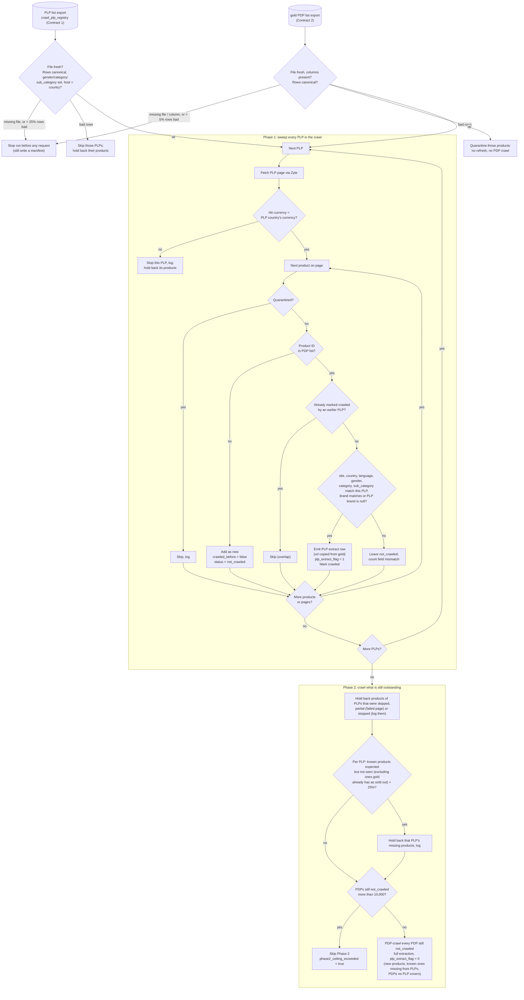

# Ticket: Ounass PLP-Efficient Crawl — Refresh Known Products From Listings, Not Product Pages

**Status: design agreed 2026-10-05; Part 0 done, Parts 1–7 not started.**

Cost case: `notes/2026-09-17-ounass-zyte-crawl-cost.md`. Listing (PLP) entries
already carry each product's ID, price and badges, so refreshing products we
already know through daily product-page (PDP) crawls costs ~85x more than
needed for `women/bags` alone.

## Goal

An opt-in `plp_efficient_crawl` mode for the Ounass spider:

- **Phase 1:** sweep every listing in the run. A known product (from gold)
  found on its listing is refreshed from the listing entry (ID, price,
  discount, label) with **no PDP request**, and marked crawled.
- **Phase 2:** PDP-crawl only what's left: new products, known products not
  seen on any listing, and special PDPs no listing covers. This is subject to
  caps and a ceiling.

Default is off, so current full-PDP behaviour is unchanged.

---

## Parts (do in order; each part is shippable on its own)

Complexity is high, so the work is split into parts with clear "done when"
criteria. Each part is reviewed and merged before the next one that
depends on it starts.

| Part | What | Repo | Depends on | Status |
|---|---|---|---|---|
| **0** | Prove PLP values match PDP values (parity probe) | this | — | ✅ done (2026-10-01) |
| **1** | Inputs: exports, registry, vocabulary, flag column in raw | scraper-pipeline | 0 | not started |
| **2** | Input loading, validation and `make preflight` | this | 0 (build with hand-made CSVs; verify against Part 1 exports) | not started |
| **3** | Crawler core: Phase 1 / Phase 2, PLP-extract rows, runtime guardrails | this | 2 | not started |
| **4** | Run observability: manifest block, quality-gate split, run status | this (+ verifier Lambda) | 3 | not started |
| **5** | Daily parity spot check | this | 3 | not started |
| **6** | Downstream readiness: discount-clearing fix, label pickup, flag kept in silver, 3-day sold-out cutoff | scraper-pipeline | 1 | not started |
| **7** | Shadow mode (1–2 weeks), tune thresholds, then go live | both | 1–6 | not started |

Parts 1 and 6 (scraper-pipeline) can run in parallel with Parts 2–5 (this
repo).

**Every part's "done when" also includes updating the reference doc
`docs/ounass_plp_efficient_crawl.md`:** flip the affected sections from
**[planned]** to **[built]**, correct anything that changed during the
build, and add a change-log line. That doc describes how the mode works
today and outlives this ticket (rule in `context/AGENTS.md`).
`tests/test_plp_efficient_docs.py` fails if an `OUNASS_PLP_EFFICIENT_*`
setting isn't documented there.

---

# Design Reference (shared by all parts)

## Flow

Every row loaded from gold has already been crawled, so it enters with
`crawled_before = true`. Only products discovered on a listing during the
run enter with `crawled_before = false`.



Rules the diagram relies on:

1. **The crawler doesn't filter the PDP list.** Whatever is in it is crawled,
   either through a listing (Phase 1) or directly (Phase 2). Scope is decided
   when the list is built (Part 1 export), and special PDPs can be added
   deliberately.
2. **New products** found on a listing are PDP-crawled once in Phase 2, even
   if several overlapping listings show them.
3. **ID matches but fields differ** (e.g. Ounass reclassified the product):
   stays `not_crawled`, gets a full PDP crawl in Phase 2, and counts toward
   the field-mismatch counter (G11).
4. **Nested-only colour variants are ignored for matching.** Sold-out colours
   lose their own listing entry and survive only as a swatch inside an
   in-stock sibling's entry. The swatch has a slug and colour code but no ID,
   price or stock, and URL + colour code can't guarantee the same product
   (decided 2026-10-03). Those products stay `not_crawled` and get a Phase 2
   PDP check until the 3-day sold-out cutoff (Part 6) removes them from the
   export.

## Contract 1: PLP List (`crawl_plp_registry` export)

One row per listing page to sweep. **Canonical values only.**

```
url,site,country,language,gender,category,subcategory,brand
https://saudi.ounass.com/api/women/bags/tote-bags,ounass,sa,AR,women,bags,tote_bags,
https://www.ounass.ae/api/women/bags/shoulder-bags,ounass,ae,EN,women,bags,shoulder_bags,
```

| Column | Required | Rule / canonical source (scraper-pipeline `canonical_seeds/`) |
|---|---|---|
| `url` | yes | The `/api/...` PLP endpoint; the human-facing page returns HTML the spider can't parse (seen 2026-09-16). Hostname must match `country` + `language` (`ounass_constants.TLD_LANGUAGE_MAP`). |
| `site` | yes | `dim_canonical_site.csv` |
| `country` | yes | `dim_country.csv` (lowercase: `ae`, `kw`, `qa`, `sa`) |
| `language` | yes | `EN` / `AR`, per `product_schema.py` |
| `gender` | **yes** | `gender_canonical` in `dim_map_gender.csv` (`women`, `men`) |
| `category` | **yes** | `category_canonical` in `dim_canonical_category_subcategory.csv` |
| `subcategory` | **yes** | `subcategory_canonical` in the same file; the pair must exist together |
| `brand` | no (null = any brand) | `dim_canonical_brand.csv` |

- **Category and subcategory are both required.** A broad `women/bags` seed
  would pull in canonical-`bags` products that Ounass lists under
  Accessories (e.g. `wallets_cardholders`), which never appear on that
  listing and would be PDP-rechecked every run. Broad and designer pages can
  still be crawled with the mode off. Products Ounass files under a
  different department need a seed for the listing they actually appear on.
- The crawler never canonicalizes raw Ounass values ("Womens", "Shoulder
  Bags"). Both lists arrive canonical, so matching is plain equality.

## Contract 2: PDP List (gold export)

CSV, one row per product × country × language, built from
`gold_product_serving_latest`. It follows the header-driven CSV convention
already used by `run_crawler.py` (`_rows_from_csv_text`,
`_read_s3_urls_source`); all fields are flat, so no JSON.

```
portal_itemid,primary_key,site,country,language,url,gender,category,subcategory,brand,out_of_stock,last_available_date
219036032,219036032_ounass,ounass,ae,EN,https://www.ounass.ae/shop-chloe-...-219035998_19.html,women,bags,tote_bags,chloe,false,2026-10-04
```

| Contract column | Gold serving column |
|---|---|
| `primary_key`, `site`, `country`, `language`, `url` | same names (`url` is per country × language) |
| `gender` | `gender` (already canonical) |
| `category` | `category_canonical` |
| `subcategory` | `sub_category_canonical` (underscore; the seed file calls it `subcategory_canonical`) |
| `brand` | `brand_canonical` |
| `out_of_stock`, `last_available_date` | same names |
| `portal_itemid` | **not exposed yet**; Part 1 adds it. Until then it's derivable by stripping `_site` from `primary_key`, which works but is fragile. |

**Matching a listing entry to a PDP list row:** by `(site, country,
language, portal_itemid)`. Site, country and language come from the PLP
row; `portal_itemid` is the entry's `visibleSku`. Then gender, category,
subcategory and brand must match the PLP row. The number in a product URL
is **not** the product ID (grey Chloé: URL `…219035998_19`, ID
`219036032`), so nothing is parsed from URLs.

## PLP-Extract Row

Minimal by design: **match on ID, refresh price, discount and label.**
Everything else is null, because gold keeps those values from the original
PDP crawl (see "How silver merges new raw rows").

| Output field | PDP source (reference) | PLP rule (verified in Part 0) |
|---|---|---|
| `portal_itemid` | `pdp.visibleSku` | `visibleSku` |
| `price` | `pdp.price` | `priceByCustomerGroupId["-1"]`. **Not** the PLP `price` key, which is the pre-sale price on sale items. |
| `price_discount` | `pdp.discountPercent` | computed: `round_half_up((1 − priceByCustomerGroupId["-1"] / price) × 100)`, null when 0 (until the discount-clearing fix in Part 6 changes both paths to emit `0`). Not `discountPercentBySaleId`. |
| `primary_label` | `pdp.badge.value` → `[label]` | highest-priority `badges[].value`. Promotion-campaign labels (e.g. `EXTRA25`) aren't on the PLP: accepted loss. |
| `url` | the crawled PDP URL | **copied unchanged from the product's row in the PDP list. Never the listing URL** (URL rule, G6). |
| `country`, `language`, `site`, run metadata | — | from the run and the PLP row |
| `plp_extract_flag` | `0` on every PDP row | `1` |
| `plp_source_url` (optional) | — | the listing page, for analysis only; never used as the product's address |
| everything else (`product_name`, `image_urls`, `text`, `out_of_stock`, `was_price`, `sizes`, `color`, …) | — | **null** (not observed) |

`plp_extract_flag` is written on **every** row (`1` listing, `0` PDP) and
lands in raw (`bronze_ounass_raw`).

## Guardrails and Failure Scopes

Principle: **fail closed, never fall back to a mass PDP recrawl, and stop
only as much as the problem affects.** One bad row shouldn't stop a whole
day's refresh; a global problem (bad inputs, broken price mapping) should.

| # | Check | When | Failure scope | Part |
|---|---|---|---|---|
| G1 | PLP row canonical, with gender/category/subcategory set | startup | **Skip that PLP** and hold back its products. **> 25% of PLP rows bad → stop run.** | 2 |
| G2 | PLP list and PDP list present, all required columns | startup | **Stop run.** Never treat "no list" as "everything is new". | 2 |
| G3 | Every page of a PLP fetched | end of PLP | **That PLP:** its products get no Phase 2 (they'd falsely look missing) | 3 |
| G4 | Known-but-unseen products ≤ 25% of the PLP's expected products, **excluding ones gold has as sold out** | Phase 2 | **That PLP:** its missing products are held back, logged | 3 |
| G5 | Part 0 parity passed for every extracted field | before enabling | Mode can't be enabled | 0 ✅ |
| G6 | PLP-extract row `url` = PDP list `url`, not a listing URL | each row | **Drop that row**, log; product goes to Phase 2 | 3 |
| G7 | PLP hostname ↔ country/language (startup); hit `localeCurrency` = country's currency (`sa` SAR, `ae` AED, `kw` KWD, `qa` QAR) (sweep) | startup + sweep | Startup: **skip that PLP** (counts toward G1's 25%). Sweep: **stop that PLP**, hold back its products. | 2, 3 |
| G8 | Export freshness (`dt=` / manifest date) | startup | ≤ 1 day old: ok. 2 days: warn. **≥ 3 days: stop run.** | 2 |
| G9 | Daily parity spot check (Part 5) | Phase 1 | **≥ 2 confirmed price/discount mismatches → stop run, no PLP-extract rows** (a mapping break is global). **< 10 usable comparisons for a country → no PLP-extract rows for that country**; other countries proceed. | 5 |
| G10 | Every canonical value in both lists exists in the latest published vocabulary | startup | Bad PLP row → as G1. **Bad PDP row → quarantine that product** (no refresh, no PDP crawl; skipped if seen on a listing). **> 5% PDP rows bad → stop run.** | 2 |
| G11 | Field-mismatch counter: ID in PDP list but fields differ from the PLP | sweep | **> 5% of a PLP's matched IDs → stop that PLP**, hold back its products | 3 |
| — | Phase 2 ceiling: ≤ 10,000 outstanding PDPs (≈ $4.37 at the 2026-09-17 rate) | Phase 2 | **Skip Phase 2**, `phase2_ceiling_exceeded = true` | 3 |

"Hold back" means those products are neither refreshed nor PDP-crawled that
run, and are logged. Without it, a skipped PLP's products would look like
"PDPs no listing covers" and all go to Phase 2.

Thresholds (25%, 5%, 10,000, 20/10 parity sample) are settings, set to
starting values and tuned during shadow mode (Part 7).

---

# Parts

## Part 0 — Parity proof ✅ (done 2026-10-01)

**Goal:** prove the listing reproduces what the PDP extractor
(`ounass_rules.get_data`) records for the same product on the same day.

- [x] `scripts/probe_ounass_plp_parity.py` (Zyte, retries 429/5xx; writes
  `rows.csv` / `summary.csv` / `raw/` under gitignored
  `output/probes/ounass_plp_parity/`)
- [x] Saudi Arabic bags run (17 products) and UAE sale run (25 products)
- [x] Chosen rules recorded in "PLP-Extract Row"; results in "Evidence"
- [ ] Open edge: exact-half discount rounding never occurred in the sample.
  Pinned by a unit test in Part 3; Part 5's daily check would flag it if
  Ounass rounds differently.

## Part 1 — Inputs (scraper-pipeline)

**Goal:** the three files the crawler reads exist in S3, daily, documented.

- [ ] Expose `portal_itemid` as its own column in gold (serving and export).
- [ ] **Revive `crawl_plp_registry`** as the Contract 1 PLP list (canonical
  values, one row per subcategory listing × country × language), published
  to S3.
- [ ] **dbt `relationships` test on `crawl_plp_registry`:** every gender,
  category/subcategory pair and brand exists in `dim_map_gender`,
  `dim_canonical_category_subcategory` and `dim_canonical_brand`. A rename
  then fails the dbt build before anything is published.
- [ ] **Publish the canonical vocabulary** (`dim_country`, `dim_map_gender`,
  `dim_canonical_category_subcategory`, `dim_canonical_brand`) to S3.
- [ ] **Daily PDP list export** from `gold_product_serving_latest` (Contract
  2) to S3, e.g. `s3://…/plp-efficient/ounass/dt=YYYY-MM-DD/pdp_list.csv`,
  same pattern as `tickets/recrawl_loop.md`.
  - Proposed: scope it to products matching a `crawl_plp_registry` row, plus
    any special PDPs (open question 1).
  - Drop products sold out for 3+ days (`current_date - last_available_date
    >= 3`); this is the 3-day cutoff's export side (decided to ship with
    this ticket, 2026-10-03).
- [ ] **Document the exports** next to `docs/RECRAWL_FLOW.md`: what each
  queries, S3 paths and layout, columns, schedule, and that this crawler
  consumes them. Link the doc here.
- [ ] **Add `plp_extract_flag` to raw:** column in
  `sql/athena/bronze_ounass_raw.sql`, and alter the dev and prod tables
  (older files read as null).

**Done when:** all three files land in S3 daily with today's date, and the
dbt test runs in CI.

## Part 2 — Input loading, validation and preflight (this repo)

**Goal:** before any Zyte request, the crawler knows its inputs are sound,
and you can check that yourself with one command.

- [ ] Loaders for the PLP list, PDP list and vocabulary (local path or
  `s3://`, reusing `run_crawler.py`'s loaders).
- [ ] Validation as plain functions (no Scrapy): G1, G2, G7 hostname, G8,
  G10, returning **every** problem plus the resulting skip / quarantine /
  stop decision.
- [ ] Settings: `OUNASS_PLP_EFFICIENT_CRAWL = False` (explicit in
  `settings.py`), plus the thresholds as settings.
- [ ] **`make preflight-ounass-plp-efficient`:** runs the same validation
  functions as the spider (no copy), with zero Zyte requests by default.
  - Reports every problem grouped by check, with offending rows/values.
  - Prints a summary: PLPs (valid / skipped), PDP rows by country ×
    language, quarantined count, export dates, and how many PDPs no PLP
    covers (and whether the 10,000 ceiling is already exceeded).
  - Exits non-zero on any run-stopping failure.
  - `--probe-one-page` fetches one PLP page to check the API isn't blocked
    (1 Zyte request).
- [ ] Unit tests for every validation rule and failure scope (synthetic
  fixtures, see Testing).

**Done when:** preflight passes on hand-made CSVs covering every check, and
on the real Part 1 exports once they exist.

## Part 3 — Crawler core (this repo)

**Goal:** Phase 1 and Phase 2 working end to end behind the flag.

- [ ] PLP-extract extractor in `ounass_rules.py` using the Part 0 rules
  (computed discount with round-half-up).
- [ ] `plp_extract_flag` on every row; `plp_extract_flag` and the null
  carve-out in `product_schema.py`.
- [ ] Phase 1 in `parse_plp`: the PLP row travels in request `meta` through
  pagination; quarantine check, ID lookup, overlap, field match, URL rule
  (G6), currency check (G7), field-mismatch counter (G11). **No PDP requests
  in Phase 1.**
- [ ] `errback` on listing requests to record failed pages per PLP (G3).
- [ ] Phase 2 via Scrapy's `spider_idle` signal: hold back skipped / partial
  / stopped PLPs' products, apply G4 (excluding sold-out) and the 10,000
  ceiling, then schedule the remaining PDPs and keep the spider alive until
  they finish.
- [ ] Unit and spider tests (see Testing), plus a local live smoke run.

**Done when:** a local run on one subcategory PLP with a hand-built ~20-row
PDP list puts every row where the flow says, and Zyte requests ≈ listing
pages + Phase 2 count.

## Part 4 — Run observability (this repo + verifier Lambda)

**Goal:** every run, including stopped and degraded ones, is visible and
correctly classified in S3 / Athena.

- [ ] **Quality gate split by row type** in `ecommercecrawl/quality_gate.py`.
  The current gate fails a field if it's blank in ≥ 20% of the file's rows
  (`QUALITY_GATE_BLANK_THRESHOLD = 0.2`). Listing rows leave name, images,
  category etc. blank, so as-is **every PLP-efficient run would fail**, and
  the per-site exclusions file can't express a per-row-type rule.
  - `plp_extract_flag = 0` rows: today's rules, unchanged.
  - `plp_extract_flag = 1` rows: `portal_itemid`, `url`, `price`, `site`,
    `country`, `language` filled; `price > 0`; `url` not a listing URL.
  - When fewer than the gate's minimum (20) PDP rows exist, the report says
    the blank check was skipped for them.
- [ ] **Manifest `plp_efficient` block:**
  - mode (live / shadow) and input paths with export dates;
  - counts: PLPs swept / skipped / partial / stopped; PDP list rows;
    quarantined; refreshed from listing; new; Phase 2 crawled; held back;
    sold-out excluded from the cap;
  - guardrail outcomes: per-PLP missing ratio and G4 trips, G11 trips,
    `phase2_ceiling_exceeded`, parity (sampled / compared / failed fetches
    / confirmed mismatches / status per country).
- [ ] **Run status:**
  - *pass*: rows written are valid, even if degraded (a PLP skipped, Phase 2
    skipped, one country without PLP rows). → `_SUCCESS`, with the
    degradation in the manifest.
  - *fail*: whole-run stops (G2, G8 ≥ 3 days, G1/G10 over threshold, G9
    confirmed mismatches) and genuine quality failures.
- [ ] **A manifest is written even when the run stops at startup**, with the
  failed checks. Today `_generate_manifest` only runs once the spider has
  opened, so input failures would be invisible in Athena.
- [ ] **Shadow runs don't read as failures.** They write no rows, so the
  gate is skipped and the verifier (which requires status `pass`) would
  write `_FAIL_QUALITY` daily. Either use an output location the verifier
  ignores, or teach it `mode = shadow`.
- [ ] Add the new manifest fields to the `crawl_manifest_raw` table
  definition. Its DDL isn't in this repo's Terraform; it's referenced from
  `lambda/bronze_manifest_verifier` and `scripts/backfill_manifests.py`, so
  locate it during this part.
- [ ] Confirm `_SUCCESS` still drives Athena partition registration
  (`context/memory.md`, 2026-02-24). If so, the quality-gate split is what
  keeps PLP-efficient data visible to dbt.

**Done when:** a stopped, a degraded and a clean run each produce the right
marker and a manifest that explains them, queryable in Athena.

## Part 5 — Daily parity spot check (this repo)

**Goal:** catch a broken price mapping on the first day it happens (G9).

- [ ] Per country, sample 20 PLP-extracted products (~$0.01 each). Each is
  PDP-fetched **immediately after its listing page**, so the price has
  little time to change.
- [ ] A price or discount mismatch is re-fetched once; it only counts if it
  persists.
- [ ] A failed fetch or missing product state is **not** a mismatch: it's
  excluded and logged.
- [ ] ≥ 2 confirmed mismatches → stop the run, no PLP-extract rows. < 10
  usable comparisons for a country → no PLP-extract rows for that country.
  Label mismatches are logged only.
- [ ] Results go in the manifest block (Part 4).

**Done when:** tests prove each outcome (pass, 1 mismatch warning, 2
mismatches stop, timing blip cleared by re-check, inconclusive country) and
a live run reports parity per country.

## Part 6 — Downstream readiness (scraper-pipeline)

**Goal:** what the crawler writes is used correctly downstream. The silver
models already treat blanks safely (see "How silver merges new raw rows").

- [ ] **Fix the discount-clearing bug** (existing, not caused by this
  ticket): an ended sale must clear `price_discount`. Likely fix: emit `0`
  for "no discount" on both paths, which changes `ounass_rules.get_discount`
  (PDP) and the PLP rule here. Agree the fix across both repos.
- [ ] Pick up `primary_label` in silver/gold, if label changes are meant to
  reach the website (no silver model reads it today).
- [ ] Keep `plp_extract_flag` through silver for analysis (listing-refresh vs
  PDP-refresh share).
- [ ] Image pipeline ignores rows with `image_urls = null` +
  `plp_extract_flag = 1` instead of treating them as failed galleries.
- [ ] **3-day sold-out cutoff, recrawl side:** products sold out for 3+ days
  drop out of `gold_pdp_recrawl_ounass_daily`'s `oos_recheck`, so they stop
  being PDP-checked daily. The export side is in Part 1. Decide whether
  they're ever rechecked (e.g. weekly).

**Done when:** a dev run with PLP-extract rows updates price/discount/label
in gold without changing names, images, URLs or stock, and an ended sale
clears its discount.

## Part 7 — Shadow mode, then go live

**Goal:** set thresholds from real data before anything is written.

- [ ] **Shadow mode, 1–2 weeks:** run daily with writes disabled. Do the full
  sweep and parity check, and log what would have happened (rows refreshed,
  Phase 2 count, every guardrail trip). The normal crawl keeps running.
- [ ] Watch in particular: Saudi blocking (Zyte "Website Ban" / HTTP 429 seen
  2026-09-30 and 2026-10-03), the normal missing-product rate (G4), G11
  trips, and how many products are quarantined.
- [ ] Tune the threshold settings from the shadow manifests.
- [ ] Go live in dev, then prod.
- [ ] Decide what happens to `gold_pdp_recrawl_ounass_daily` for Ounass
  (open question 2).
- [ ] Alert when the same PLP fails or is held back N days running, or when
  products' last crawl date gets older than N days.
- [ ] Document the pattern in `context/crawling_methodology.md`.

**Done when:** a week of live runs stays within thresholds with no
unexplained failures.

---

## Testing (cross-cutting)

**Unit tests are required and stay as regression coverage.** Ounass can
change its listing format and the contracts can change shape; these tests
catch it. Offline, no Zyte or AWS.

- **Validation (Part 2):** each failure scope (skip PLP, quarantine, stop
  run) and each threshold boundary.
- **Matching (Part 3):** null PLP brand = any; any other field mismatch fails
  and increments G11; a product marked crawled by an earlier PLP isn't
  emitted twice; quarantined products are skipped, not treated as new.
- **PLP-extract row (Part 3):** only ID, price, discount, label, url and the
  flag are set; discount rounding incl. an exact half; the URL rule (equals
  the PDP list's `url` exactly, never a listing URL).
- **Phase 2 selection (Part 3):** held-back products excluded; G4 excludes
  sold-out products; special PDPs and new products don't count toward G4;
  ceiling.
- **Spider (Part 3):** a matched hit makes no PDP request; the `spider_idle`
  handler schedules exactly the expected Phase 2 PDPs; with the flag off,
  behaviour is unchanged (existing Ounass tests pass).
- **Quality gate and manifest (Part 4):** the row-type split; pass /
  degraded / fail classification; manifest written on a startup stop.
- **Parity (Parts 0, 5):** saved PLP-hit / PDP-state pairs give the same
  values from both extractors; spot-check outcomes.

**Fixtures must be synthetic.** `.gitignore` excludes `*.json`, `*.csv` and
`*.html`, and `context/AGENTS.md` forbids committing downloaded product
data. Tests use small hand-built dicts with Ounass's key structure and
made-up values. Real captures stay in ignored local paths.

## Files to Change (this repo)

| File | Change | Part |
|---|---|---|
| `scripts/probe_ounass_plp_parity.py` | parity probe (exists) | 0 |
| `docs/ounass_plp_efficient_crawl.md` | reference doc (exists, all sections **[planned]**); updated by every part | all |
| `tests/test_plp_efficient_docs.py` | settings ↔ doc drift check (exists) | all |
| `ecommercecrawl/plp_efficient.py` (new) | loaders, validation, matching, Phase 2 selection as plain functions | 2, 3 |
| `scripts/preflight_ounass_plp_efficient.py` + `Makefile` | preflight target | 2 |
| `ecommercecrawl/settings.py` | flag and threshold settings | 2 |
| `run_crawler.py` / `Makefile` | PLP list / PDP list sources (`--plp-list`, `--pdp-list`) | 2 |
| `ecommercecrawl/rules/ounass_rules.py` | PLP-extract extractor | 3 |
| `ecommercecrawl/spiders/ounass_crawl.py` | Phase 1 / Phase 2 wiring, errback, `spider_idle` | 3 |
| `ecommercecrawl/constants/product_schema.py` | `plp_extract_flag`, null carve-out | 3 |
| `ecommercecrawl/quality_gate.py` | row-type split | 4 |
| `ecommercecrawl/pipelines.py` | manifest block, manifest on startup stop | 4 |
| `lambda/bronze_manifest_verifier/handler.py` | degraded vs fail, shadow mode | 4 |
| `context/crawling_methodology.md` | document the pattern | 7 |

---

# Evidence

## Part 0 results (2026-09-30 – 2026-10-01)

| Run | Listing | Compared | On sale |
|---|---|---|---|
| 2026-09-30 | `saudi.ounass.com/api/women/bags` (AR, SA) | 17 | 3 |
| 2026-10-01 | `www.ounass.ae/api/women/sale` (EN, AE) | 25 | 25 |

| Field | Rule | Matched PDP |
|---|---|---|
| `portal_itemid` | `visibleSku` | 42/42 |
| `price` | `priceByCustomerGroupId["-1"]` | 42/42, incl. 5 products with differently priced sizes. PLP `price` key: 0/25 on the sale run (it's the pre-sale price). |
| `price_discount` | computed from the two prices | 42/42. `discountPercentBySaleId` matched only 19/25 on the sale run, 5 points high in every miss. `discountText` matched but is translated text, so it's only a test cross-check. |
| `primary_label` | highest-priority badge | 41/42. The miss was a promotion-campaign badge only on the PDP (`EXTRA25`). No product with several badges appeared in 6 listing pages. |

## Colour variants (2026-10-01, all 27 pages of `www.ounass.ae/api/women/bags/tote-bags`)

- In-stock colours have their own listing entry and ID, e.g. Chloé
  `219035998`: grey `_19` on page 10 (ID `219036032`), brown `_15` on page 14
  (ID `219036004`). Each also appears as a swatch on the other.
- **531 of ~1,555 colour variants appeared only as a swatch**, with no ID,
  price or stock. A PDP check of 12 of them found **11 sold out**. The one in
  stock may be a scan artefact (pages fetched in two batches on a
  newness-sorted listing).
- Saudi returned Zyte "Website Ban" (520) and direct HTTP 429 on paginated
  API requests, so this check ran on UAE.

## Gold findings (scraper-pipeline code inspection, 2026-09-23)

Read from dbt model code only; gold data wasn't queried (Athena access needs
explicit approval under `context/AGENTS.md`).

- **Sold-out products stay in gold.** `gold_product_serving_latest` has no
  `out_of_stock` filter; `gold_pdp_recrawl_ounass_daily` re-queues them as
  `oos_recheck` indefinitely.
- **Gold doesn't expose `portal_itemid`**, only `primary_key =
  portal_itemid || '_' || site`.
- **Use gold serving, not the PDP registry.** `silver_pdp_registry_ounass`
  keeps one URL per product, not per country × language.
- **Gold drops products without a canonical mapping.** An unmapped product
  therefore looks new on every run and gets a daily PDP crawl: accepted for
  now (Leak 1).
- **Canonical `bags` includes Ounass Accessories items** (`Bag Accessories`,
  `Small Leather Goods`), which is why category + subcategory are required
  (Leak 2).
- Prior art: `crawl_plp_registry` existed in scraper-pipeline (its
  `memory.md`, 2026-05-08) and now survives only in `dbt/target/`.

## How silver merges new raw rows (code inspection, 2026-10-04)

`silver_product_fact_ounass_daily`, `silver_product_dim_ounass` and
`silver_product_i18n_ounass` merge each new raw row onto the stored state with
`coalesce(new, previous)`.

- **Blanks are safe:** a PLP-extract row's null name, images, category, text
  or stock keeps the previous values. The row updates price/discount and
  counts as a crawl (`last_crawl_date`).
- **Non-blank values always overwrite.** Hence the **URL rule:**
  `silver_product_i18n_ounass` (→ the website's product link in gold
  serving) and `silver_pdp_registry_ounass` (→ the recrawl address) keep the
  latest non-blank `url`. A listing URL on a PLP-extract row would, after
  one dbt run, point every refreshed product at a JSON listing page and
  break its future PDP crawls. So the row's `url` is copied from the PDP
  list (G6).
- **Discount-clearing bug (existing):** the PDP path records a blank
  discount when a sale ends (14 of 17 full-price products in the Saudi
  probe), so `coalesce` keeps the old discount and gold derives a wrong
  strikethrough price. Fixed in Part 6.
- **`primary_label` isn't read by any silver model today.**

---

## Decision Log

| Date | Decision |
|---|---|
| 2026-09-23 | Known products come from gold, canonical values only on both sides; a non-canonical PLP value is an error. |
| 2026-09-23 | Match key `portal_itemid` (`visibleSku`), unique per product; null in an optional scope field = wildcard. |
| 2026-09-23 | PLP-extract rows carry only ID, price, discount, label (+ url, flag); everything else null. |
| 2026-09-23 | PLP extraction must reproduce PDP values; proving it is Part 0. |
| 2026-09-23 | Unmapped products (Leak 1): accepted for now. |
| 2026-09-23 | Gender, category and subcategory required on every PLP row; brand optional (Leak 2). |
| 2026-09-30 | No crawler-side filtering of the PDP list; scope is set when the list is built. Special PDPs allowed. |
| 2026-09-30 | Phase 2 ceiling 10,000 PDPs per run. |
| 2026-10-01 | Discount computed from the two PLP prices; `discountText` and `discountPercentBySaleId` not used. |
| 2026-10-01 | Promotion-campaign labels: accepted loss. |
| 2026-10-03 | Nested-only colour variants ignored for matching (URL + colour code isn't proof of identity). |
| 2026-10-03 | Crawler fetches the canonical vocabulary from S3; no vendored copy. |
| 2026-10-03 | PLP list lives in scraper-pipeline as `crawl_plp_registry`. |
| 2026-10-03 | Missing-product cap 25% (setting, tune later). |
| 2026-10-03 | 3-day sold-out cutoff ships with this ticket. |
| 2026-10-03 | Daily export job, documented in scraper-pipeline for future lookup. |
| 2026-10-03 | `plp_extract_flag` on every row, added to raw; downstream redesigned from there. |
| 2026-10-04 | URL rule: PLP-extract `url` copied from gold, never the listing URL. |
| 2026-10-04 | Parity spot check: 20 per country, fetched right after the listing, re-check once, error at ≥ 2 confirmed mismatches, failed fetches excluded, < 10 usable → no PLP rows for that country. |
| 2026-10-04 | Canonical drift: dbt test at source + startup content check + runtime counter. Rejected: one coupled export job; seed-file hashes. |
| 2026-10-04 | Products gold has as sold out don't count toward the 25% cap. |
| 2026-10-04 | Preflight `make` target with the same validation code as the spider. |
| 2026-10-05 | Failure scopes narrowed: skip a bad PLP, quarantine bad gold rows, per-country parity inconclusive; whole-run stops reserved for global problems. |
| 2026-10-05 | Quality gate split by row type; manifest `plp_efficient` block; degraded runs still `_SUCCESS`. |
| 2026-10-05 | Shadow mode before go-live; work split into Parts 0–7. |

## Open Questions

- [ ] **1. Export scoping.** Should the PDP list export keep only gold
  products matching a `crawl_plp_registry` row (plus special PDPs)? Proposed:
  yes. Otherwise a whole-gold export sends every out-of-scope product to
  Phase 2.
- [ ] **2. `gold_pdp_recrawl_ounass_daily` for Ounass.** Running it alongside
  this mode double-crawls. Proposed: stop using it for Ounass once Part 7
  goes live.
- [ ] **3. Shadow-mode output (Part 4).** A separate S3 location the verifier
  ignores, or a `mode = shadow` the verifier understands?
- [ ] **4. Stale-export thresholds (G8).** ≤ 1 day ok, 2 days warn, ≥ 3 stop:
  confirm.
